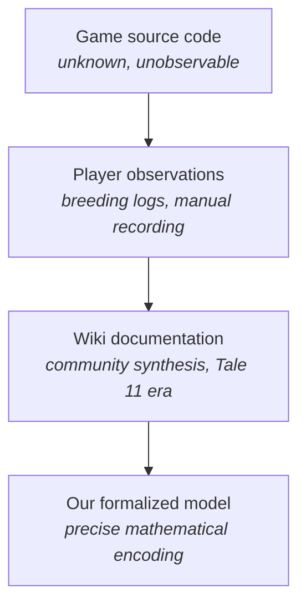

# Research Methodology: ATITD Citrus Genetics

A critical examination of how we investigate citrus tree breeding mechanics in
A Tale in the Desert (ATITD). This document separates confirmed facts from
speculation, audits the assumptions baked into our current analysis, and
proposes alternative research methods for exploring a black-box system without
getting locked into any single theory.

---

## 1. Source and Ground Truth

### 1.1 The Wiki Source

The community's understanding of citrus genetics comes from the
[Indonesian Beehives guide on the ATITD Tale 11 wiki](https://atitd.wiki/tale11/Guides/Indonesian_Beehives#Estimated_Ideal_Values).
This is a player-compiled guide, not official documentation. The game
developers have never published source code or mechanics specifications.

### 1.2 Confirmed: Species Expression Is Nearest-Neighbor in 4D Trait Space

Every citrus tree has four observable traits: Color, Sweet, Size, and Length,
each an integer from 0 to 1000. These four values define a point in a
4-dimensional trait space. Three claims about species expression, at
decreasing confidence:

1. **Species is deterministic from the four traits.** Confirmed. Trees with
   the same (Color, Sweet, Size, Length) always express the same species.
   This is established beyond dispute by extensive player testing.

2. **Approximate species centroids are empirically known.** Confirmed. The
   centroids below, averaged from ~1,300 Indonesian Hives, reliably predict
   species identity. Players routinely use them for breeding targets.

3. **The decision rule is nearest-neighbor (Voronoi) in 4D.** Established as
   the working model. The exact distance metric (Euclidean, weighted, or
   other) and precise boundary positions between adjacent species have not
   been independently mapped. The centroids may be slightly offset from the
   game's internal prototype values since they are player-observed averages,
   not data-mined constants. For practical breeding this does not matter; for
   boundary experiments it is a source of uncertainty.

The centroids (based on ~1,300 recorded Indonesian Hives):

| Species | Color | Sweet | Size | Length |
|---|---|---|---|---|
| Amanatsu | 540 | 230 | 560 | 550 |
| Buddha's Hand | 170 | 390 | 830 | 730 |
| Calamondin | 450 | 620 | 860 | 100 |
| Citron | 570 | 770 | 280 | 260 |
| Coralfruit | 570 | 800 | 550 | 60 |
| Corian | 330 | 380 | 440 | 190 |
| Etrog | 550 | 660 | 610 | 380 |
| Grapefruit | 620 | 680 | 290 | 70 |
| Iyokan | 660 | 260 | 570 | 200 |
| Kabosu | 350 | 410 | 670 | 570 |
| Kinnow | 740 | 770 | 630 | 560 |
| Kumquat | 630 | 350 | 640 | 550 |
| Lemon | 670 | 210 | 760 | 920 |
| Lenat | 800 | 230 | 150 | 970 |
| Lime | 490 | 290 | 840 | 940 |
| Mandarin | 530 | 650 | 720 | 630 |
| Orange | 360 | 670 | 850 | 650 |
| Oroblanco | 220 | 810 | 560 | 550 |
| Pummelo | 760 | 660 | 390 | 540 |
| Rangpur | 840 | 500 | 710 | 100 |
| Shangjuan | 410 | 570 | 420 | 560 |
| Sudachi | 290 | 200 | 830 | 600 |
| Summerbell | 750 | 710 | 400 | 930 |
| Tangelo | 750 | 670 | 920 | 820 |
| Tangerine | 220 | 610 | 950 | 230 |
| Yuzu | 370 | 370 | 460 | 840 |

**What this means**: species identity is a deterministic function of the four
observable trait values. The breeding problem reduces to: how do you move a
tree's trait point to a desired region of 4D space?

### 1.3 The Speculative Theory

Everything below is reverse-engineered from observed breeding outcomes. None
of it has been confirmed by the game developers or source code inspection.

| Claim | Summary | Confidence |
|---|---|---|
| C1 | Each tree has 8 hidden gene values (2 per trait), integers 0-1000 | Medium -- within the hidden-gene family, 1-gene is catastrophically bad and 2-gene fits well, but 3+ genes and zero-hidden-state architectures (Model P) are untested |
| C2 | Color $= \text{mean}(g_1, g_2)$ with round-half-up | High *within current architecture* -- alternatives score 600-900 worse, but conditional on C1/C6/C7 being correct |
| C3 | Sweet $= \min(g_1, g_2)$ | High *within current architecture* -- mean and $g_1$ alternatives score 640-930 worse, conditional on C1/C6/C7 |
| C4 | Size $= \max(g_1, g_2)$ | High *within current architecture* -- alternatives score 540-970 worse, conditional on C1/C6/C7 |
| C5 | Length $= g_1$ only ($g_2$ unobservable) | Medium -- min/max alternatives gain 59, within noise |
| C6 | Inheritance: fair coin flip per gene slot, slot-preserving | Medium -- untested alternatives exist |
| C7 | Sparse gene-mutation process favored over independent-per-gene alternatives | High for rejecting independent per-gene mutation at tested rates. Does not establish exact mutation count; 0-mutation events, rare 2-mutation events, and phenotypically invisible multi-gene changes remain unresolved. Visible trait changes confound recombination with mutation |
| C8 | Nudge: uniform distribution on integers -150 to +150 | Medium -- triangular is 86 worse, but Gaussian/Laplacian untested |
| C9 | Nudge clamped to [0, 1000] | Low -- wrapping and reflecting untested |
| C10 | Cloning: some children are exact copies of one parent | Medium -- large within-family floored-score improvement in Hive1b only (34% clone share, +41 floored log-score vs no clone); evidential strength not yet calibrated under proper likelihood |

**Architecture-conditional language rule.** Except for the established
species-expression ground truth in Section 1.2, claims about hidden genes,
inheritance, mutation, nudge mechanisms, cloning, or latent parameter values
are conditional on the generative architecture in which those entities exist.
Evidence that one parameterization fits better within CLAIM does not establish
that the corresponding latent mechanism exists. Models with no persistent
hidden state (e.g. Model P, Section 4.11) are structural alternatives, not
limiting cases obtained by setting hidden-gene parameters to zero.

### 1.4 Provenance Chain



Each link introduces potential errors. Player observations may have recording
mistakes or missing children. The wiki synthesizes across players who may have
had different game versions or misunderstood edge cases. Our formalization
makes choices (integer gene space, specific floor value, specific convergence
criterion) that could introduce artifacts.

**Stationarity warning**: The wiki theory comes from Tale 11. If game
mechanics changed between tales or patches, pooling observations from
different eras fabricates apparent mixtures or anomalies. Game tale/build/
date/server metadata should be attached to every observation where
recoverable, and observations from mechanically distinct versions should
never be pooled without first demonstrating equivalence. Note: failure
to reject a difference test is not evidence of equality (it may simply
reflect low power). Use equivalence/non-inferiority testing with
preregistered scientifically meaningful margins, or fit a hierarchical
version-by-mechanic model and pool only when between-version variation
is demonstrably negligible relative to those margins.

---

## 2. Current Exploration Approach

This section summarizes what the project does today. For full technical
specification, see `systems_engineering.md` Section 4.

### 2.1 Data

The dataset is 692 children from 14 litters in `data/children.csv`. Each
record has: the litter name, child ID, parent A's 4 observable traits,
parent B's 4 observable traits, and the child's 4 observable traits. No
hidden gene values are observed.

**Effective sample size depends on the estimand.** The pedigree structure:

| Level | Count | Notes |
|---|---|---|
| Litters | 14 | Hive1 through Hive11, plus Hive1a/1b/1c |
| Unique parent pairs | 11 | Hive1a/1b/1c share the same pair |
| Unique physical parent trees | ~12 | Hive7 shares one parent with Hive1 group |
| Children | 692 | Range: 20-72 per litter |

For between-cross questions (parent effects, gene count, cross-trait
coupling), the effective sample is the number of distinct parent
configurations, not 692. These 11 distinct configurations are **not
statistically independent**: several share one or both physical parent
trees (e.g. Hive7 shares one parent with the Hive1 group), so their
offspring distributions are correlated through the shared parent's
latent state. Between-cross analyses must model the repeated-parent dependence
explicitly (e.g. hierarchical model with parent-level random effects,
or a pedigree-graph bootstrap that resamples independent pedigree
components rather than treating parent pairs as exchangeable units).
With ~12 unique physical trees, the maximum number of fully disjoint
(non-overlapping) parent pairs is at most 6; the actual count depends
on the pedigree graph and must be computed from the data. For
within-cross conditional-distribution questions (e.g. offspring variance
given fixed parents), individual children can be legitimate sampling
units if conditional independence holds. Define the unit separately for
each analysis. With ~10-12 clusters connected through shared parent
trees, naive cluster bootstrap or independent-sample inference on all
11 configurations is invalid and should be replaced by pedigree-aware
methods.

Notable structure:
- The dataset is SHA-256 fingerprinted for provenance tracking
- Analyses requiring between-cross inference must use pedigree-aware
  methods: multi-membership/hierarchical models keyed by physical parent
  tree, or pedigree-component bootstrap that resamples independent
  connected components of the parent graph. Ordinary parent-pair cluster
  bootstrap is invalid because pairs sharing physical trees are not
  independent. Within-cross analyses may use children as units if
  conditional independence is defensible. Both child count and
  independent-cross count should be reported

**Ascertainment warning**: It is not established whether the 692 children
are complete offspring sequences or a selected subset. If players
disproportionately recorded interesting species, successful crosses, or
unusual children, then $P(\text{recorded} \mid \text{child outcome})$ is not constant. Every
inferred offspring frequency, mutation rate, clone fraction, and
distributional test can be biased by outcome-dependent recording. A Tier 0
audit should determine: whether child IDs are consecutive, whether raw logs
establish every birth, whether records were entered prospectively or
selectively, and whether any exclusion criteria existed. If completeness
cannot be established, restrict confirmatory claims to prospectively
collected complete litters

### 2.2 The CLAIM Model

The community theory is encoded as a Python dict in `core/constants.py`:

```python
CLAIM = {
    "rules": ("mean", "min", "max", "g1"),  # display rules per trait
    "mut": "one8",      # exactly 1 of 8 genes nudged
    "p": None,          # not used for one8
    "shape": "uniform", # nudge distribution shape
    "R": 150,           # nudge range: -150 to +150
    "rround": "halfup", # rounding mode for mean display rule
    "clone": True,      # allow clone component
}
```

The fitting engine (`core/model.py:LitterFit`) takes a model spec and a
litter of children, then finds the hidden gene values that maximize the
floored log-score via coordinate ascent. The clone fraction is fitted per
litter via 121-point grid search over $c \in \{0.0, 0.005, \ldots, 0.600\}$.

### 2.3 The 30-Model Comparison

The project tests CLAIM against 29 rivals in `pipelines/compare.py`. The
rivals vary one axis at a time from the CLAIM spec:

| Axis | Variants | Count |
|---|---|---|
| Nudge range | $R \in \{100, 125, 140, 160, 175, 200\}$ | 6 |
| Nudge shape | Triangular, $R \in \{150, 200, 250\}$ | 3 |
| Nudge mechanism | Independent, p in {0.08, 0.11, 0.14, 0.17, 0.20} | 5 |
| Gene count | 1 latent value per trait (single hidden gene) | 1 |
| Display rules | Each trait tested with each alternative rule | 12 |
| Rounding | Color rounds down instead of half-up | 1 |
| Cloning | No clone component | 1 |
| **Total** | CLAIM + 29 rivals | **30** |

### 2.4 Fitting Method

For each model and each litter independently:

1. Initialize hidden gene values from parent observables
2. Coordinate ascent: scan gene pairs for each trait, optimizing one trait at
   a time while holding others fixed
3. Scan order: joint (both parents), then parent A alone, then parent B alone
4. Clone fraction: grid search over 121 values of c
5. Convergence: stop when per-round floored log-score improvement $< 10^{-6}$ or
   after 8 rounds
6. Floored scoring: any child with raw probability $< 10^{-15}$ is scored at $10^{-15}$
   (not a proper likelihood -- a heuristic floor)

**Field-name convention**: The implementation uses field names `fit_ll` and
`cv_ll` for historical reasons. Their current contents are floored
log-scores, not proper log-likelihoods. Throughout this document,
references to these field names should be understood as floored log-scores.

### 2.5 Validation Layers

| Layer | What it tests | Result |
|---|---|---|
| Model recovery | Generate fake data from known model, verify correct model wins | 9/9 correct (self-consistency only -- see caveat below) |
| Gene recovery | Fit to synthetic CLAIM data, check hidden genes recovered | 68% exact coordinate match (needs recomputation: report identifiable vs non-identifiable subset separately, plus equivalence-class and predictive-distribution recovery) |
| PPC | Simulate from fitted model, compare 7 summary statistics | All within 95% range |
| Multi-trait changes | Count children where 2+ traits differ from both parents | 1 real vs 97 expected under INDEP (see caveat: this counts recombination + mutation, not mutation alone) |
| Optimizer validation | Exhaustive search on V=3 and V=11 gene spaces | Matches coordinate ascent |
| Pedigree consistency | Shared parents fitted independently agree on hidden genes | Consistent across litters |

### 2.6 Current Results

CLAIM ranks #1 on in-sample floored log-score at -5462.5. See `README.md`
for the full results table.

**Key caveats** (documented in `README.md`):
- **Cross-validation is a failed instrument for this problem.** Held-out CV
  prefers the independent-nudge rival by 253 floored log-score units, and this
  is demonstrated as a bias in synthetic checks: cv_ll picks INDEP even on CLAIM-generated synthetic
  data (3/3 seeds). The mechanism is understood (strict models call held-out
  children impossible when hidden-gene estimation fails on the training fold).
  The current latent-genotype CV procedure should not be cited as evidence
  about mechanism. (Note: leave-one-parent-pair-out CV for no-hidden-state
  models like P0 is a different procedure and must be separately
  simulation-calibrated before use.) Alternative
  validation strategies: cross-litter transfer for shared parents, whole-
  family holdout, or prospective prediction on newly collected data.
- Length display rule ($g_1$ vs min/max) cannot be distinguished by fit alone.
- Hidden genes are often only bounded, not exactly identified. The 68%
  exact-recovery figure is meaningful only for structurally identifiable
  genes. For non-identifiable parameters (e.g. Length $g_2$, or the split of
  Color genes whose sum is constrained), recovery should be reported on
  observational-equivalence classes, not exact coordinates.
- Hive1b shows a 34% clone component; no other litter does.
- **Model recovery (9/9) is self-consistency, not robustness.** When the
  generating mechanism is one of the candidate models and fitting uses the
  same assumptions, recovery mainly verifies the code works. It does not
  establish recovery under model misspecification. An adversarial simulation
  study is needed: generate from architectures not in the candidate set, fit
  the existing 30 models, and measure the false-confidence rate.
- **Model comparison confounds architecture with latent optimization.** Every
  model gets hidden parent genes fitted separately for each litter. A
  mechanism may score well because its latent representation is easier to
  tune, not because it better describes the game. The shared-parent litters
  provide a stronger test: fit parent genotype using Hive1a and predict
  Hive1b/1c without refitting that parent's genes.

### 2.7 Hypothesis Generation vs Confirmation

The same 692 children have been used to construct the model, tune model
variants, inspect anomalies, compare parameters, generate alternative
explanations, and evaluate fit. The alternative methods in Section 4 propose
many more analyses on the same dataset.

**Risk**: Eventually some explanation will fit extremely well simply because
the research program has adaptively searched the dataset. This is the
multiple-comparisons version of overfitting.

**Mitigation**: The 692-child dataset should be treated as
exploratory/training data from this point forward. Before further large-scale
model search, define a preregistered confirmatory experiment and evaluate
final hypotheses on entirely new children. Any result from re-analyzing the
existing data should be labeled explicitly as exploratory.

---

## 3. Assumption Audit

An adversarial examination of what assumptions are baked into the current
approach and how each could be wrong.

### 3.1 Structural Assumptions (About the Game)

**A1: Hidden-state dimensionality is unresolved.** Within the hidden-gene
model family tested so far, a one-latent-value-per-trait model fits
catastrophically worse than the two-gene CLAIM architecture ($\text{fit\_ll} = -10487$,
169 impossible children), so one hidden value per trait is inadequate
*conditional on a hidden-gene architecture*. This does not establish that
hidden genes exist at all: Model P and other phenotype-only architectures
contain no hidden genes (Section 4.11). If hidden genes do exist, two values
per trait currently outperform one, while three or more remain untested. A
3-gene model would have different inheritance structure (3 coin flips per
trait) and different display rules (median? weighted average?).

**A2: Integer gene values in [0, 1000].** The model assumes discrete integer
genes. If the game uses floating-point values internally, our discrete
probability calculations are approximations. The range could be [0, 999] or
[0, 10000] with the display value being a rescaling. The integer assumption is load-bearing: it makes exact probability
calculation tractable. Continuous latent gene values would require
integration over latent densities, though the observed-data likelihood
can remain a discrete PMF after quantization (displayed traits are
still integers).

**A3: Slot-preserving inheritance.** The model assumes child gene slot 1
always comes from a parent's gene slot 1. If inheritance allows slot swapping
(child slot 1 can come from parent's slot 2), the identifiability structure
changes. For min/max display rules, swapping $g_1$ and $g_2$ can produce
observationally different offspring distributions (because nudging $g_1$ vs $g_2$
has different effects on the displayed value). For the mean rule, slot
swapping is observationally equivalent (mean is symmetric). This is partially
testable but has not been tested.

**A4: Fair 50/50 coin flip per gene.** Could be biased (e.g. 60/40 toward
one parent). Could be correlated across genes (all 8 from the same parent
sometimes). Could depend on proximity, tree age, or species. The current
framework does not test biased-coin models: a biased coin would degrade
CLAIM's fit, but since we never fit a biased-coin variant we would not know
if it fits better.

**A5: Exactly one mutation per child.** The one-of-8 model assumes exactly
one gene is nudged. The INDEP model allows 0 or multiple. The multi-trait
change count (1 child with 2+ traits differing from both parents vs 97
expected under INDEP) is often cited as strong evidence for sparse mutation.

However, "visible trait differs from both parents" is not the same as
"mutation occurred in that trait." Under the two-hidden-gene model,
recombination alone (without any mutation) can produce a child whose
displayed value differs from both parents. Example: Sweet with min rule,
parent A genes (300, 700) showing 300, parent B genes (800, 500) showing
500. A child inheriting B's slot-1 and A's slot-2 gets (800, 700) showing
700 -- different from both parents, no mutation involved. This can happen
independently in multiple traits.

The 1-vs-97 comparison therefore confounds recombination-driven visible
changes with mutation-driven changes. The correct approach: derive the null
distribution of visible change patterns under inheritance plus zero/one
mutation, integrating over compatible parental genotypes. Model E's explicit
(pi_0, pi_1, pi_2) mutation-count architecture is the right way to infer
mutation sparsity. The current evidence favors sparse mutation over
independent per-gene mutation at tested rates, but the exact count remains
undertested.

**A6: Uniform nudge distribution.** Tested against triangular (86 worse) but
not against Gaussian, Laplacian, beta, or empirical distributions. The shape
distinction is subtle: with R=150, a uniform nudge has standard deviation 87;
a triangular has SD 61. Different shapes mainly affect the tails. With only
692 children and most nudges invisible (hidden gene changes that do not
affect the display value), the data may not have enough power to distinguish
shapes.

**A7: Display rules tested one at a time.** The 30-model manifest varies one
trait's display rule per rival. No model tests combinations of non-standard
rules (e.g. what if both Sweet and Size use mean?). If two display rules are
wrong, no single-swap rival will score well, and the error will be invisible.
There are $4^4 - 1 = 255$ non-CLAIM display rule combinations; only 12 are
tested.

**A8: Clamping at 0 and 1000.** After mutation, genes exceeding [0, 1000] are
clamped. Alternatives: wrapping (1050 becomes 50) or reflecting (1050 becomes
950). This matters only for genes near the boundaries. With R=150, a gene at
value 900 has a ~16.6% chance of exceeding the upper boundary ($\frac{50}{301}$ for
integer-uniform nudge in $\{-150, \ldots, +150\}$). Wrapping vs clamping
would produce different offspring distributions for extreme-valued parents.
Not tested.

**A9: Parent assignment in data is correct.** The project takes the recorded
parent A and parent B at face value. If the game's parent-selection mechanism
differs from what was recorded (wrong parent identified, a third tree
interfering, coordinate edge cases with the +/-19 range), the model would
be fitting noise as signal. The argument that "CLAIM has 0 impossible
children, so parents are probably correct" is partly circular: hidden genes
are optimized using those same children, so the model can accommodate some
parent mistakes by adjusting unobserved genes. Parent assignment should be
validated independently from model fitting: raw coordinate logs, controlled
two-parent-only experiments, or alternative-parent score comparisons
using all candidate nearby trees.

**A10: Children are independent given parents.** Each child is modeled as an
independent draw given the parents' hidden genes. If the game uses a shared
random state (e.g. a sequential PRNG where the first child's mutation affects
the second child's seed), the independence assumption is wrong. This could be
tested by looking for serial correlations between siblings' trait values
within a litter.

### 3.2 Methodological Assumptions (About Our Testing)

**M1: Maximum floored score is the right criterion.** The current fitting
maximizes a floored score (not a proper likelihood). It selects the model
that assigns highest probability to observed data *at the best-fit hidden
genes*, with impossible children scored at $10^{-15}$.
This conflates model adequacy with parameter estimation quality. A model with
more flexible hidden-gene structure gets penalized less by poor estimation.
The cv_ll vs fit_ll discrepancy (INDEP wins cv_ll, CLAIM wins fit_ll) is a
direct manifestation of this problem.

**M2: The floor hides information and there is no observation-error model.**
Children scored at the $10^{-15}$ floor are the strongest evidence against a
model. Under the uniform +/-140 model, 15 children are impossible; under
+/-125, 30 are impossible. But the floor compresses their signal to a fixed
$-34.5$ per child penalty regardless of *how* impossible they are.

More fundamentally, every recorded trait value is treated as exact ground
truth. One transcription error can look exactly like a rare mechanism and
disproportionately affect a model whose probabilities are very small.

Fix: replace the floor with a proper contamination/observation-error
likelihood. The general form is:

$$P_{\text{obs}}(\text{child} \mid \text{parents}, \text{model}) = (1 - \epsilon) \cdot P_{\text{game}}(\text{child} \mid \text{parents}, \text{model}) + \epsilon \cdot P_{\text{error}}(\text{child})$$

This requires specifying three things before it can be used:

1. **P_error distribution**: What does a recording error look like?
   Options include uniform over the trait range (digit scramble) or
   one-digit transcription error (nearby values more likely). These
   produce very different contamination components. A uniform P_error is
   the simplest default. Parent misattribution is a distinct error
   mechanism (it changes the conditioning variable X, not the
   observation kernel P_error; see the sensitivity section below for
   its separate specification). (Note: rare genuine game behavior
   outside the model is mechanism misspecification, not observation
   corruption, and
   belongs in a competing model rather than in P_error.)

2. **Error granularity**: Does $\epsilon$ apply per child (the entire record is
   suspect) or per field (individual trait values can be wrong)? Per-field
   errors are more realistic but more complex.

3. **Epsilon treatment**: Is $\epsilon$ fixed (e.g. 0.01), globally estimated,
   hierarchical across litters, or given a prior? If $\epsilon$ is freely
   fitted per model, a wrong model can inflate its contamination fraction to
   explain difficult observations as "errors." The same $\epsilon$ and $P_{\text{error}}$
   must be used across all competing game-mechanic models.

Also distinguish "recording error" from "rare true game behavior" -- these
should not share the same mixture component. A recording error corrupts the
observation; a rare game behavior is a real event the model should explain.

**Primary baseline model** (to be used for all formal comparisons):
- $E_i \sim \text{Bernoulli}(\epsilon)$ per child (the entire four-trait child outcome
  vector $Y_i$ is suspect; parent fields are conditioned on as correct)
- $P_{\text{record-error}}(Y_i) = 1001^{-4}$ (uniform over $\{0,\ldots,1000\}^4$)
- $\epsilon \sim \text{Beta}(1, 99)$ prior (low-contamination prior, mean 1%, mode 0)
- The same observation model and $\epsilon$ treatment apply to every competing
  game-mechanics model
- "Rare genuine game behavior" is NOT included in P_record-error -- that is
  a competing model of the game, not corrupted observation

**Sensitivity analyses** (run after primary results): sensitivity varies
along two orthogonal axes:

1. **Error-kernel/granularity axis**: switch the error shape (per-record
   uniform, per-field, one-digit) while integrating over error rate.
   To isolate kernel shape from effective rate, place the prior on a
   common attempted-error probability $q \sim \text{Beta}(1, 99)$ ($q$ is the
   probability of an attempted corruption event per record, before
   accounting for clamping or identity outcomes) and transform for
   each kernel: per-record uses $\epsilon = q$; per-field uses
   $\epsilon_{\text{field}} = 1 - (1-q)^{1/4}$; one-digit uses $\epsilon_{\text{digit}} = q$.
   Note: for the one-digit kernel, clamping can return altered values
   to the original, so the observable-change probability is slightly
   below $q$ for boundary trait values; $q$ is consistently treated as the
   attempted-error rate across all kernels.
2. **Error-rate axis**: for each error kernel, replace the Beta prior with
   fixed error rates from a preregistered grid. Define the grid in terms
   of a common attempted-error probability $q \in \{0.005, 0.01, 0.02, 0.05\}$
   (consistent with Axis 1; q is the latent attempted-error rate, not
   the observable-change rate). For the primary per-record model,
   $\epsilon = q$ directly. For per-field errors, translate to
   $\epsilon_{\text{field}} = 1 - (1-q)^{1/4}$. For one-digit errors,
   $\epsilon_{\text{digit}} = q$. Report the corresponding observable-change
   probability alongside q for each kernel when results are presented.

Run at minimum the diagonal (each kernel at its matched prior) and the
rate sweep on the primary per-record kernel. The full Cartesian product
(3 kernels x 4 fixed rates) is desirable if computationally feasible.

Each alternative error model must be fully specified as a normalized
generative likelihood before use:
- **Per-field errors**: $E_{i,t} \sim \text{Bernoulli}(\epsilon_{\text{field}})$ per trait per
  child; corrupted trait $Y_{i,t}$ replaced by $\text{Uniform}\{0,\ldots,1000\}$;
  $\epsilon_{\text{field}}$ is derived from the common record-level rate $q$ via
  $\epsilon_{\text{field}} = 1 - (1 - q)^{1/4}$ (no independent prior on
  $\epsilon_{\text{field}}$; the prior on $q$ from the error-kernel axis induces the
  prior on $\epsilon_{\text{field}}$, while the fixed $q$ grid from the error-rate
  axis induces corresponding fixed per-field rates). Note: 1% per-field implies ~3.9% probability that at
  least one of four fields is corrupted per record. When comparing
  against the primary 1% per-record model, report both the per-field
  $\epsilon_{\text{field}}$ and implied per-record rate $1 - (1 - \epsilon_{\text{field}})^4$
- **One-digit transcription model**: with probability $\epsilon_{\text{digit}}$, one
  randomly selected decimal digit of one randomly selected trait is
  replaced by a uniform random digit from the other 9 digits.
  Note: $\epsilon_{\text{digit}} = q$ is the attempted-transcription-error
  probability; the observable-change probability is slightly lower
  because post-replacement clamping to [0, 1000] can map the altered
  value back to the original for boundary trait values (e.g., trait
  value 1000 with hundreds digit changed to 9 yields 1900, clamped
  back to 1000). Report the exact observable-change probability
  conditional on the trait-value distribution if this difference
  materially affects results. Out-of-range values after
  digit replacement are clamped to [0, 1000]. Trait values are
  represented as zero-padded 4-character strings (e.g. "0042") before
  digit selection; $\epsilon_{\text{digit}} \sim \text{Beta}(1, 99)$
- **Parent misattribution**: latent true parent pair Z_i drawn uniformly
  from all candidate pairs within +/-19 coordinate range of the recorded
  child position; P(Y_i | Z_i, M) uses the true parent pair; this is not
  a P_error kernel but rather changes the conditioning variable X, and
  requires a candidate-set construction rule and spatial data not
  currently in the dataset. Defer to Tier 5 if spatial data unavailable.
Report sensitivity of all downstream conclusions to these alternatives.

**M3: Per-litter independence in fitting.** Hidden genes are fitted
independently per litter. When litters share parents (Hive1a/1b/1c and
Hive7), the independent fits do not enforce consistency. The README notes
that fits *do* agree across litters (pedigree consistency check), but this
is observed post-hoc, not enforced during fitting. Joint fitting across
litters with shared parents would be more principled and could improve
gene recovery.

**M4: The rival set is not structurally diverse.** The current 30-model
comparison consists primarily of local variants of the CLAIM hidden-gene
architecture, plus one one-gene-per-trait simplification. It does not test
zero-persistent-hidden-state mechanisms (Model P), three-or-more-gene
architectures, continuous latent variables, spatial inheritance, epistasis,
linked inheritance, environmental factors, or other fundamentally different
architectures. Therefore the current comparison primarily answers "which
tested CLAIM-family specification fits best?" rather than "which general
class of mechanism generated the observations?"

**M5: Cross-validation is biased.** Documented in `README.md`: held-out
scoring picks INDEP even on CLAIM-generated synthetic data (3/3 seeds). The
mechanism is understood (strict models call held-out children impossible when
hidden-gene estimation fails on the training fold), but it means cv_ll
cannot serve as the primary model selection criterion for this problem.

**M6: Optimizer quality may be model-dependent.** Coordinate ascent may find
better optima for some models than others, giving those models an unfair
advantage. The optimizer validation (exhaustive on V=3 and V=11, multi-start
escalation) partially addresses this but only covers a few models.

**M7: Sample size limitations.** With 692 children across 14 litters, many
model distinctions are near the noise floor. The fit_ll gap between CLAIM
and uniform +/-160 is only 16 floored log-score units. On synthetic data, gaps
of similar magnitude arise between the true model and its closest rival,
suggesting the data is near the discrimination limit for closely-related
specifications.

### 3.3 The Streetlight Problem

The current approach is excellent at answering: "which of these 30 similar
models best explains the data?" It cannot answer: "does any model in this
family explain the data well?"

The PPC is the only check that partially addresses this. It compares 7
summary statistics (children with 0/1/2+ trait changes, per-trait change
counts) between real data and simulated data from the fitted model. All real
counts fall within simulated 95% ranges. But 7 coarse statistics are a weak
test. A model could match these 7 statistics while being wrong in ways the
statistics do not capture.

We are searching for our keys under the streetlight. The 30-model comparison
tells us where on this street the keys are most likely. It does not tell us
whether the keys are on this street at all.

---

## 4. Alternative Research Methods

Each method below includes: what question it answers, how to apply it to the
ATITD data specifically, what it would reveal that current methods cannot,
and an implementation sketch.

### 4.1 Within-Litter Offspring Distribution Analysis

**Question**: What structure exists in the child trait distributions within
each litter, independent of any model?

**Fundamental constraint**: Parent traits are constant within each litter.
You cannot compute within-litter parent-child mutual information because the
parent predictor has zero variance within a litter. Residualizing parent
traits against litter means gives an all-zero predictor. Parent-to-child
dependency is therefore a *between-cross* question answerable only from
11 distinct parental configurations (sharing some physical parent trees --
see Section 2.1) -- far too few for reliable MI estimation.

**What can be done instead** (two separate analyses):

**Analysis A -- Between-cross parent effects** (N ~ 11 distinct configs):
Treat litter-level summary statistics (mean child trait, child trait
variance, proportion of children showing visible change) as the response
and parent traits as predictors. With only ~11 distinct configurations
(some sharing physical parent trees, so not fully independent), use
descriptive rank correlations only -- do not attach ordinary
independent-sample p-values or confidence intervals. For inferential
statements, use a multi-membership/random-effect model keyed by
physical parent tree, or restrict to the subset of fully disjoint
(non-overlapping) parent pairs. Report honestly that power is very low
and that any between-cross result is exploratory.

**Analysis B -- Within-litter child trait structure** (N = litter size):
For each litter independently, analyze the joint distribution of the
4 child traits. Important: CLAIM does *not* predict full trait independence.
The one-of-eight exclusive mutation target and the clone component both
induce cross-trait dependence; the resulting observed-trait covariance
sign is configuration-dependent (it depends on parental genotypes, clone
fraction, and display rules, so it cannot be stated as universally
positive or negative). The correct CLAIM null is the full joint
four-trait distribution including inheritance, exclusive mutation target,
and clone mixture -- not marginal independence.

Test by comparing observed within-litter dependence statistics
(correlations, covariance, energy distance, co-occurrence counts) against
a parametric-bootstrap distribution generated from CLAIM. Each bootstrap
replicate must be refit with the same optimizer pipeline (re-estimating
hidden parent genotypes, clone fractions, and all nuisance parameters)
rather than only forward-simulated from plug-in fitted values;
conditioning on plug-in states makes the null distribution too narrow
when latent-state uncertainty is substantial. Unexpected
dependence means dependence *beyond* CLAIM's predicted dependence, not
dependence versus zero. Specific checks:
- Compare observed pairwise correlations against CLAIM-predicted
  correlations from parametric bootstrap.
- Test whether the within-litter variance of each trait matches model
  predictions (accounting for the inheritance coin flip and mutation).
- Look for excess co-variation beyond what CLAIM predicts: does the
  observed trait covariance exceed the CLAIM-generated null? Excess
  covariance could arise from epistasis, environmental factors,
  correlated inheritance, marginal misspecification, contamination-model
  errors, parent misassignment, non-IID siblings, or other model
  misspecification (see Section 4.3 for the full list).

**Cost**: Hours. The within-litter analysis is straightforward.
The between-cross analysis is limited by N ~ 11 and should be labeled
exploratory.

### 4.2 Simulation-Calibrated Distributional Goodness-of-Fit Tests

**Question**: Does the distribution of child trait values match model
predictions, beyond the 7 PPC summary statistics?

**Method**: For each litter and trait, compute the fitted model's predicted
distribution over child trait values (already available via `trait_rows` in
`model.py`) and compare against the empirical distribution using
distributional discrepancy statistics.

**Specific tests**:
- Chi-squared goodness-of-fit: binned comparison, interpretable.
  Preregister a deterministic binning algorithm: sort trait values
  0 -> 1000, greedily accumulate adjacent values left-to-right until
  the model-predicted expected count reaches >= 5, close the bin and
  start the next; merge any final underfilled tail bin into the
  preceding bin. Apply this exact algorithm (using model-predicted
  counts, not observed counts) after every replicate's refit to ensure
  the test statistic is comparable
- Parametric bootstrap: refit the model on simulated datasets, recompute the
  test statistic, and compare the observed statistic to the empirical null

**Why not standard KS/AD**: The predicted distributions are discrete and
depend on parameters estimated from the same observations. Off-the-shelf
KS/AD null distributions assume conditions not met here (continuous data,
known parameters). A simulation-based bootstrap null is required.

Define confirmatory hypothesis families prospectively and apply
Benjamini-Hochberg FDR correction within each family where its dependence
assumptions are defensible. Use simulation-based or more conservative
multiplicity control where the test battery is strongly dependent. Report
exploratory analyses descriptively rather than folding them into the
confirmatory FDR family.

**Extension -- joint distribution tests**: Compare the joint distribution of
(child_color, child_sweet) pairs using multivariate two-sample tests (energy
distance or maximum mean discrepancy). The current PPC checks only seven coarse summaries (0/1/2+ visible-change
counts and per-trait change counts) and does not assess the full marginal
or joint child-trait distributions.
Joint departures indicate joint-distribution misspecification. Missing
trait coupling specifically requires a dependence statistic or comparison
that accounts for the fitted marginals (e.g. copula tests or residual
correlation after marginal calibration).

**What this reveals**: Whether the fitted model is adequate
*distributionally*, not just on 7 summary statistics. Specific litter/trait
combinations that depart from predictions are targets for deeper
investigation.

**Cost**: Hours. Requires generating the predicted distribution from fitted
genes (straightforward extension of existing code).

### 4.3 CLAIM-Calibrated Within-Litter Dependence Analysis

**Question**: Do child traits show dependence structure beyond what CLAIM
predicts?

**Why not parent-child dependency analysis**: Parent traits are constant
within each litter, so conditioning on litter absorbs all between-litter
parent variation. You cannot test parent-to-child trait effects within
litters when the parent predictor does not vary. Cross-trait parent effects
(e.g. does parent Color influence child Sweet?) are a between-cross question
with N ~ 11 -- too few for reliable conditional independence testing.

**Why not formal causal discovery (PC/GES)**: The true causal graph has
massive latent confounding (hidden genes cause both parent displays and child
inheritance). With 11 parent configurations and deterministic display
transformations, PC/GES assumptions are badly violated and arrow directions
would be meaningless.

**What can be done**: Within each litter, compare observed child-trait
dependence against the CLAIM-predicted dependence structure. CLAIM is *not*
a trait-independence model: the exclusive one-of-eight mutation target
and the clone component both induce cross-trait dependence (the resulting
observed-trait covariance sign is configuration-dependent). The correct
null is the full CLAIM joint distribution, not marginal independence.

Test using within-litter correlation matrices and Hoeffding's D (sensitive to
non-monotone dependence), comparing observed statistics against
parametric-bootstrap distributions generated from the full CLAIM joint model
(with re-estimation of all nuisance parameters per replicate; see Section 4.1)
rather than against zero. (Ordinary permutation nulls destroy CLAIM-predicted
dependence and should not be used.) Excess dependence beyond the CLAIM-predicted
level could arise from epistasis, environmental factors, correlated
inheritance, marginal misspecification, contamination-model errors,
parent misassignment, non-IID siblings, or other model misspecification.
Report as exploratory.

**Cost**: Hours. CLAIM-calibrated within-litter dependence statistics on existing data.

### 4.4 Bayesian Model Comparison

**Question**: How probable are different models given the data, accounting
for parameter uncertainty?

**Method**: Compute marginal likelihoods (Bayesian evidence) for each model
by integrating or summing over all model-specific latent states and
parameters with defensible priors.

**Prerequisite -- proper likelihood required**: Bayesian evidence requires a
proper probability model $P(D \mid \theta, M)$ that integrates to one. The current
floored score explicitly replaces tiny/zero probabilities with $10^{-15}$ without
renormalizing. You cannot give a non-normalized heuristic a prior, integrate
it, and call the result a Bayes factor. The contamination likelihood
(Section 3.2 M2) must be implemented first:
$P_{\text{obs}} = (1 - \epsilon) \cdot P_{\text{game}} + \epsilon \cdot P_{\text{error}}$. Only then can Bayesian
evidence be validly calculated.

**Why this matters**: The cv_ll failure shows cross-validation is unreliable.
Bayesian model comparison is the principled alternative, but only if the
likelihood is proper.

**Complete model evidence.** For each model architecture $M$, let $\theta_M$
contain every architecture-specific unknown parameter and latent state,
including parental latent states if present, clone parameters, inheritance
parameters, mutation parameters, environmental/random-effect parameters, and
all other nuisance quantities. Let $\epsilon$ denote the common observation-error
parameter.

$$p(D_{\text{children}} \mid X, M) = \int p(D_{\text{children}} \mid X, \theta_M, \epsilon, M) \, p(\theta_M \mid X, M) \, p(\epsilon) \, d\theta_M \, d\epsilon$$

where X denotes the observed parent phenotypes (conditioned on, not
modeled). All evidence, posterior, and Bayes-factor expressions condition
on X throughout, consistent with the conditional-inference contract.

Parameters contributing to the generative model must be integrated rather
than optimized away when computing Bayesian evidence, unless an approximation
is explicitly justified and simulation-validated.

**Posterior model probabilities** additionally require model priors:

$$p(M \mid D_{\text{children}}, X) \propto p(D_{\text{children}} \mid X, M) \cdot p(M)$$

If no defensible model priors are specified, report marginal likelihoods or
Bayes factors rather than absolute posterior model probabilities.

**Required prior specifications** (primary preregistered choices; alternatives
are sensitivity analyses only):
- Contamination fraction: $\epsilon \sim \text{Beta}(1, 99)$ (shared across all models)
- CLAIM clone fraction: $c_l \sim \text{Beta}(1, 9)$ per litter (mean 10%, mode 0).
  This is a subjective skeptical prior chosen on parsimony grounds
  (favoring simpler mechanisms over elaborate ones), not calibrated to
  the current dataset. Sensitivity analysis: recompute under $\text{Beta}(1,4)$, $\text{Beta}(1,19)$,
  and $\text{Beta}(2,8)$ to verify conclusions are not prior-dominated.
  Hierarchical extension deferred to sensitivity
- Clone source: $P(S=A) = P(S=B) = 1/2$ (primary symmetry assumption; not
  empirically established). Sensitivity: $s = P(S=A) \sim \text{Beta}(1, 1)$
- Model C inheritance biases: $q_t \sim \text{Beta}(1, 1)$ per trait
- Model D crossover probability: $p_{\text{block}} \sim \text{Beta}(1, 1)$
- Model E mutation-count simplex: $(\pi_0, \pi_1, \pi_2) \sim \text{Dirichlet}(1, 1, 1)$
- Model F target weights: $w_j \sim \text{Dirichlet}(1, \ldots, 1)$, i.e.
  $M \sim \text{Categorical}(w_1, \ldots, w_8)$, called mutation-target weights
- Model G mean-reversion strength: $\lambda \sim \text{Beta}(1, 1)$
- Model H local/jump mixture (general two-component mutation):
  $\rho \sim \text{Beta}(1, 5)$ (prior mean 1/6, concentrating near rare jumps;
  sensitivity alternative: $\text{Beta}(1,1)$ for uninformative);
  $K_{\text{jump}} \sim \text{Uniform}[10, 500]$ (magnitude of signed jump kernel)
- Model I continuous latent-state: per-gene prior $\sim \text{Uniform}(0, 1000)$
  density (continuous, not the discrete base measure used by other models);
  observed traits remain discrete PMFs via the rounding/display transform
- Model J epistatic coupling: cross-trait coefficient $\sim \text{Normal}(0, 50)$
  per coupling term
- Model K environmental loadings: $\beta_t \sim \text{Normal}(0, \sigma_\beta)$,
  $\sigma_\beta \sim \text{HalfCauchy}(100)$, $E_i \sim \text{Normal}(0, 1)$
- Model L_R (primary benchmark): litter-level random effect on mutation
  range. $\mu_R \sim \text{Normal}(\log(150), 1)$ (global log-mean, inferred);
  $\tau_R \sim \text{HalfCauchy}(0.5)$ (log-scale SD; actual prior-predictive
  range of R_l must be computed via simulation including marginalization
  over the hyperprior, rounding, and clamping -- do not use hand-derived
  approximations);
  $R_l = \text{round}(\exp(\text{Normal}(\mu_R, \tau_R)))$ clamped to $[1, 1000]$
  (integer discretization matching the nudge mechanism).
  Inferring $\mu_R$ rather than fixing the center at $\log(150)$ ensures the
  $\tau_R = 0$ vs $\tau_R > 0$ comparison isolates heterogeneity rather than
  confounding it with a global shift away from 150. The null model
  ($\tau_R = 0$) infers $\mu_R$, giving $R = \text{clamp}_{[1,1000]}(\text{round}(\exp(\mu_R)))$
  (same transformation as the hierarchical alternative); the alternative
  ($\tau_R > 0$) infers both $\mu_R$ and $\tau_R$.
  Model L_clone (sensitivity): litter-level random effect on clone
  fraction. $\mu_c \sim \text{Normal}(\text{logit}(0.1), 2)$ (global mean, inferred);
  $\tau_c \sim \text{HalfCauchy}(1)$; $\text{logit}(c_l) \sim \text{Normal}(\mu_c, \tau_c)$.
  Inferring $\mu_c$ rather than fixing the center at $\text{logit}(0.1)$ separates
  the global clone-rate estimate from between-litter heterogeneity:
  $\tau_c$ measures dispersion independently of the overall level.
  (Note: a litter-level mutation-rate random effect L_mut is omitted
  because CLAIM's mutation mechanism is categorical target selection
  (one of 8 slots), not a per-gene Bernoulli probability. A random
  effect on the categorical target distribution would be Model F with
  litter-level weights, which is a different architecture.)
  The primary comparison uses L_R; L_clone is run as a sensitivity
  variant
- Model N: concrete benchmark instances with fixed deterministic rules
  (e.g. mutation target = child_index mod 8); these are zero-parameter
  point hypotheses, not a parameterized family (see Section 4.11)
- Model O third-parent probability: $\eta \sim \text{Beta}(1, 9)$
- Model P0-independent: per-trait $\alpha_t \sim \text{Beta}(1, 1)$, $\sigma_t \sim
  \text{HalfCauchy}(100)$, with discretized-Normal observation model, traits
  independent (see Section 4.11)
- Model P0-coupled: same per-trait priors plus equicorrelation $\rho \sim
  \text{Uniform}(-1/3, 1)$ (strict open interval; see Section 4.11)
- Model P1: deferred until spatial data collected (Tier 5)

Each model's complete parameter inventory must be finalized before computing
marginal likelihoods. **Important**: several models in Section 4.11 are
currently defined as hypothesis families, not fully specified probability
laws. Before formal Bayesian comparison, each must be split into named
point models with a complete generative simulator: exact latent-state
space, event ordering, kernel specification, boundary handling,
display/observation mapping, and priors for every free quantity.
Specifically: Model D requires a block layout and crossover-location law;
Model G requires a full conditional distribution $p(\delta \mid g)$, not just
$E[\delta \mid g]$; Model H requires a specified jump kernel (sign, shape,
support) for K_jump; Model J requires explicit coupling terms and
functional form; Model K requires a rounding/clamping observation law;
Model O requires a rule for selecting the third tree or neighborhood
contribution. The §4.4 inventory is not complete until these probability
laws are fully specified. Sensitivity analysis over defensible alternative
priors is required (see prior-sensitivity analysis below and
Section 4.6 item 5).

**Primary inferential contract: conditional inference.** Condition on
observed parent phenotypes. The unconditional base measure for each gene
is iid $\text{DiscreteUniform}\{0, \ldots, 1000\}$. The latent-gene prior is then
restricted (conditioned) to the set of genotypes compatible with the
observed display value under each model's display rule. Because different
display rules define different compatible sets, the conditional prior is
model-specific but derived from the same universal base measure.

Explicitly, for a parent displaying trait value D under a two-gene model:
- **Mean rule**: compatible set $= \{(g_1, g_2) : \text{round\_half\_up}((g_1+g_2)/2) = D\}$.
  Each pair receives equal mass $1/|\text{compatible set}|$.
- **Min rule**: compatible set $= \{(g_1, g_2) : \min(g_1, g_2) = D\} =
  \{(D, g_2) : g_2 \geq D\} \cup \{(g_1, D) : g_1 > D\}$. Each pair gets
  equal mass $1/|\text{compatible set}|$.
- **Max rule**: compatible set $= \{(g_1, g_2) : \max(g_1, g_2) = D\} =
  \{(D, g_2) : g_2 \leq D\} \cup \{(g_1, D) : g_1 < D\}$. Each pair gets
  equal mass $1/|\text{compatible set}|$.
- **g1 rule**: compatible set $= \{(D, g_2) : g_2 \in \{0,\ldots,1000\}\}$.
  $g_2$ is uniform on $\{0,\ldots,1000\}$.

This conditioning convention must be used consistently across all model
comparisons. For models with different gene counts (e.g. three-gene Model
A), extend the base measure analogously (iid DiscreteUniform per gene)
and condition on the model's display rule.

**Model I exception (continuous latent states)**: Model I uses real-valued
genes with unconditional base density $p_0(G \mid M_I) = \text{iid Uniform}(0, 1000)$
(continuous, not discrete). The conditional prior given observed phenotype
X is:

$$p(G \mid X, M_I) = \frac{p_0(G \mid M_I) \cdot \mathbf{1}\{T_I(G) = X\}}{Z_I(X)}$$

where $T_I$ is the continuous-to-discrete display transform (inheritance and
mutation operate on reals; displayed traits are rounded) and $Z_I(X)$ is the
normalization integral over the continuous compatible region
$\{G : T_I(G) = X\}$. For the mean rule this region is
$\{(g_1,g_2) : \lfloor(g_1+g_2)/2 + 0.5\rfloor = D\}$, a continuous strip. Compute $Z_I$
analytically or by numerical quadrature. The discrete and continuous
contracts are both derived from their respective uniform base measures and
conditioned identically; they differ only in whether the compatible set is
finite (sum) or continuous (integral).

(Alternative: full generative inference, modeling parent phenotypes as part
of the likelihood. This requires a generative model for how parents were
sampled, which is problematic because breeders selected them intentionally.
Not recommended unless parent-selection bias can be modeled.)

**Pedigree constraint**: When multiple litters share a physical parent
tree, the Bayesian model must assign one latent genotype variable G_j per
physical tree ID and construct the joint likelihood over all litters
involving that tree. Integrating separate latent genotypes per litter
for the same physical parent violates the persistent-genotype hypothesis
and gives the model excess flexibility. The evidence integral is
therefore over the pedigree-wide joint latent state, not per-litter
independent states.

**Integration method**: All latent dimensions must be integrated jointly,
not profiled. "Sum one coordinate while profiling the rest" is not marginal
likelihood integration. For discrete genes:
- **Conditional factorization**: CLAIM's likelihood does *not* factor
  unconditionally across traits. CLAIM contains child-level global latent
  variables. In the non-clone branch, conditional on exclusive mutation
  target $M=m$, trait contributions factor under the current architecture.
  In the clone branch, cloned-parent identity $S \in \{A, B\}$ is an additional
  shared latent variable; conditioning only on clone=True leaves all four
  traits coupled through the common parent choice. The joint child
  likelihood has the form:
$$P(y) = c \sum_s P(S=s) \, P_{\text{clone}}(y \mid S=s) + (1-c) \sum_m P(M=m) \prod_t P(y_t \mid M=m, \theta)$$
  where $P(S=A) = P(S=B) = 1/2$ by default (symmetric unless mechanically asymmetric).
  **Clone genotype transition** (required for multi-generation pedigree
  likelihoods in Experiment 4): if "clone" means genetic clone,
  $G_{\text{child}} = G_S$ (exact copy of the clone-source parent's full latent
  genotype, with no recombination or mutation). If cloning copies only
  the observable phenotype, the child's latent genotype must be
  generated by a separate specification. The genetic-clone definition
  is the primary assumption.
  Dynamic programming can exploit the conditional factorization in the
  non-clone branch, but must sum/integrate over mutation target, clone
  status, and clone source exactly.
- **Evidence estimation** for marginal likelihoods $p(D \mid M)$. Ordinary
  MCMC samples the posterior but does not return $p(D \mid M)$; a dedicated
  evidence estimator is required. Preregister one of: (a) thermodynamic
  integration / power posteriors (Friel & Pettitt 2008), (b) stepping-
  stone sampling (Xie et al. 2011), (c) bridge sampling from a
  reference distribution (Meng & Wong 1996), or (d) tempered SMC with
  accumulated normalizing-constant estimates. Validate the chosen
  estimator on synthetic data with known marginal likelihoods before
  applying to real data. Preregister convergence diagnostics and a
  numerical-error tolerance for log marginal likelihoods (e.g., run
  two independent estimator runs and require $|\log Z_1 - \log Z_2| <
  0.1$ nats; or use replicate-based SE $< 0.05$ nats). When the
  numerical uncertainty interval on a log-BF overlaps a decision
  boundary ($\text{BF} = 0.01$ for $A_{\text{prospective}}$ inclusion, $\text{BF} = 10$ for
  confirmatory verdict), the conservative decision applies: retain
  the rival in A_prospective; do not claim BF >= 10 until numerical
  uncertainty is resolved by increasing computation.
- **Laplace approximation is a poor match** for integer-valued, bounded,
  multimodal, non-identifiable parameters.
- Run **prior-sensitivity analysis**: compare results under several
  defensible priors to ensure conclusions are not prior-dominated.

**What this reveals**:
- Whether CLAIM's superiority survives proper Bayesian penalization
- Posterior distributions of hidden gene values (posterior width is one
  diagnostic of practical identifiability conditional on the prior and data)
- Which hidden genes are well-determined vs poorly determined

**Cost**: Days to weeks. Requires contamination likelihood first, then
prior specification and integration method selection.

### 4.5 Active Experiment Design

**Question**: If you could breed more trees in-game, which crosses would be
most informative for distinguishing between models?

**Method**: Compute a predictive-separation criterion for hypothetical new
crosses. Use Jensen-Shannon divergence (JSD) across the surviving model
set (defined by the candidate-set rule in Section 4.11's model-selection
procedure S_final, always including CLAIM plus every A_prospective
member in the candidate set (so K_arch >= 2 is guaranteed by the
non-empty A_prospective requirement)) where the atomic unit is the
architecture family.
Preregister within-family prior weights $\pi_{j \mid f}$ summing to 1 per family
(default: equal weight among the family's fully specified point models).
Architecture-level evidence: $p(D \mid f) = \sum_j \pi_{j \mid f} \, p(D \mid f_j)$.
Architecture-level posterior-predictive distribution (post $D_{\text{train}}$):
posterior within-family weights $\tilde{\pi}_{j \mid f}(D) = \pi_{j \mid f} \, p(D \mid f_j) / p(D \mid f)$,
giving $p(y \mid D, f) = \sum_j \tilde{\pi}_{j \mid f}(D) \, p(y \mid D, f_j)$. Use these posterior
weights for all architecture-level predictives, active design JSD, and
the frozen prospective $p(D_{\text{new}} \mid D_{\text{train}}, f)$. JSD uses equal weights over
architecture families ($1/K_{\text{arch}}$ per family for $K_{\text{arch}} \geq 2$ surviving
families). A_fit and A_prospective membership is determined by
architecture-level BFs $p(D \mid f)/p(D \mid \text{CLAIM})$.
integrating parameter uncertainty into each model's predictive
distribution. Explicitly, the criterion is:

$$M(y) = \sum_k w_k P_k(y)$$

$$\text{JSD}_w(P_1, \ldots, P_K) = \sum_k w_k \cdot \text{KL}(P_k \| M)$$

With equal weights $w_k = 1/K$, this equals the mutual information
$I(M; Y)$ under a uniform model prior -- i.e., it already averages over
possible future observations and measures expected reduction in
uncertainty about which model generated them. (Note: JSD is NOT equal
to (1/2)*symmetrized KL; a counterexample is disjoint support where
JSD = log(2) but symmetrized KL is infinite.) Equal weights avoid the
need to specify model priors p(M) at the experiment-design stage; if
Bayesian posterior model probabilities become available from Section 4.4,
they may be substituted as weights in JSD_w as a sensitivity check, but
equal-weight JSD is the primary preregistered design criterion. If the
desired utility is information about both architecture and parameters
(not just model identity), that requires the distinct quantity
$I((M, \theta); Y)$, which is more expensive to compute. The cross
maximizing the preregistered criterion is the highest-ranked under that
criterion (not universally "most informative" -- it is optimal only
under the selected objective). Note: the JSD criterion as stated is a
single-observation design heuristic: it evaluates the expected
information from one child, not from an N-child experiment. Even under
IID offspring, information from N children does not equal N times the
per-child JSD because posterior updating saturates. For the initial
screening stage, per-child JSD is a computationally tractable proxy
for ranking crosses; for the final confirmatory design, compute the
N-child batch-predictive JSD using the family-level formula:
$$P_f(Y_{1:N}) = \sum_j \tilde{\pi}_{j \mid f}(D) \int p(Y_{1:N} \mid d, \theta, f_j) \, p(\theta \mid D, f_j) \, d\theta$$
where the sum over j (architecture-family point models) is outside the
integral, reflecting that the point-model identity f_j is shared across
the entire N-child batch (not redrawn independently per child). For
architectures whose children are conditionally IID given theta (most
families), p(Y_{1:N}|d,theta,f_j) = prod_i p(Y_i|d_i,theta,f_j).
For stateful or non-IID architectures (e.g. Model N, whose predictions
can depend on child sequence, timestamp, or previous process state),
use the architecture's sequential joint probability law rather than the
product factorization. Preregister the numerical computation method before final-stage
design: e.g. nested Monte Carlo (outer sum over j weighted by
pi~_{j|f}(D); inner integral over theta via importance sampling from
p(theta|D,f_j)); use common random numbers across candidate designs
when ranking; report Monte Carlo SE; preregister a fixed sample count
or a run-until precision criterion (e.g. SE < 0.001 nats); define a
deterministic tie-breaking rule for designs whose estimated JSD
utilities are indistinguishable within Monte Carlo error. Compute the
N-child batch ranking and compare it to the per-child screening ranking
as a diagnostic. The batch ranking is authoritative for the final
design decision; if the two rankings disagree, report the disagreement,
choose the design according to the preregistered batch criterion, and
note that the per-child screening ranking should not override it. For the final confirmatory stage,
where the stopping rule requires data from >= 3 parent pairs, define a
joint multi-cross design d containing every controllable design
variable required by surviving architectures: at minimum parent
crosses, allocations, and spatial geometry (x_j, n_j for current
stage; (X_j, W_j, n_j) after Wave 1); for stateful architectures
(e.g. Model N with sequential child dependence), also include child
ordering, timing, and reset schedule as preregistered design variables.
Freeze the complete design specification before collecting Wave-2
outcomes. Optimize JSD of the joint predictive distribution over the
full multi-cross dataset rather than selecting the top J individually
ranked crosses (which may be informationally redundant).

**High-value experiments**:

1. **Single-trait-extreme cross**: Choose parents that differ in exactly one
   trait (e.g. parent A has Color=200, parent B has Color=800, but matching
   Sweet/Size/Length displayed values). **Caveat**: matching displayed values
   do not guarantee matching hidden genotypes -- two parents both showing
   Sweet=300 could have genes (300,700) and (300,500), producing offspring
   variation through recombination alone. To interpret variation in the
   "matched" traits as mutation evidence, either establish identical latent
   genotypes through pedigree inference, or integrate over posterior
   uncertainty in the hidden parental genotypes and compare the full
   predicted offspring distribution under each mutation mechanism. Without
   genotype control, this experiment is informative but not conclusive.

2. **Self-cross (identical genotype, not just phenotype)**: Two trees with
   the same observable traits can have very different hidden genes (e.g. two
   trees showing Sweet=300 could have genes (300, 700) and (300, 500) under
   the min rule). Recombination between phenotypically identical but
   genotypically different parents produces offspring variation without
   mutation. To truly isolate the mutation mechanism, use the same physical
   tree as both parent positions (if the game permits), or first establish
   identical hidden genotype through multi-generation pedigree inference.
   Merely matching visible traits is insufficient.

3. **Boundary-value cross**: Choose parents with genes constrained near 0 or
   1000 to test clamping vs wrapping vs reflecting behavior. Note: Sweet=5
   under the min rule means both genes are >= 5 and at least one equals 5 --
   the other gene could be anywhere from 5 to 1000. To guarantee genes near
   a boundary, use multi-generation pedigree information or breed for extreme
   values where the display rule constrains both genes (e.g. Color=5 under
   the mean rule implies $g_1 + g_2 \approx 10$, so both genes must be near 0).

4. **High-N litter**: A single cross with 200+ children (achievable by
   repeated planting in-game) gives much stronger statistical power for all
   distribution tests. The current largest litter is 72 children.

5. **Controlled parent assignment**: Plant exactly 2 trees within the +/-19
   range of a new tree, with no other trees within a wider buffer zone.
   This eliminates ambiguity about which trees are the parents *conditional
   on the established +/-19 selection radius being correct* (see A9). To
   independently verify the selection boundary, clear a wider neighborhood
   and vary tree placement distances. Record coordinates precisely.

**Cost**: Requires in-game time. Most experiments need 1-3 hours of planting
and recording. The payoff is new data that no amount of re-analysis of the
existing 692 children can provide.

### 4.6 Sensitivity Analysis

**Question**: Which model parameters matter most, and which are
observationally irrelevant?

**Method**: Systematically vary each parameter and measure the effect on
floored log-score. Identify "stiff" directions (parameter changes that
rapidly degrade the fit) and "sloppy" directions (parameter changes the data
cannot detect).

**Specific analyses**:

1. **Fine nudge-range sweep**: Plot fit_ll as a function of R from 50 to 300
   in steps of 5. The current data tests $R \in \{100, 125, 140, 150, 160, 175,
   200\}$. A finer grid reveals whether there is a sharp peak at $R=150$ or a
   broad plateau.

2. **Profile scores for hidden genes**: For each litter and each focal
   gene, sweep that gene over [0, 1000] and **re-optimize all other
   genes and nuisance parameters** at each grid value to obtain true
   profile scores (floored log-score until proper likelihood is
   available). Simply holding other genes fixed produces conditional
   objective slices, which can manufacture false identification or false
   flatness depending on the reference optimum. This visualizes which
   genes are well-identified (sharp peak) vs poorly identified (flat
   profile, only bounded). The README notes 68% exact recovery; the
   profiles would show *why* the other 32% are only bounded. Apply the
   same re-optimization principle to clone-fraction profiling.

3. **Clone fraction profile**: For litters other than Hive1b, plot $\text{fit\_ll}$ as
   a function of clone fraction $c$. If the curve is flat, cloning is
   undetectable in that litter. If it peaks at $c > 0$, there may be a weak
   clone signal below the detection threshold.

4. **Sloppy parameter identification**: Use exact profile score surfaces (and
   discrete posterior entropy once a proper likelihood is available) to
   identify parameter combinations the data constrains vs combinations it
   does not. (Note: Fisher information / Hessian analysis is inappropriate
   here because gene values are integer-valued, bounded, and often non-
   identifiable. The objective is piecewise/discrete and multimodal.)
   While using the floored heuristic score (fit_ll), these are descriptive
   profile curves and equivalence-class cardinality counts only -- not
   inferential profile likelihood intervals. A score-drop threshold on the
   floored score has no standard LR-test interpretation and must not be
   reported as a confidence interval. Use profile curves descriptively to
   identify regions of non-identifiability. Inferential profile likelihood
   intervals (with simulation-calibrated score-drop cutoffs) are appropriate
   only after the proper contamination log-likelihood is implemented and
   validated, and the cutoff must be calibrated by simulation through the
   entire fitting procedure for this discrete/bounded/non-identifiable
   latent space -- not taken from a chi-squared distribution.

5. **Prior-sensitivity analysis** (for Bayesian comparisons in Section 4.4):
   For each prior hyperparameter specified in Section 4.4, recompute
   marginal likelihoods under at least two defensible alternatives (e.g.
   clone fraction $\text{Beta}(1,9)$ vs $\text{Beta}(1,4)$ vs $\text{Beta}(2,8)$; $\epsilon$ $\text{Beta}(1,99)$
   vs $\text{Beta}(1,49)$; $\sigma_t$ $\text{HalfCauchy}(100)$ vs $\text{HalfCauchy}(50)$). Also include
   the latent-gene base measure as a sensitivity target: the iid
   $\text{DiscreteUniform}\{0,\ldots,1000\}$ base measure is itself a consequential prior
   choice. Declare whether it is treated as model-defining (and scope BF
   conclusions accordingly) or as a nuisance prior; if the latter, include
   at least one defensible alternative (e.g., a narrower range or a
   non-uniform base measure) in the grid. The full prior-sensitivity grid
   must be enumerated before running the analysis (not chosen after seeing
   results). Vary priors one-at-a-time first, then in prespecified joint
   combinations (e.g. clone + $\epsilon$ jointly).
   The primary robustness threshold is $\text{BF} = 10$. Classify each BF
   result into one of three evidence categories: strong-CLAIM
   ($\text{BF} \geq 10$), indeterminate ($0.1 < \text{BF} < 10$), or strong-alternative
   ($\text{BF} \leq 0.1$). A conclusion is prior-sensitive if the evidence
   category changes across priors in the grid -- equivalently, if
   the set of priors straddles one of the $\pm\log(10)$ boundaries. A
   BF that remains $\geq 10$ under all alternatives is not prior-sensitive
   even if its magnitude varies. Report the evidence category for
   every prior in the sensitivity grid for each contrast. Also add
   the preregistered within-family weights $\pi_{j \mid f}$ to the
   sensitivity grid: for every multi-submodel architecture family in
   A_fit, specify at least one defensible alternative weight scheme
   and verify that architecture-level BF and A_prospective membership
   conclusions are robust to it. The contrast list is $\text{BF}_{CLAIM,A} =
   p(D \mid \text{CLAIM})/p(D \mid A)$ for all $A \in A_{\text{fit}}$, preregistered before running
   the sensitivity grid. $\text{BF} = 3$ / $\text{BF} = 1/3$ boundary is reported as
   a secondary descriptive analysis only. Prior-sensitive conclusions
   must not be treated as definitive.

**Cost**: Hours for items 1-4 (profile/sweep sensitivity using existing
fitting code). Prior-sensitivity analysis (item 5) requires the Bayesian
marginal-likelihood infrastructure from Section 4.4 and shares its
days-to-weeks cost estimate.

### 4.7 Anomaly and Outlier Analysis

**Question**: Are there specific children that all models struggle to
explain?

**Method**: Define a single anomaly statistic for each child: the
best-model floored log-score $S_i = \max_M \log P_{\text{floor}}(y_i \mid M, \hat{\theta}_M)$, where $P_{\text{floor}}$ is the current floored score (to be
replaced by the proper contamination log-predictive probability once
available). Rank children by $S_i$ -- a child is family-wide anomalous
when even its best-model score is low. (Ranking by worst-case or average
is misleading: a child can have a terrible worst-case score because one
deliberately bad rival hates it while CLAIM explains it perfectly.) For
stronger results, use leave-one-child-out or posterior-predictive scores
so each child's own data is not used to fit the genes against which it
is judged. Use this same $S_i$ definition consistently for ranking,
calibration, and thresholding.

**What anomalous children mean**: A child that all models score poorly is a
highly informative data point. It may reveal a mechanic outside the entire
model family, a data error (wrong parent recorded, transcription mistake),
or a legitimate low-probability draw from the true generating process.
Determine anomaly status via simulation/posterior-predictive calibration:
use the $S_i$ statistic defined above ($\max_M \log P_{\text{floor}}(y_i \mid M, \ldots)$)
consistently for ranking, calibration, and thresholding.
In each bootstrap replicate, simulate a full dataset, refit all
candidate models, recompute the same $\max_M$ statistic, and compare. This
accounts for both fitting and model-selection effects.

**Follow-up for each anomaly**:
- Which trait(s) are anomalous?
- What parent gene values would make the child probable?
- Is the child consistent with a different parent pair (parent
  misattribution)?
- Is it consistent with a zero-mutation recombinant (ordinary inheritance,
  no nudge)? With the clone component (exact copy of one parent)? With
  two or more simultaneous mutations?
- Is it consistent with a larger nudge range than R=150?

**Concrete deliverable**: A ranked table of the 20 most anomalous children
with per-model floored log-scores, the specific trait(s) causing the low score,
and proposed explanations.

**Cost**: Exploratory ranking is minutes (per-child scores already
computed during fitting; disaggregation and ranking only). Simulation-
calibrated anomaly testing (full-dataset generation, refitting all
candidate models in each replicate) is hours to days depending on the
number of replicates and models.

### 4.8 Exploratory Pattern and Model-Adequacy Detection

**Question**: Are there patterns in the raw data that no model predicts?

**Analyses**:

1. **Child-parent residuals**: Compute $\delta_{\text{trait}} = \text{child\_trait} -
   \text{nearest\_parent\_trait}$ for all 4 traits and all 692 children. "Nearest
   parent" means whichever parent's value is closer to the child's.
   **Tie treatment**: when the child is equidistant from both parents,
   omit that child-trait pair from signed-residual analyses and report
   the tie count separately. (Averaging produces a spurious zero residual;
   assigning to a fixed parent injects label asymmetry.) For unsigned
   distance diagnostics, use the unambiguous absolute nearest-parent
   distance |child - nearest_parent|, which is well-defined at ties.
   Under
   CLAIM, nearest-parent residuals reflect inheritance/recombination,
   mutation/nudge, display transformation, and latent-genotype uncertainty.
   Plot histograms and look for unexpected
   structure: bimodality, asymmetry, heavy tails, or discrete peaks.

2. **Sibling dependence tests**: Within each litter, distinguish three
   hypotheses: (a) conditional IID given parents and model (CLAIM's
   prediction), (b) exchangeable but dependent (e.g. overdispersed), and
   (c) ordered/stateful dependence (e.g. serial correlation). If child ID
   corresponds to production order, test using serial autocorrelation, runs
   tests, and lagged dependence. If order is not meaningful, test for
   overdispersion relative to the model's predicted variance. Calibrate all
   test statistics against CLAIM's explicit null. Non-IID siblings could
   indicate shared environmental effects, a sequential PRNG state, or
   another unmodeled shared/stateful process (e.g. changing parent state,
   batch effects, ordering artifacts).

3. **Trait change co-occurrence**: For each child, determine which traits
   differ from both parents' displayed values. Note: under the two-hidden-
   gene model, a child can differ from both parents in a trait purely from
   recombination (no mutation), so "visible change" does not equal "mutation
   in that trait." The joint distribution of which traits show visible
   changes contains information about both recombination patterns and
   mutation frequency. Compare the observed distribution against the
   predicted distribution under each model (integrating over compatible
   parental genotypes), not against the naive expectation of "at most one
   changed trait per mutation."

4. **Dimensionality reduction** (exploratory only): Project
   model-residualized or litter-mean-subtracted 4D child trait vectors
   into 2D via PCA. Raw (non-residualized) offspring will cluster by
   litter simply because different crosses have different parent phenotypes
   and therefore different child means; this dominant known structure can
   obscure or masquerade as novel clustering. Color by litter. Compare any
   observed PCA-based statistic against matched simulated datasets under
   the null model to distinguish real structure from sampling noise. This
   is explicitly exploratory -- do not count visual clusters as evidence
   without a prespecified quantitative statistic. UMAP in particular
   manufactures low-dimensional geometry depending on hyperparameters, so
   prefer PCA for interpretability.

**Cost**: Hours. Standard statistical analyses on existing data.

### 4.9 Mixture Models

**Question**: What if the true mechanics are a mixture of different
processes?

**Method**: Fit a mixture model where each child is drawn from one of K
component models with learned mixture weights. The observation model must
include the same contamination likelihood as the baseline (Section 3.2):

$$p_{\text{obs}}(y_i) = (1 - \epsilon) \sum_k w_k \cdot p_k(y_i \mid G, \theta_k) + \epsilon \cdot p_{\text{error}}(y_i)$$

where $\epsilon$ is the recording-error probability and $p_{\text{error}}$ is the
contamination distribution. Without this, difficult or transcription-error
children can be allocated to the flexible (e.g. INDEP) component instead
of the error term, manufacturing a false heterogeneous-mechanism signal.

Use the EM algorithm:

1. E-step: compute the posterior error probability $r_{i0} = P(E_i = 1 \mid y_i)$
   and the joint mechanism responsibility
   $q_{ik} = P(E_i = 0, Z_i = k \mid y_i) = (1 - r_{i0}) \cdot r_{ik}$,
   where $r_{ik} = P(Z_i = k \mid E_i = 0, y_i)$ is the conditional mechanism
   assignment given non-error. All M-step updates use $q_{ik}$ (not $r_{ik}$),
   so that children with high error probability contribute less to
   mechanism and genotype estimation.
2. M-step:
   (a) Update epsilon: for MAP EM with $\epsilon \sim \text{Beta}(a, b)$,
       $\epsilon_{\text{new}} = (\sum_i r_{i0} + a - 1) / (N + a + b - 2)$
       (for the primary Beta(1,99) this becomes $\sum_i r_{i0} / (N + 98)$).
       This Beta-prior MAP treatment is the primary formal branch
       consistent with the §3.2 contamination contract (epsilon ~
       Beta(1,99)). Fixing epsilon at its prior mean is a sensitivity
       analysis only; it changes the formal observation model and must
       not be used as an equal-status alternative in any confirmatory
       comparison. Report fixed-epsilon results alongside the primary
       MAP results but label them explicitly as sensitivity analysis.
   (b) Update mixture weights:
$$w_k^{\text{new}} = \frac{\sum_i q_{ik}}{\sum_i (1 - r_{i0})}$$
   (c) Update genotypes and mechanism parameters using q_ik-weighted
       contributions. **Parental latent genotypes must be shared across
       all mixture components** -- each physical parent tree has one
       genotype used by every component. The shared-genotype update
       maximizes the q_ik-weighted total log-likelihood:
$$G^* = \operatorname*{arg\,max}_G \sum_i \sum_k q_{ik} \cdot \log p_k(y_i \mid G, \theta_k)$$
       This is a blockwise conditional update (generalized EM / ECM):
       update $G$, then update each $\theta_k$ separately. Each block update
       must non-decrease the Q-function. Either iterate the inner
       $(G, \theta_1, \ldots, \theta_K)$ coordinate blocks to a joint M-step
       tolerance, or accept a single-pass generalized EM step with an
       explicit outer convergence criterion. Under MLE, monitor
       non-decrease of the observed-data log-likelihood; under MAP
       (when epsilon uses a Beta prior), include the log-prior term in
       the Q-function and monitor non-decrease of the penalized
       observed-data log-posterior. Use the same objective consistently
       in all bootstrap refits.
   Allowing separate genotypes per component would confound mechanism
   switching with genotype switching.
   **Note**: this shared-genotype constraint applies to mixture components
   that share a common latent-state representation (e.g. CLAIM + INDEP,
   both using two genes per trait). Mixtures of architectures with
   incompatible latent spaces (e.g. two-gene CLAIM + zero-hidden-state
   P0) require either a valid cross-component latent mapping or
   formulation as a model-selection problem rather than a within-model
   mixture
3. Iterate until convergence

**Application**: Start with K=2 -- a CLAIM component and an INDEP component
with a learned mixture weight w. EM yields a point estimate of w.
When $\hat{w}$ is comfortably interior (e.g. $0.1 < \hat{w} < 0.9$), ordinary
parametric-bootstrap percentile intervals or profile intervals may be
used as descriptive summaries (B >= 200 replicates preserving litter
sizes, pedigree structure, and shared genotypes). However, these are
**not valid for the formal pure-vs-mixture decision** near $w = 1$ (see
boundary note below). If the
point estimate $\hat{w}$ is near 1.0 and the mixture
provides no calibrated predictive improvement over pure CLAIM, the data
does not support a mixture. **Boundary note**: $w = 1.0$ lies on the
boundary of the parameter space. Standard profile-likelihood asymptotics
fail here for two reasons: (1) the mixture weight is on a boundary, and
(2) when $w = 1$ the disappearing component's mechanism-specific parameters
$\theta_k$ are unidentifiable under the null. This is more severe than a
single identified parameter hitting a boundary; the simple chi-bar-square
(50:50 $\chi^2_0$:$\chi^2_1$) approximation does not generally apply.
**Primary test**: use a parametric-bootstrap LRT generated under
$H_0: w = 1$ (pure CLAIM). Preregister a fixed B large enough for the
required Monte Carlo precision (minimum B = 999; choose B to ensure
the binomial Monte Carlo error on the bootstrap p-value at the
intended significance level is below a preregistered tolerance --
e.g., for $\alpha = 0.05$ and $B = 999$, the MC SE $\approx 0.007$; for SE $< 0.003$
use B >= 5000). Do not increase B adaptively after seeing results;
if in doubt, preregister the larger B. For each replicate, simulate data from pure CLAIM, refit
both the pure model and the full mixture pipeline, and record the
LRT statistic. Compare the observed LRT to this
simulation-calibrated null distribution. Obtain one-sided confidence
limits on w by bootstrap inversion. If epsilon is estimated via MAP
(Section 4.9 step 2a), the test statistic is a penalized
objective-difference rather than a classical LRT; bootstrap calibration
remains valid for the exact statistic used, but the statistic must be
computed identically in every replicate (same MAP objective, same prior).
If a classical LRT is desired, use MLE nuisance-parameter fitting
throughout. Do not use analytic chi-bar-square critical values unless
the regularity conditions for this specific fixed-component formulation
are explicitly verified.
If w settles near 80% CLAIM / 20% INDEP
with meaningful predictive gain, this suggests heterogeneous mechanics.

**Per-litter mixtures**: The clone fraction in Hive1b (34% clones) suggests
litter-level heterogeneity. A per-litter mixture model could
reveal whether different litters follow different mechanics or whether the
clone mechanism is the only source of heterogeneity. However, with only 14
litters, independent point estimates can exaggerate apparent heterogeneity.
Clone rates should be estimated under a hierarchical model or with
bootstrapped profile likelihoods to establish whether Hive1b is genuinely
exceptional or within the expected range of per-litter variation.

**Caveat -- universal explanation risk**: A child-level mixture can fit
departures by reallocating difficult observations into whichever component
explains them. This is not necessarily evidence that the game literally
switches mechanisms. Compare the mixture against simpler contamination/error
models and require component membership to correlate with an independently
observed covariate (litter, position, time) or replicate predictively on
new data.

**What this reveals**:
- Whether the data is homogeneous or contains subpopulations with different
  rules
- Per-child posterior assignments (which component each child most likely
  belongs to) -- these can be inspected for patterns
- But only if the mixture is validated against the contamination alternative
  and shows predictive power beyond fitting training anomalies

**Cost**: Days. Requires implementing the EM wrapper around the existing
fitting code.

### 4.10 Known Unknowns Framework

A structured inventory of what we know, what we know we do not know, and
strategies for discovering things we do not know we do not know.

**Known knowns** (high confidence, strong evidence):
- Species expression is nearest-neighbor in 4D trait space (confirmed)
- Display rules for Color, Sweet, Size are mean/min/max *within the current
  two-gene architecture* (600+ floored log-score gap vs alternatives, conditional on the C1/C6/C7 architectural assumptions)
- Sparse mutation strongly favored over independent per-gene mutation at
  tested rates (but "exactly one" vs "mostly one" is not yet distinguished;
  visible trait changes confound recombination with mutation)
- Within the tested hidden-gene family, two latent values per trait fit
  substantially better than one; whether hidden genetic state exists at all
  remains unresolved (see Model P, Section 4.11)
- Within the current hidden-gene/nudge architecture, a mutation range near
  +/-150 is preferred by the existing floored-score comparison; existence
  and exact form of a nudge mechanism remain architecture-dependent

**Known unknowns** (identified gaps, testable):
- Exact nudge distribution shape (uniform vs triangular are close)
- Length display rule ($g_1$ vs min/max indistinguishable by fit)
- Exact clone mechanism (only observable in Hive1b)
- Second gene value for many traits (bounded but not identified)
- Parent selection when multiple candidates exist within +/-19 range
- Whether mechanics vary between tales/patches

**Unknown unknowns** (what each method could discover):

| Method | Type of unknown-unknown it could detect |
|---|---|
| Within-litter offspring analysis (4.1) | Unexpected trait coupling, parent asymmetry |
| Distribution tests (4.2) | Systematic distributional departures |
| CLAIM-calibrated dependence analysis (4.3) | Dependence beyond CLAIM's predictions |
| Bayesian comparison (4.4) | Proper complexity-penalized ranking (requires contamination likelihood) |
| Active experiments (4.5) | Any mechanic distinguishable by new data |
| Sensitivity analysis (4.6) | Unidentifiable parameters, sloppy directions |
| Anomaly analysis (4.7) | Individual exceptions to all models |
| Sibling dependence (4.8) | Non-independence/non-exchangeability of children |
| Mixture models (4.9) | Heterogeneous mechanics across subpopulations |
| Alternative architectures (4.11) | Architectures outside current 30-model set (CLAIM generalizations and structurally different families) |
| Designed experiments (4.12) | Any mechanic distinguishable only by new data |

### 4.11 Alternative Model Architectures

The 30-model comparison varies parameters within a single family. The
following architectures fall into two categories: (1) **extensions/
generalizations of CLAIM's hidden-gene framework** that are outside the
current 30-model candidate set but share the same latent-state
representation (Models C, E, F, G, H, L, M), and (2) **structurally
different architectures** with fundamentally different latent-state
representations or no latent state at all (Models A, B, D, I, J, K, N,
O, P). Both categories should be tested to escape the streetlight
problem.

**Preregistered model sets**: Three distinct sets govern different stages
of the research program:
- **G_stress** (stress-test generators): architectures used as
  data-generating processes in Tier 2 adversarial recovery. Generators
  need only simulate data, not fit to data. Must include at least: (a)
  every category-2 architecture for which a concrete benchmark generator
  can be written without new data (P1 is exempt until spatial data
  exist); and (b) a mandatory category-1 subset of CLAIM-extension
  architectures (initial mandatory set: F, H, L, M) for which a
  benchmark generator can be written. Category-1 models not in G_stress
  cannot trigger the promotion path into A_fit; any category-1
  architecture omitted from G_stress must be placed directly in the
  A_fit mandatory core or documented as out-of-scope with justification.
- **A_fit** (fitted alternatives): architectures implemented as full
  inference models in Tier 3. A mandatory core set is preregistered
  before Tier 2 (initial priority: C, E, G from category 1; A, B, D,
  P0 from category 2). Additionally, any architecture in G_stress
  whose recovery simulation shows false-CLAIM rate exceeding 0.05 in
  any stress-test cell must be promoted from G_stress into A_fit for
  formal comparison (subject to the data-availability constraint
  below). Promotion uses the raw simulation proportion with a
  preregistered minimum of B = 200 replicates per cell; promote when
  the observed false-CLAIM count >= floor(0.05 * B) + 1 in any cell.
  Architectures not in G_stress and not in the mandatory core are not
  automatically in A_fit. **Data-availability constraint**: architectures
  that can be simulated in G_stress but cannot be fitted to the current
  dataset due to missing conditioning covariates are deferred from A_fit
  until the required data are collected. Once data become available,
  these architectures become mandatory A_fit members (data-availability
  deferral is lifted, not subject to the promotion threshold). Model O
  can already appear in pre-Wave-1 G_stress using synthetic neighborhood
  covariates drawn from a preregistered prior; Wave 1 adds empirically-
  grounded O stress cells once observed neighborhood geometry is
  available and O becomes a mandatory A_fit member. Model P1 requires
  spatial covariate data not yet collected and is deferred from G_stress
  until Wave 1; P1 enters both G_stress and A_fit as a mandatory member
  in Wave 1. G_stress results from pre-Wave-1 runs are retained for
  recalibration.
- **A_prospective** (prospective BF set): the subset of A_fit used
  in Tier 5's pairwise-minimum BF criterion. Frozen before collecting
  $D_{\text{new}}$. Must include every architecture in $A_{\text{fit}}$ that achieved
  marginal-likelihood within $\text{BF} > 1/100$ of CLAIM on training data.

State explicitly which §4.11 models belong to each set and document the
deterministic promotion rules. P1 is explicitly exempt from G_stress
and A_fit until spatial data are collected (Tier 5).

**Implementation requirement**: Before these can be used for adversarial
simulation recovery (Tier 2 item 11), each must be converted from a
hypothesis family into one or more fully specified benchmark generators with
concrete parameter values, latent-state generation, mutation order, boundary
handling, and display rules. Picking one convenient parameterization per
family understates the model-misspecification problem. The adversarial study
should run a stress-test ensemble across a preregistered grid of
parameter settings to produce a response surface $P(\text{CLAIM selected} \mid
M_{\text{true}}, \theta_{\text{true}})$ rather than a single pass/fail per architecture.
The stopping criterion (Section 6.3 item 2) requires the false-CLAIM
upper bound to hold for every cell in this grid, so the grid must be
defined before running the study.

**Model-selection procedure S(D)**: Before Tier 2 simulations, preregister
an explicit deterministic selector S(D) mapping a fitted dataset to a
selected model (or an inadequacy flag). Define two selector tiers to
match implementation availability: S_Tier2 (used for Tier 2 adversarial
recovery and promotion decisions; must use the contamination log-
likelihood / MLE or MAP machinery already available before Tier 2;
marginal likelihood is not permitted for S_Tier2 because evidence
infrastructure is not available until Tier 4); S_final (used for Tier
3-5 and final confirmatory claims; must use architecture-level
marginal-likelihood scoring, consistent with the Tier-4/Tier-5 BF
procedures used to construct A_prospective and support formal
confirmatory claims, so that S_final's simulation-recovery guarantee
is calibrated for the same decision rule that generates the formal
BFs; implemented and validated in Tier 4). S_final parameter
treatment: integrated parameters only (marginal likelihood requires
integration; MLE/MAP is not permitted for S_final). Promotion
decisions are based on S_Tier2; all final guarantees and convergence
criteria refer to S_final, which must be recalibrated with fresh
simulations after it is frozen. For S_final, the scoring objective is
architecture-level marginal likelihood (the existing cv_ll procedure
is explicitly prohibited due to its demonstrated failure on CLAIM-
generated synthetic data -- a CV-based selector is permitted only if
a newly specified CV protocol independently passes the preregistered
simulation-recovery calibration),
(b) parameter treatment: integrated for S_final (marginal likelihood requires integration; MLE/MAP are not permitted for S_final); MLE or MAP as preregistered for S_Tier2,
(c) optimizer/restart policy (number of restarts, convergence tolerance),
(d) tie-breaking rule (when two models score within epsilon of each other),
(e) how an absolute-GOF failure interacts with model selection (flag
inadequacy rather than selecting the least-bad model, or report both),
and (f) the precise event counted as "false CLAIM" in the stress-test
grid (e.g. CLAIM is selected when it did not generate the data).
Analytically distribution-equivalent boundary points -- where the
alternative architecture's data-generating process is observationally
indistinguishable from CLAIM (e.g. Model C at $q_t=0.5$ exactly, Model
E at $\pi_1=1$ exactly) -- must be explicitly excluded from the false-
CLAIM event and labelled as equivalence controls rather than stress
cells; selecting CLAIM at such points is not an error. Only cells with
a preregistered positive predictive-separation criterion (e.g.
single-child JSD > 0) from CLAIM are subject to the false-CLAIM
guarantee. For
active experiment design (Section 4.5), separately freeze the JSD
candidate-set rule -- e.g., all prespecified fitted architectures, or
all models within a preregistered BF threshold of the best -- and use
that exact rule in every design calculation. The "surviving model set"
referenced in Section 4.5 is defined by this candidate-set rule.

**Model A -- Three genes per trait.** Each trait has three latent values
$g_1, g_2, g_3$. Child inherits each slot independently. Display could be median,
mean, or order statistic. *Why plausible*: within the tested hidden-state family, the
one-value architecture performs poorly, but this only establishes that
two values fit better than one -- not that exactly two is correct. *Test*: derive the complete predicted observable mixture under
two-slot versus three-slot inheritance (including mutation kernel), then
compare using simulation-calibrated tests (parametric-bootstrap difference
in proper log-score, energy distance, or MMD -- not off-the-shelf KS/LR,
which require calibration conditions not met here). Raw mode counting is
insufficient because mutation broadens the observable support even under
two slots. *Refute*: high-N controlled crosses match the two-slot predicted
mixture and reject the three-slot alternative under simulation-calibrated
comparison.

**Model B -- Unordered diploid alleles.** Each parent carries an unordered
pair {a, b}. A gamete selects one allele; the child gets one from each
parent. No persistent slot-1 vs slot-2 identity. *Why plausible*: resembles
conventional Mendelian inheritance. *Differs from CLAIM*: creates one
contribution from each parent rather than independently copying both slots.
*Test*: derive the complete gamete-pair distribution (four combinations at
1/4 each before collapsing identical states), propagate through
mutation/display, and compare observed child frequencies against this null.
*Refute*: crosses reveal combinations requiring both slots from one parent.

**Model C -- Biased parental inheritance.** Inheritance probability is
$q_t$ per trait (fitted, not fixed at 0.5). *Why plausible*: spatial
orientation, tree age, or parent-selection logic could create asymmetry.
*Test*: reciprocal parent-role experiments show systematic bias. *Refute*:
a joint equivalence criterion is met: $P(\max_t |q_t - 0.5| < \delta \mid D)
\geq 0.95$ (Bayesian), or simultaneous confidence intervals for all four
$q_t$ fall within $[0.5 - \delta, 0.5 + \delta]$ with multiplicity-adjusted
coverage (frequentist). Preregister $\delta$ (e.g. $\delta = 0.05$). This
establishes that bias across all traits is jointly negligible.

**Model D -- Block/chromosomal inheritance with crossover.** Eight genes
occupy linked blocks. Child selects parental haplotypes, then undergoes zero
or one crossover, creating correlated inheritance across traits. *Why
plausible*: game may mimic chromosomes. *Test*: excess co-inheritance of
parental trait combinations beyond CLAIM-predicted dependence. *Refute*:
in the non-clone branch, inheritance origins across traits are consistent
with CLAIM's per-trait independent coin flips (the clone branch induces
correlated origins by construction and must be conditioned out or modeled
separately).

**Model E -- Zero/one/two mutation count.** $K \sim \text{Categorical}(\pi_0, \pi_1,
\pi_2)$, then select $K$ distinct gene slots uniformly and mutate them. *Why
plausible*: covers the unexplored region between exactly-one and
independent-Bernoulli. *Test*: small but reproducible excess of zero or two
mutation signatures. *Refute*: posterior concentrates at $\pi_1 \approx 1$.

**Model F -- Gene-specific mutation-target weights.** Mutation target
$M \sim \text{Categorical}(w_1, \ldots, w_8)$ with fitted target-selection weights $w_j$
(sum $= 1$) rather than uniform $1/8$. *Why plausible*: different
traits or slots may deliberately mutate at different rates. *Test*: derive
expected per-trait observable deviation rates from the full generative null
with $w_j = 1/8$ (accounting for genotype, recombination, display rule,
nudge magnitude, and boundaries) and compare against observed rates.
*Refute*: high-N data supports $w_j = 1/8$.

**Model G -- State-dependent mutation magnitude.** Nudge distribution
depends on the starting gene value: $E[\delta \mid g] \propto (500 - g)$
(mean-reverting). *Why plausible*: games often use state-dependent adjustment
to keep values in usable ranges. *Test*: mutations near extremes show inward
bias beyond clamping prediction. *Refute*: conditional distributions match a
state-independent kernel.

**Model H -- Local/jump mutation mixture.** With probability
$(1-\rho)$, draw $\delta \sim \text{Uniform}[-R, R]$; with probability $\rho$, draw
$\delta \sim K_{\text{jump}}$ (a specified signed jump kernel). The prior $\rho \sim \text{Beta}(1,5)$
(Section 4.4) concentrates toward small rho but does not preclude
moderate values. *Why plausible*: explains
anomalous children without an arbitrary floor. *Test*: extreme changes
beyond any bounded kernel, replicated. *Refute*: no tail excess in high-N
crosses.

**Model I -- Continuous hidden genes with display quantization.** Genes are
real-valued; inheritance and mutation operate continuously; only displayed
traits are rounded. *Why plausible*: internal game variables need not be
integers. *Test*: rounding-boundary frequencies better explained by
sub-integer positions. *Refute*: continuous-state flexibility fails to improve
simulation-calibrated prospective prediction or marginal likelihood relative
to corresponding discrete models.

**Model J -- Cross-trait epistasis.** A displayed trait depends partly on
genes from another trait: $\text{Sweet} = f(S_1, S_2, C_1)$. *Why plausible*: game
designers may create coupled breeding. *Test*: compare the observed joint
child-trait distribution against the complete CLAIM-predicted joint
distribution, including dependence induced by the exclusive mutation target
and clone component. Add explicit cross-trait terms and test whether they
improve simulation-calibrated fit and prospective prediction. *Support*:
reproducible residual dependence remains after accounting for all
CLAIM-predicted dependence, and an epistatic model explains that excess
dependence out of sample. *Refute*: CLAIM reproduces the observed joint
dependence within simulation-calibrated uncertainty and adding epistatic
terms provides no meaningful prospective predictive improvement.

**Model K -- Child-level environmental factor.** Each child receives latent
$E_i$ shifting multiple traits: $Y_{it} = f_t(G_{it}) + \beta_t \cdot E_i$. *Why
plausible*: location, time, or game state could influence all outputs. *Test*:
compare observed cross-trait covariance and higher-order dependence against
the complete CLAIM-generated null. Fit a shared-factor model to the residual
dependence. *Support*: covariance remains beyond the CLAIM-predicted
dependence structure and the latent environmental factor provides reproducible
predictive improvement. *Refute*: residual dependence beyond CLAIM is
consistent with the simulation-calibrated null and the environmental-factor
model does not improve prospective prediction.

**Model L -- Litter-level random effects.** Two sub-models: L_R
(mutation range R drawn from a litter-level distribution) and L_clone
(clone fraction c drawn from a litter-level distribution). See Section
4.4 for prior specifications. (CLAIM's mutation mechanism is categorical
target selection, not a scalar mutation probability, so a litter-level
mutation-rate random effect is architecturally incompatible with CLAIM;
litter-varying mutation behavior would instead require litter-specific
categorical target weights, i.e. a Model-F-type extension.)
*Why plausible*: Hive1b's clone behavior suggests context-dependent
mechanics. *Test*: parameter estimates cluster by litter beyond sampling
variation. *Refute*: Bayes factor comparing the hierarchical model
($\tau > 0$) against the fixed-effect model ($\tau = 0$) is below $1/10$, or
$P(\tau < \delta_\tau \mid D) \geq 0.95$ (equivalently, the 95% upper credible
bound on $\tau$ falls below the preregistered negligible-heterogeneity
threshold $\delta_\tau$). Preregister $\delta_\tau$ before fitting.

**Model M -- Mutation-before-inheritance.** Mutate parental gene copies
first, then select inherited values. *Why plausible*: implementation order is
arbitrary. *Differs*: mutation and segregation do not commute near nonlinear
display rules or boundaries. *Test*: extreme crosses match pre-inheritance
transition probabilities. *Refute*: predicted distributions decisively worse.

**Model N -- Stateful PRNG/hash mechanism.** Mutation target or inheritance
decisions depend deterministically on child sequence number, coordinates,
timestamp, or server state. *Why plausible*: the system is software, not
biology. This is a broad hypothesis family, not a single model. For formal
comparison, define concrete zero-free-parameter benchmark instances (e.g.
mutation target = child_index mod 8; inheritance source = hash(parent_id,
child_index) mod 2). Each benchmark is a point hypothesis with a fully
specified generative process. *Test*: reproducible serial patterns, cycles,
or resets in controlled repeated experiments with known child
index/timestamp. *Refute*: repeated controlled experiments with adequate
power show that the predicted sequence/reset/state effects fail to
replicate. (Note: apparent exchangeability alone does not refute a PRNG
mechanism, since pseudorandom sequences can appear exchangeable when
relevant state variables are unobserved.)

**Model O -- Third-parent/neighborhood contribution.** With probability eta,
one inherited contribution originates from a third nearby tree or weighted
neighborhood pool. *Why plausible*: parent identification is inferred, not
independently established. *Test*: impossible children become probable with a specific third
tree. *Refute*: controlled two-parent experiments match two-parent model.

**Model P -- Phenotypic/spatial inheritance with no persistent hidden
state.** A child's trait distribution depends only on currently observable
parent phenotypes and spatial/environmental covariates. No hidden genes
exist; the observable phenotype is all there is. For each trait t:

$$Y_t = g_t(A_t, B_t, d_A, d_B, N) + \text{noise}_t$$

where A_t, B_t are the displayed parent traits, d_A, d_B are parent
distances, and N summarizes explicitly measured nearby-tree covariates.

*Why plausible*: phenotype-only mechanics are a structurally simpler
alternative (no unobservable state),
and game developers may have implemented a straightforward spatial
computation rather than a genetics simulation. Spatial proximity is
established in parent selection (+/-19 range), making distance-dependent
inheritance plausible, but no distance effect on offspring traits
conditional on parent identity is currently established.

The **defining prediction** is **state sufficiency**: two breeding
situations with the same observable parental traits and the same measured
spatial/neighborhood covariates must produce the same offspring
distribution. There is no persistent unobserved genotype attached to a tree.

*Support*: offspring distributions shift systematically with observable
geometry/neighborhood variables while remaining reproducible for identical
observable states. *Refute*: two parent pairs matched on all Model-P
observable predictors produce reproducibly different offspring distributions
across repeated experiments, showing that the stated Model-P observables
are insufficient and motivating an unobserved-state model (the difference
could also stem from an omitted spatial/environmental predictor,
time-varying state, or another unmeasured non-genetic variable; reserve
"persistent tree-attached state" for experiments demonstrating persistence
across contexts or generations); or a multi-generation pedigree requires
stable latent information carried by a particular tree that cannot be
reconstructed from its current phenotype and measured environment alone.

Split into two testable sub-models:

- **Model P0 -- Phenotype-only, no hidden state.**
  $P(Y \mid A_{\text{phenotype}}, B_{\text{phenotype}})$. Two sub-variants define the joint
  child-trait law:

  **P0-independent** (primary benchmark): traits are conditionally
  independent given parent phenotypes. For each trait t, define latent
  $Z_t \sim \text{Normal}(\alpha_t A_t + (1-\alpha_t) B_t, \sigma_t)$, observed
  $Y_t = \text{clip}(\text{round}(Z_t), 0, 1000)$. The joint child probability is the
  product over traits: $P(Y) = \prod_t P(Y_t)$. This produces discrete bin
  probabilities on $\{0, \ldots, 1000\}$ compatible with the contamination PMF
  $1001^{-4}$ and directly comparable to discrete CLAIM PMFs via Bayes
  factors. Priors: $\alpha_t \sim \text{Beta}(1, 1)$, $\sigma_t \sim \text{HalfCauchy}(100)$.

  **P0-coupled** (sensitivity variant): traits follow an equicorrelated
  multivariate Normal. Define $Z = (Z_1, \ldots, Z_4) \sim \text{Normal}_4(\mu, \Sigma)$
  where $\mu_t = \alpha_t A_t + (1-\alpha_t) B_t$, $\Sigma_{ii} = \sigma_t^2$,
  and $\Sigma_{ij} = \rho \sigma_i \sigma_j$ for $i \neq j$. The equicorrelation
  parameter $\rho$ has support $(-1/(K-1), 1)$ for $K=4$ traits (strict
  inequalities to guarantee positive definiteness). Prior:
  $\rho \sim \text{Uniform}(-1/3, 1)$ truncated to the open interval.
  Observed $Y_t = \text{clip}(\text{round}(Z_t), 0, 1000)$. This separates the
  state-sufficiency test from the independence assumption: rejecting
  P0-independent but not P0-coupled would suggest that the independence
  restriction, not state sufficiency per se, drove the rejection
  (though the more flexible coupled model may also simply have lower
  power). The replicated phenotype-matched state-sufficiency experiment
  remains the decisive phenotype-sufficiency test. (Rejecting the
  parametric P0 model rejects that particular parameterization, not
  phenotype sufficiency as a principle. Phenotype sufficiency is
  refuted only if a replicated experiment using phenotype-matched parent
  pairs in randomized spatial/temporal conditions still shows
  systematic offspring differences -- ruling out both parametric
  misspecification and environmental confounds. Conversely, rejecting P0
  does not by itself establish persistent tree-attached hidden state;
  P1-style spatial/environmental mechanisms could produce the same
  result. A test for persistent hidden state requires additionally
  matching/randomizing spatial and temporal covariates.)

  Both variants are fitted and simulation-calibrated cross-validated
  using leave-one-parent-pair-out folds: each fold holds out all litters
  from one parent pair configuration, fits P0 on the remaining
  configurations, and scores the held-out litters. Because some parent
  pairs share physical trees, folds involving shared trees are not
  independent; to test unseen-tree generalization, an alternative
  fold scheme removes all crosses involving a held-out physical tree
  or pedigree component. (Note: this leave-one-parent-pair-out CV must
  be separately simulation-calibrated; it is distinct from the failed
  latent-genotype CV procedure in Section 2.6.) The decisive
  phenotype-sufficiency test requires new data with independently
  replicated phenotype-matched parent pairs under randomized spatial,
  temporal, and block conditions: do distinct physical parent pairs
  with identical displayed traits, placed in randomized locations and
  bred across different time windows, produce the same offspring
  distribution? Hive1a/b/c use the same physical parents and cannot
  distinguish phenotype sufficiency from persistent hidden state or
  environmental confounds.

- **Model P1 -- Phenotype + spatial/environmental state.**
  $P(Y \mid A_{\text{phenotype}}, B_{\text{phenotype}}, d_A, d_B, N)$. Requires new controlled
  spatial data not present in the current dataset.

### 4.12 Designed Verification Experiments

Designed verification analyses and experiments; some use existing observations,
while others require new controlled in-game data.

**Experiment 1 -- Cross-litter genotype transfer** (existing data).
Infer a distribution or observational-equivalence set over the two shared
parental genotypes using Hive1a data rather than selecting a single optimum.
(Hive1a/b/c share the same parent pair.) Predict Hive1b/1c by integrating
over that genotype uncertainty:

$$p(D_{\text{target}} \mid D_{\text{train}}, M) = \int p(D_{\text{target}} \mid G, \phi, M) \, p(G, \phi \mid D_{\text{train}}, M) \, dG \, d\phi$$

where D_train denotes the designated training data. **Data-leakage
constraint**: D_train must not include any litter that shares a parent
with the target litter except through the designated training litter
(Hive1a). Because the pedigree-aware model constrains each physical
parent tree to one genotype, including an unrelated litter that happens
to share a parent with Hive1b/1c would leak genotype information about
the target parents. In practice: D_train = Hive1a only, unless the
analyst verifies that no other non-target litter shares a parent node
with the target litters. G denotes the shared-parent latent
states, and phi contains additional nuisance parameters whose uncertainty
must propagate. Under frequentist
analysis, retain the profile-supported genotype set: all genotype
configurations G for which the profile log-likelihood satisfies
$l(G) \geq l(\hat{G}) - c/2$, where $c$ is the simulation-calibrated cutoff
for the joint genotype configuration (not the $\chi^2_1$ approximation,
which is invalid for the high-dimensional, discrete, bounded, and
potentially non-identifiable latent space). Calibrate c by simulation:
generate data from the fitted model, enumerate genotype support sets
at each candidate cutoff, and choose c to achieve empirical 95%
coverage of the true generating genotype. The predictive envelope is
the union of predictive distributions across this set; score the
held-out litter using the worst-case (minimum) predictive score over
the support region. A single best-fit genotype may be reported as a
secondary plug-in diagnostic, but its false-rejection rate must be
calibrated separately in simulation. (Alternatively -- and recommended
as the primary formal implementation -- restrict the formal stopping
criterion in Section 6.3 to the Bayesian integrated-predictive
implementation, which avoids the need for simulation-calibrated
profile-support regions. The frequentist profile-envelope approach
is retained as an exploratory diagnostic.)
Litter-specific parameters (clone fraction) must not be estimated from the
target litter (data leakage). Three options:
(a) use one preregistered global clone fraction for every litter, or
(b) fit a hierarchical clone-rate distribution using only eligible
non-target data (satisfying the same no-shared-parent constraint as
D_train -- e.g. if Hive1b is the target, Hive1c shares both target
parents and must also be excluded from clone-rate estimation) and
integrate the target litter's unknown clone fraction out when computing
the predictive score, or
(c) use the primary Bayesian treatment: independent $c_l \sim \text{Beta}(1, 9)$ per
litter (matching the prior in Section 4.4) and integrate c_l out of the
predictive distribution for the target litter.
Option (b) is preferred if litter-to-litter clone variation is
scientifically plausible; option (c) is preferred for consistency with the
formal Bayesian comparison. Either way, the predictive contract must be
defined before scoring.

Compare the held-out transfer score against: (a) independently
fitted genes (in-sample oracle -- not a fair baseline), and (b) a
simulation-calibrated null distribution of expected predictive-score
degradation under the true model. Also compare against alternative
architectures under the same transfer protocol.

This is arguably the single most valuable analysis available in the existing
data: it converts hidden genes from disposable nuisance parameters into
genuinely testable latent states.

**Experiment 2 -- Reciprocal parent-role swap** (new data).
Use the same two physical parent trees but reverse whichever game
circumstances determine A vs B role. **Design requirement**: because
simply mirroring child placement simultaneously changes spatial
covariates, parent-role reversal must be achieved without confounding
geometry. Options: (a) use a counterbalanced/factorial design that
varies role and geometry independently (e.g. multiple child positions
for each role assignment), (b) include geometry in the same generative
model and estimate parent-role effects conditional on spatial covariates
(combining with Experiment 3), or (c) use a game mechanic that assigns
parent roles without spatial rearrangement if one exists. Test whether
offspring distributions are exchangeable under reversal. Metric:
parametric-bootstrap likelihood-ratio statistic comparing $q=0.5$ to
role-specific inheritance probabilities (asymptotic chi-squared
calibration is not guaranteed with discrete latent variables and fitted
nuisance parameters).

**Experiment 3 -- Spatial parent-weight mapping** (new data).
Same parental trees, multiple child positions at controlled distances and
directions. Test whether inheritance probability depends on parent-child
geometry. Metric: put geometry directly into the generative model (e.g.
$P(O_{t,s}=A \mid x) = \text{logit}^{-1}(\beta_0 + \beta^T x)$) for each trait $t$ and
gene slot s (or specify whether geometry coefficients are global,
trait-specific, or slot-specific), and integrate over latent parental
origin when evaluating observed child traits, rather than
hard-classifying inferred parental origin then regressing on position.

**Experiment 4 -- Multi-generation backcross** (new data).
Breed A x B to make F1 offspring, then cross F1 back to A and B separately.
Fit a full-pedigree likelihood under competing architectures (two-slot,
unordered-diploid, three-gene, block-inheritance). Multi-generation data can
identify hidden alleles that a single generation cannot. The pedigree
likelihood must handle the case where an F1 tree appears both as a child
and as a parent: condition only on founder phenotypes (observed, exact);
generate/integrate F1 latent genotypes through the inheritance model;
model each F1 phenotype observation once using the contamination/measurement
model; propagate that same F1 latent genotype when it acts as a parent in
the next generation. Do not simultaneously treat an F1 tree's phenotype
as an error-prone child outcome and as an exact conditioned covariate --
either integrate it as a latent quantity throughout, or, if parent
phenotypes are independently re-measured and assumed exactly known for
conditioning, distinguish that second measurement explicitly in the
likelihood and treat it as independent of the child-observation
contamination model.

**Experiment 5 -- Temporal block / PRNG reset test** (new data).
Collect children from the same fixed cross in ordered blocks: continuous
sequence, after logout/login, after server restart, different real-world
days. Use repeated pre/post-reset pairs (multiple logout/login or restart
cycles) and matched control blocks with comparable elapsed time but
without resets. A single before/after comparison cannot distinguish a
reset-specific effect from elapsed time, server conditions, or other
unmeasured state changes. Preregister one primary difference-in-differences contrast with a
defined scalar endpoint (e.g., per-child average trait deviation from
the cross-specific mean, or proper log-score under the fitted model):
for each matched reset/control cycle pair, compute
$\Delta = (\text{post} - \text{pre})_{\text{reset}} - (\text{late} - \text{early})_{\text{control}}$ on the primary
endpoint, then test whether the average Delta differs from zero using
a paired permutation test (cycle-level sign-flipping, which requires
counterbalancing or randomizing reset/control assignment order across
cycles; if randomization is infeasible, state the assumed exchangeability
condition explicitly). Preregister the block size (number of children
per block), the matching rule linking reset to control cycles, and a
minimum scientifically meaningful effect size for the primary contrast. Additional diagnostics
(serial autocorrelation, runs tests, change-point detection, blockwise
distribution shifts) are secondary/exploratory. If multiple reset types
are tested (e.g., logout/login vs server restart), use a max-statistic
global test calibrated by permutation under the matched-control null.
A reproducible discontinuity in the difference-in-differences,
beyond what matched control blocks show, would support a reset-specific
mechanism.

**Experiment 6 -- Independent raw-data audit** (existing data).
Have a second person independently re-enter a stratified sample of records,
oversampling high-leverage/anomalous children. Report stratum-specific
discrepancy rates (e.g. anomalous vs non-anomalous strata separately)
and compute the dataset-wide transcription-error rate using
inverse-probability/design weights based on known sampling fractions
(the raw discrepancy rate from an anomaly-enriched sample would be a
biased estimate of the overall error rate). Rerun model rankings after
corrections. This should happen before sophisticated new modeling.

**Experiment 7 -- Parent-swap invariance test** (existing data, no gameplay).
For every litter, swap all A/B parent columns and rerun the entire fitting
and scoring pipeline. For symmetric-inheritance models, the predicted
probability distribution must be invariant under parent relabeling: scores
must agree within a tight numerical tolerance (e.g., $|\Delta \text{score}| < 10^{-8}$) and
fitted genotypes must be equivalent after A/B relabeling (operationally:
equal optimized score plus equal predictive distribution, or membership
in the same observational-equivalence class after relabeling). Bitwise equality
of floating-point results is an implementation determinism check, not the
scientific invariant. Any difference exceeding numerical tolerance reveals
an implementation defect or undocumented parent asymmetry. This is a
powerful metamorphic test requiring no knowledge of the true mechanics.

**Experiment 8 -- Prospective blinded prediction** (new data).
Before collecting new children, freeze: model architecture, inference
procedure, priors and fitting rules, nuisance-parameter treatment, complete
predictive distribution (integrating latent-state and parameter uncertainty
rather than freezing point estimates), and evaluation metric. Collect
offspring and score once. Use a proper contamination likelihood and a
preregistered scoring rule. The prospective Bayes factor is defined as:

$$\text{BF}^{\text{new}}_{C,A} = \frac{p(D_{\text{new}} \mid D_{\text{train}}, X_{\text{new}}, C)}{p(D_{\text{new}} \mid D_{\text{train}}, X_{\text{new}}, A)}$$

using predictive distributions frozen before observing D_new. No parameter
or latent-state refitting on prospective outcomes is allowed before this
score is computed. This is the Bayes factor referenced in the stopping
criterion (Section 6.3 item 4). This is more scientifically
valuable than any amount of re-analysis of the existing 692 children.

**Experiment 9 -- Cross-tale/patch replication** (new data from different
game version). Run matched controlled crosses from different tales or patch
windows. Use equivalence testing with preregistered margins (not just
failure to reject a difference test) to determine whether
the complete predictive distributions are sufficiently similar to
authorize pooling observations for prediction and estimation within
the tested design region (i.e., for claims whose support is restricted
to that region). Note: this test establishes predictive equivalence
over matched design points only -- it does not authorize pooling for
latent-mechanism or hidden-gene-parameter inference, where
different mechanisms could produce similar predictions on the tested
region. Pooling for mechanism-parameter inference requires either a
shared-mechanism hierarchical version model or a stronger stationarity
test. Versions could differ in underlying display rules, inheritance,
or mutation mechanisms while producing similar predictives on the
tested region, or vice versa; component-wise stationarity is outside
current scope. Preregister the exact predictive-model construction
used in both versions: preregister exactly one of the following two
branches before running the experiment. (a) Prespecified frozen family:
use the same fixed model family (e.g., CLAIM architecture) in both
versions; in each bootstrap replicate, refit only the version-specific
parameters -- no model selection step. (b) Data-dependent selector:
if a selector chooses the model family from data, preregister the
exact selector rule; rerun that exact rule inside every bootstrap
replicate; define JSD from the selected or model-averaged predictive.
Use the same family/selector in both versions.
Preregister a specific predictive-distribution distance statistic:
fit version-specific predictive models on each version's data
separately, freeze them, then compute $\text{JSD}(P_{\text{version1}}(\cdot \mid X),
P_{\text{version2}}(\cdot \mid X))$ directly over the outcome support at each matched
design point X (crosses run in both versions) and average using fixed
design weights. The equivalence decision rule: authorize pooling only
if the preregistered one-sided $(1-\alpha)$ upper confidence bound $U$ on
the weighted averaged JSD satisfies $U < \delta_{\text{JSD}}$ (e.g.,
$\delta_{\text{JSD}} = 0.01$ nats per child, $\alpha = 0.05$). Bootstrap the
complete fit-plus-JSD procedure using matched pedigree components as
the bootstrap unit (not individual children), preserving the
cross-level dependence structure and version matching; use the BCa (bias-corrected and accelerated) bootstrap to compute the
one-sided upper bound $U$: compute the bias-correction constant $z_0$ from
the proportion of bootstrap replicates below the original estimate, and
compute the acceleration constant $a$ using the leave-one-matched-
pedigree-component-out jackknife of the complete fit-plus-JSD estimator:
let $\hat{\theta}_{(-i)}$ be the estimator with pedigree component $i$ removed;

$$a = \frac{\sum_i (\bar{\theta} - \hat{\theta}_{(-i)})^3}{6 \left(\sum_i (\bar{\theta} - \hat{\theta}_{(-i)})^2\right)^{3/2}}$$

where $\bar{\theta}$ is the mean of the
jackknife values. Preregister the replicate count (minimum B_boot = 999). If exact
computation of JSD over the full four-trait support is computationally
prohibitive (dense support under contamination), preregister a sparse-
support or Monte Carlo estimator for JSD with a preregistered
numerical error criterion (e.g., MC SE < 0.001 nats).

Note: predictive equivalence over the matched design region is a
necessary but not sufficient condition for authorizing pooling of
historical wiki data.
A second independent gate is required: either (a) demonstrate that
wiki recording was complete and unselected using external checks
(complete litter lists, wiki submission timestamps), or (b) model
the ascertainment/sampling mechanism explicitly. If neither gate
can be satisfied, historical wiki data remain exploratory-only even
when cross-tale equivalence passes.

---

## 5. Research Roadmap

The principle: establish data quality and exploit existing structure before
building new models; replace heuristic scoring before formal model comparison;
test genuinely different architectures before refining parameters.

### Tier 0: Data Integrity (hours, existing data)

Do these before anything else.

1. **Ascertainment/completeness audit** -- determine whether the 692
   children are complete offspring sequences or an outcome-selected subset.
   Check whether child IDs are consecutive, whether raw logs establish every
   birth, whether records were entered prospectively or selectively, and
   whether any exclusion criteria existed. If completeness cannot be
   established, restrict confirmatory claims to prospectively collected
   complete litters. This is distinct from transcription accuracy (item 2).
2. **Independent raw-data audit** (Experiment 6) -- have a second person
   verify a stratified sample of records, oversampling anomalous children.
   Establishes whether transcription errors affect conclusions.
3. **Parent-swap invariance test** (Experiment 7) -- swap A/B columns for
   every litter and verify score invariance. Detects implementation defects
   or undocumented parent asymmetry.
4. **Define experimental units** -- explicitly document which analyses treat
   692 children vs 11 distinct parent-pair configurations as the sample
   size (noting that some parent pairs share physical parent trees, so the
   11 are not fully statistically independent). Flag all
   analyses requiring pedigree-aware or multi-membership inference
   (not just simple litter clustering; see Section 2.1).

### Tier 1: Exploit Existing Structure (hours-days, existing data)

5. **Cross-litter genotype transfer** (Experiment 1) -- infer shared-parent
   latent-state uncertainty from Hive1a and propagate it into Hive1b/1c
   prediction without target-litter refitting. The strongest mechanistic
   test available in existing data.
6. **Anomaly ranking** (Section 4.7) -- identify the 20 most informative
   children. High-leverage records drive conclusions.
7. **Child-parent residual histograms** (Section 4.8) -- exploratory/model-adequacy
   distributional shape.
8. **Within-litter offspring distribution analysis** (Section 4.1) --
   within-litter child trait correlations and variance checks compared
   against CLAIM-predicted dependence (Analysis B); exploratory between-cross
   rank correlations on 11 distinct parental configurations (Analysis A;
   noting shared physical parents reduce effective independence). Note:
   within-litter parent-child MI is impossible because parent traits are
   constant within each litter.
9. **Fine nudge-range sweep** (Section 4.6) -- R from 50 to 300 at high
   resolution.

### Tier 2: Fix the Scoring Framework (days, new code)

10. **Contamination likelihood** -- replace the $10^{-15}$ floor with the
    primary baseline observation model (see Section 3.2 M2). This is
    prerequisite for all subsequent model comparison (Bayesian or
    frequentist).
11. **Adversarial simulation recovery (generative benchmark simulators)**
    -- implement generative simulators for architectures in the
    preregistered stress-test set G_stress (both CLAIM extensions and
    structurally different architectures from Section 4.11). These are
    data-generating processes only; inference/fitting models for these
    architectures belong to the fitted-alternative set A_fit (Tier 3).
    Generate data, fit existing 30 models using the preregistered
    selector S_Tier2, measure false-confidence rate per stress-test cell
    (Section 6.3 item 2).
12. **Profile scores** (Section 4.6) -- visualize hidden-gene
    identifiability. Report equivalence-class recovery, not just exact
    coordinate recovery.

### Tier 3: Test Alternative Architectures (days-weeks, new code)

13. **Alternative architectures** (Section 4.11) -- implement inference/
    fitting models for all architectures in the preregistered set A_fit.
    The mandatory core (C, E, G, A, B, D, P0) is implemented
    unconditionally. Additional §4.11 models (F, H, I, J, K, L, M, N,
    O) are implemented if promoted from G_stress by the deterministic
    promotion rule (observed false-CLAIM count >= floor(0.05 * B) + 1
    in any stress-test cell, with B = 200 replicates per cell; subject
    to the data-availability constraint in §4.11).
    Full spatial Model P1 requires Tier 5 data collection.
14. **Bootstrap distribution tests** (Section 4.2) -- parametric bootstrap
    null (not off-the-shelf KS/AD).
15. **2-component mixture model** (Section 4.9) -- with contamination
    comparison and predictive validation.
16. **Within-litter dependence analysis** (Section 4.3) -- compare observed
    child-trait dependence against CLAIM-predicted dependence structure.

### Tier 4: Formal Comparison (weeks, after Tier 2-3 prerequisites met)

17. **Bayesian marginal likelihoods** (Section 4.4) -- using contamination
    likelihood, proper priors, and integration/sampling methods
    appropriate to each model's mixed discrete-continuous state space.
18. **Active experiment design** (Section 4.5) -- compute which in-game
    crosses maximize the preregistered predictive-separation criterion
    between surviving model architectures.

### Tier 5: In-Game Experiments (requires gameplay)

Tier 5 is explicitly iterative for architectures that depend on
covariates not yet in the dataset (P1, O):
- **Wave 1**: collect spatial/neighborhood data; fit and evaluate
  newly enabled models (P1, O -- both become mandatory A_fit members
  once Wave-1 covariate data exist, regardless of their pre-Wave-1
  G_stress promotion results, because the data-availability deferral
  is lifted); extend A_fit and recalibrate using
  fresh simulations; extend G_stress to include P1 stress cells and
  empirically-grounded O stress cells based on observed neighborhood
  geometry (preregister the new generator set, matched design points
  Q(X,W) with spatial covariates W, and benchmark-discriminator
  diagnostic and simultaneous false-CLAIM calibration for each new
  cell -- no cell is exempt from the false-CLAIM guarantee based on
  benchmark-discriminator power -- before fitting); construct a new A_prospective;
  rerun the Tier-4 joint multi-cross active-design optimization (now
  with design `d = {(X_j, W_j, T_j, R_j, n_j)}` incorporating
  controllable spatial variables W_j and, for stateful architectures
  surviving into A_prospective, timing/ordering/reset variables T_j,
  R_j; fields irrelevant to a given architecture are omitted) and the prospective sample-size/power
  calculation using the updated frozen A_prospective; freeze
  everything before any Wave-2 outcomes are observed.
- **Wave 2 (prospective)**: collect the independent prospective dataset
  used for the final BF criterion. Models first fitted from Wave-1
  data cannot be scored on Wave-1 data prospectively.

19. **Prospective blinded prediction** (Experiment 8) -- freeze model, then
    collect new children and score once (Wave-2 data).
20. **Multi-generation backcross** (Experiment 4) -- test latent structure
    across two generations.
21. **Reciprocal and spatial experiments** (Experiments 2, 3) -- test
    parent-role and distance effects (Wave-1). Collect the
    geometry/neighborhood data required to fit and test full spatial
    Model P1.
22. **Temporal block / PRNG test** (Experiment 5) -- test child
    independence.
23. **Cross-tale replication** (Experiment 9) -- test stationarity across
    game versions.

---

## 6. Epistemological Notes

### 6.1 The Black-Box Problem

ATITD implements an algorithmic process, potentially using pseudorandom or
externally supplied state. We observe only inputs
(parents) and outputs (children). We cannot inspect the code, set
breakpoints, or run controlled experiments in a test environment. This is
closer to studying a natural phenomenon than reverse-engineering software.

The key difference from natural science: physical phenomena follow
discoverable laws, but game code could be arbitrary. The game could use a
hash function, a lookup table, or contain bugs. The only constraint is that
the code produces the children we observe.

### 6.2 Model Comparison vs Model Discovery

The current approach excels at model comparison: given a finite candidate
set, which fits best? What it cannot do is model discovery: finding a model
that was not in the candidate set.

The alternative methods in Section 4 are designed to support model discovery
by providing exploratory/model-adequacy signals (within-litter distribution analysis,
goodness-of-fit tests, anomaly analysis) that could suggest entirely new hypotheses. The goal is to avoid
the failure mode of spending all effort refining a model that is wrong in a
way the refinement process cannot detect.

### 6.3 When to Stop

Convergence criteria for the research program, using graded evidential
language rather than binary confirmation. Quantitative thresholds
(to be finalized and preregistered before Tier 2 analyses):

1. Tier 1 anomaly analysis (Section 4.7) shows no anomalies exceeding
   a simulation-calibrated rate. Simulate the entire anomaly-count
   statistic under the full fitted/selection pipeline: generate data
   from the selected model, refit all candidates, recompute the anomaly
   count (children whose best-model score falls below a preregistered
   tail threshold), and compare the observed count to the simulated
   count distribution. The observed anomaly count must fall below the
   95th percentile of the simulated distribution. Individual extreme
   outliers may be legitimate rare draws and do not require named
   causes. (Other Tier 1 analyses -- genotype transfer, residual
   histograms, within-litter distribution, fine R sweep -- are
   exploratory/diagnostic and inform research direction but do not
   have formal stopping thresholds here. Cross-litter transfer is
   covered separately in criterion 3.)
   **Historical-data note for criterion 1**: All analyses of the
   original 692 historical children are exploratory regardless of
   ascertainment status, because those data were used adaptively
   throughout model construction, alternative generation, statistic
   selection, and evaluation. Passing the Tier 0 ascertainment audit
   is a necessary prerequisite for using historical frequencies
   without bias-awareness, but it does not upgrade exploratory
   analyses to confirmatory status; failure means historical
   frequencies may be biased and must be treated with that caveat
   in exploratory analyses. The
   formal calibrated anomaly criterion must be applied to prospectively
   collected complete litters whose statistics, model sets, and
   decision rules were preregistered before the data were observed.
   Historical anomaly analyses inform hypothesis generation and
   pipeline validation only.
2. Simulation calibration: when CLAIM generates the data, the 95%
   one-sided lower confidence bound on the true recovery probability
   must exceed 0.90 (choose the number of simulation replicates to
   achieve this precision; >= 100 is a minimum but may be insufficient).
   When out-of-family architectures generate the data, the 95% upper
   confidence bound on the false-CLAIM selection probability must be
   below 0.10 **simultaneously for every prespecified non-equivalent
   stress-test cell** (analytically distribution-equivalent boundary
   points are excluded; see false-CLAIM event definition).
   Use one-sided exact Clopper-Pearson confidence bounds for both
   recovery and false-CLAIM probabilities, with per-cell confidence
   level set to $1 - \alpha/m$ (where $\alpha = 0.05$ and $m$ is the number
   of non-equivalent cells), ensuring simultaneous coverage.
   Bounds apply simultaneously for every prespecified stress-test
   cell (each distinct $M_{\text{true}} \times \theta_{\text{true}}$ combination in the
   benchmark grid). "Materially different" is operationalized by
   the grid-construction rule: the stress-test grid must include
   (a) each architecture in the preregistered G_stress set (P1 is
   exempt until spatial data exist; see Section 4.11),
   (b) parameter settings spanning near-CLAIM boundaries (average
   single-child JSD < 0.01 nats, as a grid-population stratum for
   coverage near CLAIM) and far-from-CLAIM regimes, and
   (c) at least 3 parameter settings per parameterized architecture
   (for zero-free-parameter point-hypothesis families such as Model N,
   use at least 3 distinct benchmark instances instead) spaced to
   cover qualitatively distinct prediction regions, defined by a
   predictive-distance metric: for architectures with conditionally
   IID children, compute single-child JSD between the alternative's
   and CLAIM's predictive distributions, averaged over Q(X). For
   stateful/non-IID architectures (e.g. Model N), single-child JSD
   can be zero while the full-dataset sequential distribution differs
   strongly; use instead the per-observation average JSD of the joint
   sequence distribution (or an appropriate divergence on the
   preregistered joint sequence distribution over the frozen sequence/
   timing/reset design used in Q(X)). "Near-CLAIM" means the chosen
   distance < 0.01 nats per observation; "far-from-CLAIM" means > 0.10
   nats per observation, computed using the architecture-appropriate
   divergence. CLAIM parameters for the comparison are set to their
   MLE on the current dataset. For architectures that depend on
   covariates not in Q(X) (e.g., Model N's sequence/timestamp
   dependence, Model O/P's spatial covariates), define an extended
   frozen design distribution Q(X, W) over the required covariates
   and integrate accordingly.
   **Benchmark discriminator diagnostics**: For each stress-test cell
   (architecture $A$, parameter $\theta_{\text{true}}$), define explicit diagnostic
   simulation distributions: $P^{\text{diag}}_{A,c}(D)$ -- data generated by the
   alternative generator with $\theta_{\text{true}}$ fixed at the stress-cell value
   and shared nuisance variables (sample size, parent design, contamination)
   drawn from the preregistered scheme; and $P^{\text{diag}}_C(D)$ -- data generated
   by CLAIM with the same shared nuisance scheme but CLAIM's MLE parameters.
   Architecture-specific latent states and mechanism parameters are
   generated under each architecture's own law. Compute $T = \log p(D \mid A) -
   \log p(D \mid C)$ from these two fully specified distributions, fixing which
   quantities are fixed at their stress-cell values and marginalizing the
   rest under the preregistered nuisance distribution. Preregister this
   specification before running any simulations. For each stress-test cell,
   compute a simulation-calibrated benchmark discriminator statistic $T$ and
   measure its empirical power at a 10% false-positive threshold (using the 90th empirical quantile of T under
   B_null CLAIM-null simulations as the threshold c, where rank k =
   ceil(0.90 * B_null) ensures a nominal exceedance rate at most 10%
   (for B_null simulations with distinct T values, the kth order
   statistic leaves exactly B_null - k values above it, and
   ceil(0.90 * B_null) minimizes over-conservatism while ensuring
   at most 10% empirical exceedance; the actual population type-I
   rate may differ -- this threshold is diagnostic, not formally
   calibrated)
   rate; report the Clopper-Pearson CI on power from B_alt alternative
   simulations). Report this benchmark discriminator power diagnostically
   for every stress-test cell. Note: T is not the NP likelihood ratio
   (which would require fully specified marginal distributions over all
   latent variables); low T-power therefore does NOT exempt a cell from
   the false-CLAIM < 0.10 requirement, because a weaker discriminator
   may fail to distinguish alternatives that another decision rule
   could separate. No cell is exempt from the simultaneous false-CLAIM
   < 0.10 guarantee on the basis of low benchmark power. If a cell
   cannot be shown to satisfy the < 0.10 false-CLAIM bound, report it
   as a known limitation of the methodology at the current sample size
   and training configuration rather than suppressing the cell.
   Stage-specific calibration: pre-Wave-1 simulation uses the 692-child
   historical design and S_Tier2; every subsequent recalibration must
   simulate the actual frozen sample size, pedigree structure, covariate
   distribution, and training procedure of that stage's S_final, not
   the pre-Wave-1 configuration. The matched nuisance variables for the
   discriminator simulation: set shared design variables (sample size,
   parent-design distribution, ascertainment scheme, contamination
   distribution) identically across CLAIM and alternative generators;
   use each architecture's own preregistered law for its
   architecture-specific latent states and mechanism parameters
   (e.g. P0/P1 have no hidden genotype; Model N has its own state
   structure). For architectures whose generators do not provide
   tractable evaluable log-likelihoods, the benchmark discriminator
   diagnostic is marked unavailable for that cell -- preregister an
   alternative classifier/discriminator (e.g., a sample-based
   classifier trained on generator outputs) or document the
   unavailability. This does not exempt the cell from the formal
   false-CLAIM guarantee, which is determined by running S_final on
   simulated data directly. Report B_null, B_alt, and k in the
   preregistration.
   For high-dimensional parameter spaces, use a space-filling
   design (e.g., Latin hypercube) over the scientifically
   plausible range rather than ad hoc selection. Preregister the
   complete grid (exact cells or deterministic construction
   algorithm) before running any recovery simulations.
   Guarantees apply only to the covered region of the parameter
   space. Separate per-cell 95% bounds
   do not provide 95% joint coverage (with m cells, joint coverage
   can be as low as $0.95^m$). Use a simultaneous procedure: either
   Bonferroni-adjusted one-sided bounds at level $1 - \alpha/m$ per cell
   (where $\alpha = 0.05$ and $m$ is the number of cells), or a
   simulation-based simultaneous confidence band. Choose simulation
   replicates per cell based on the adjusted confidence level.
   Averaging across easy settings could conceal dangerous regions;
   the simultaneous worst-cell guarantee is required.
   Note on error budgets: the benchmark discriminator diagnostic
   (false-positive threshold, CI on discriminator power) and the
   final false-CLAIM simultaneous guarantee ($\alpha = 0.05$ over $m$
   cells) are separate frequentist statements; no joint 95% guarantee
   across both is claimed. Each provides its own stated coverage for
   its own estimand.
   **Recalibration requirement**: Tier 2 calibration uses the existing
   30-model pipeline. After A_fit, priors, evidence estimator, GOF
   rule, and final selector S_final are frozen (end of Tier 3-4), generate
   a fresh, independent confirmatory simulation set with new random
   seeds (do not reuse any replicate used for promotion decisions,
   grid construction, or pipeline debugging). Rerun CLAIM-recovery
   and every stress cell through the complete final pipeline using
   these fresh simulations. Criterion 2 thresholds refer to these
   final-pipeline simulations only. Any subsequent change to the
   candidate set or selector must trigger recalibration with another
   independent simulation set.
   Preregister: (a) the benchmark grid of architectures and parameter
   settings, (b) how true CLAIM genotypes, clone rates, and litter
   structures are sampled for the recovery criterion, and (c) the
   number of simulation replicates per cell. Criterion 2 only
   guarantees that the false-CLAIM selection probability is below 0.10
   in every prespecified stress cell; it does not guarantee that the
   correct generating architecture is selected. If the data exhibit
   absolute model inadequacy, flag that using a separate simulation-
   calibrated GOF criterion (not the relative BF). Note: ordinary
   posterior-predictive p-values are not Uniform(0,1) under the null
   because the data contribute to both fitting and discrepancy; they are
   typically conservative. Calibrate the rejection threshold by
   simulation through the entire fitting procedure and report a
   simulation-calibrated tail probability rather than assuming a nominal
   0.05 has frequentist size 5%. Bayes factors measure only relative
   evidence between
   included candidates and cannot serve as absolute model-adequacy tests
3. Real-data falsification: CLAIM survives cross-litter transfer on
   prospectively collected complete litters. **Historical-data note
   for criterion 3**: As with criterion 1, all analyses of the
   original 692 historical children are exploratory regardless of
   ascertainment status (due to adaptive data use throughout model
   development). The historical Hive1a->Hive1b/1c transfer may inform
   hypothesis generation and pipeline validation but is not a formal
   stopping criterion. The formal criterion 3 must be applied to
   prospectively collected data with a preregistered transfer design:
   at least one designated training litter and at least one
   independently collected target litter from the same physical parent
   pair, all records complete, with the predictive contract (model,
   statistic, decision rule) frozen before target outcomes are
   observed. The transfer training litter must be placed in Wave 1
   or in a separately labeled training/calibration tranche excluded
   from the criterion-4 D_new dataset; the criterion-4 frozen
   predictive must be locked before any Wave-2 observation. The
   repeated-parent target litter may be part of Wave 2 only if no
   Wave-2 information was used to update the frozen model before
   its score. This repeated-parent-pair structure is separate from
   the ordinary Wave-2 multi-parent requirement and must be explicitly
   included in the Tier-5 design. Tier 0 ascertainment audit is still
   required as a prerequisite for using historical data in exploratory
   analysis. Preregister K >= 1 target litters from the same parent
   pair as $D_{\text{train}}$. The general $K$-target joint predictive score is:

$$\log p(D_1,\ldots,D_K \mid D_{\text{train}}) = \log \int p(G, \phi_{\text{shared}} \mid D_{\text{train}}) \prod_{k=1}^K \left[ \int p(D_k \mid G, \phi_k, \phi_{\text{shared}}) \, p(\phi_k \mid \phi_{\text{shared}}) \, d\phi_k \right] dG \, d\phi_{\text{shared}}$$

   integrating shared parental genotype $G$ and shared nuisance $\phi_{\text{shared}}$
   once; integrating each litter-specific $\phi_k$ separately. If the
   formal criterion uses only independent clone priors (phi_k independent
   of $\phi_{\text{shared}}$), the product terms simplify to $\int p(D_k \mid G, \phi_k)
   \, p(\phi_k) \, d\phi_k$ -- but this must be preregistered. Preregister K
   and whether testing is joint (single K-litter score) or separate
   (each target litter scored individually with Bonferroni adjustment)
   before any outcomes are observed. The historical example (Hive1a as
   training, Hive1b/Hive1c as K=2 targets) is illustrative only.
   Do NOT sum individual predictive log-scores as those assume independent
   G posteriors. Verify that the joint log predictive score falls within
   the preregistered one-sided lower-tail simulation-calibrated interval.
   For calibration: condition on the realized training data D_train,
   simulate K target datasets from the frozen posterior predictive of
   the fitted model, record the joint score for each synthetic replicate,
   preregister a lower-tail acceptance threshold (e.g. 5th percentile),
   and fix the simulation count with a preregistered Monte Carlo precision
   criterion before observing target outcomes. (Held-out transfer score within the 95%
   simulation-calibrated interval), simulation-calibrated goodness-of-fit
   diagnostics (p > 0.05 after multiplicity correction) as a necessary
   non-falsification condition (not evidence of adequacy -- a low-powered
   test can pass trivially; pair with demonstrated power against
   preregistered practically important departures or an equivalence-style
   bound on the discrepancy statistic), and preregistered prospective tests
4. CLAIM predicts prospectively collected data (new in-game crosses,
   minimum $N \geq 100$ children from $\geq 3$ new parent pairs) with a
   frozen-posterior-predictive Bayes factor $\text{BF}^{\text{new}}_{C,A} \geq 10$ (as
   defined in Experiment 8) over every architecture in a preregistered
   alternative set A_prospective (not just CLAIM parameter variants):
   $\min_{A \in A_{\text{prospective}}} \text{BF}^{\text{new}}_{C,A} \geq 10$, where
   $\text{BF}_{A,C} = p(D_{\text{train}} \mid A) / p(D_{\text{train}} \mid C)$ and
   $A_{\text{prospective}} = \{A \in A_{\text{fit}} : \text{BF}_{A,C} > 0.01 \text{ under the primary}$
   $\text{preregistered prior}\}$ plus the single strongest training-data rival
   (the $A \in A_{\text{fit}}$ maximizing $\text{BF}_{A,C}$ under the primary prior;
   includes all co-maximizers within the preregistered numerical log-
   evidence tolerance). A_prospective membership must also be
   recomputed under every preregistered prior configuration in the
   sensitivity grid; use the union of all rivals crossing the 0.01
   threshold under any defensible preregistered prior, so that prior
   sensitivity cannot silently exclude a rival from the prospective
   set. A_prospective is required to be non-empty: if no architecture
   clears the 0.01 threshold under any prior, the mandatory strongest-
   rival inclusion (across all priors) ensures at least one member.
   For each architecture in A_prospective, its frozen prospective
   predictive is computed under the primary preregistered prior. If
   an architecture enters only due to an alternative prior, this is
   noted explicitly: the prospective test evaluates it under the
   primary-prior predictive; the prior-sensitivity union ensures
   inclusion but does not guarantee the most favorable predictive
   version is tested. The set A_prospective and each architecture's
   frozen predictive distribution must be locked before collecting
   D_new. Selecting the "best alternative" after inspecting D_new would
   invalidate the preregistered pairwise BF. **Note on composite
   alternatives**: a frozen composite $p(D_{\text{new}} \mid A_{\text{mix}}) =
   \sum_{A \in A_{\text{prospective}}} \pi_A \cdot p(D_{\text{new}} \mid D_{\text{train}}, X_{\text{new}}, A)$
   with preregistered weights $\pi_A$ normalized over exactly $A_{\text{prospective}}$
   is a weaker criterion: CLAIM can beat the model-averaged alternative
   while still losing to a constituent with small $\pi_A$ weight. If the
   intended conclusion is "CLAIM beats every rival," retain the
   pairwise-minimum condition. If using composite, the supported
   conclusion is "CLAIM beats the preregistered model-averaged
   alternative" and constituent pairwise BFs should be reported
   separately. No refitting on prospective outcomes
   is allowed before scoring. The minimum prospective sample size must
   be determined by a pre-study power calculation preregistered before
   any Wave-2 data are collected. The power calculation must specify:
   (a) a target power (e.g., 0.90), (b) a generating scenario (e.g.,
   CLAIM as true data-generating process with maximum-likelihood hidden
   genes estimated from Wave-1 data), and (c) a preregistered success
   event (e.g., `P_C(min_{A in A_prospective} BF_{C,A}^new >= 10)` >=
   target power, evaluated by simulating B_power Wave-2 datasets of
   size n from the generating scenario and scoring under frozen Wave-1
   fitted models). Preregister B_power and require that the one-sided
   lower Clopper-Pearson confidence bound (at level 1 - alpha_power,
   preregistered) on the simulated success proportion exceeds the
   target power, rather than using only the raw proportion. Choose n
   such that this CI-based power criterion is met. The generating
   scenario must be fixed from Wave-1 data before Wave-2 data
   collection begins

Note: "all rivals" means only models we thought to write down. A Bayes
factor cannot protect against an omitted architecture. The appropriate
conclusion at each stage is graded:

- **Current**: "CLAIM is the best-fitting model within a family of 30
  related specifications. The family has not been tested against
  fundamentally different architectures."
- **After Tier 1-2**: "CLAIM survives exploratory model-adequacy
  diagnostics. Exploratory historical cross-litter transfer
  performance is consistent with CLAIM. Formal transfer awaits
  preregistered prospective repeated-parent data, as all analyses
  of the original 692 children are exploratory regardless of
  ascertainment status."
- **After Tier 3-4**: "CLAIM survives formal comparison against diverse
  alternative architectures outside the original family. Prospective
  experiment preregistered."
- **After Tier 5 (pairwise-minimum criterion)**: "CLAIM predicts
  prospectively collected data from designed experiments better than
  every architecture in the preregistered A_prospective set."
- **After Tier 5 (composite-only criterion)**: "CLAIM predicts
  prospectively collected data better than the preregistered
  model-averaged alternative. Individual pairwise comparisons should
  be inspected for any constituent that outperforms CLAIM."

For speculative reverse-engineered breeding-mechanism claims below Section
1.2, the word "confirmed" should not be used. The appropriate framing is
"not yet falsified by increasingly stringent tests." The established
species-expression ground truth in Section 1.2 is exempt.
