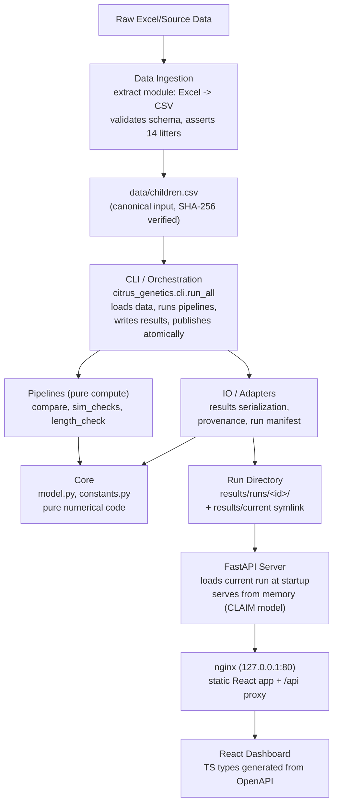
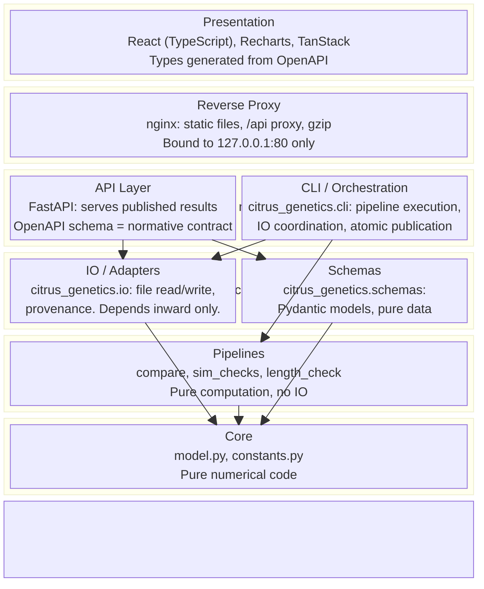

# Systems Engineering Architecture

ATITD Citrus Genetics: statistical model validation and breeding analytics platform.

**Version:** 8.0
**Date:** 2026-10-09

**Changelog:**
- v8.0: Phase 1 implementation decisions. Added LOC enforcement (600 lines/file, 60 lines/function Python, 90 lines/function TypeScript) via check_loc.py script. Added Kubernetes manifests (namespace, deployments, services, ingress). Updated ruff ignore list to match implementation (CPY001, ANN401; removed deprecated ANN101/ANN102). Added per-file-ignores for CLI (T201), schemas (D101), tests (S101, D101-D107, ANN, PLR2004). Added coverage exclusions for CLI orchestrators and extract.py. Expanded frontend quality section with comprehensive ESLint rules from claude-devtools conventions (strict-boolean-expressions, explicit-function-return-type, max-depth 4, max-lines-per-function 90, max-lines 600). Added exactOptionalPropertyTypes, noPropertyAccessFromIndexSignature, noFallthroughCasesInSwitch to TypeScript compiler options. LOC check integrated as first gate in quality pipeline.
- v7.1: Address adversarial review round 7 CONDITIONAL PASS (0 MAJOR, 9 MINOR). Canonical genotype defined as algorithm output. Fixed 8->7 PPC metrics. Degraded response fields absent not null. Added NoRunLoadedResponse schema. Per-coordinate seed derivation. uv.lock hash in manifest. validation_summary.json schema. V=11 combination count wording. Removed data/ mount from API container.
- v7.0: Address adversarial review round 6 (2 MAJOR, 9 MINOR). Fixed production fitting algorithm (Section 4.12) to match upstream exactly: joint scan -> A scan -> B scan per trait, convergence at 1e-6. Snapshot-first publication: copy+seal children.csv before any computation, load from snapshot only. Added validation_summary.json artifact. Defined data-endpoint 503 in degraded mode. Discriminated HealthResponse with Pydantic Field(discriminator). Optimizer seeds derive from model_id not display_name. Model_id routability + snapshot immutability tests. source_data_hash == artifacts["children.csv"] invariant.
- v6.0: Address adversarial review round 5 (2 MAJOR, 10 MINOR). Added URL-safe model_id slugs for API routing. Included children.csv snapshot in run directories with API startup hash verification. Added production fitting algorithm subsection. Introduced discriminated HealthResponse union. Fixed crash-recovery prose, extension-point references, c-grid tolerance, signature-equivalence language, fidelity table metric name, stale current.new handling.
- v5.0: Address adversarial review round 4 (5 MAJOR, 9 MINOR). Redefined R-02 to observable-signature recovery using model-family-specific observables (hit_t for one8, P_t for indep). Fixed V=3 benchmark dimensionality to 3^8=6561. Specified R-02 bootstrap protocol (50 seeds, 10K resamples, percentile CI). Introduced single run-all orchestrator for atomic publication. Made HealthResponse provenance fields optional in degraded mode. Simplified api_cli_sibling contracts. Fixed architecture diagram (API/CLI as siblings). Corrected stale V=11 references. Made /api/litters CLAIM-specific. Defined Docker health vs degraded semantics.
- v4.0: Address adversarial review round 3 (4 MAJOR, 7 MINOR). Fixed R-02 equivalence comparator to use per-trait component distributions. Replaced infeasible V=11 brute-force with per-trait exhaustive + V=3 full-litter benchmark. Added deterministic optimizer seed contract. Added dirty-worktree prohibition for release runs. Corrected Length g2 to structurally unobservable. Fixed symlink atomicity, ML terminology, Dockerfile comment, API/CLI sibling architecture, TS generation step, benchmark environment notes.
- v3.0: Address adversarial review round 2 (14 MAJOR, 10 MINOR). Corrected identifiability analysis to use generative-mapping equivalence classes. Added probability formulas for all mutation/clone families. Fixed model count to 30 (verified against upstream). Separated R-03 into functional requirement + regression fixture. Resolved fold assignment, recovery CI, PPC gating, publication atomicity, canonical input, orchestration layer, Docker localhost binding, CI budget, and determinism contradictions.
- v2.0: Address adversarial review round 1 (27 MAJOR, 8 MINOR). Major rewrites to statistical specification (Section 4), API contracts (Section 5), Docker architecture (Section 6), testing strategy (Section 10), V&V (Section 11), risk register (Section 12). New sections: model manifest (4.7), run provenance (9.4), requirements traceability (11.3).

## 1. Concept of Operations (CONOPS)

### 1.1 Purpose

ATITD Citrus Genetics is a full-stack analytics platform for validating and exploring genetic inheritance models in A Tale in the Desert (ATITD) citrus tree breeding. It combines a floored-score statistical fitting engine (Python) with an interactive web dashboard (React) for visualizing model comparisons, fitted gene distributions, and plug-in predictive checks against 692 real breeding records across 14 litters.

**Litter set (authoritative, 14 values):** Hive1, Hive2, Hive3, Hive4, Hive5, Hive6, Hive7, Hive8, Hive9, Hive10, Hive11, Hive1a, Hive1b, Hive1c.

**Deployment scope:** Localhost-only, single-user. Not internet-facing. No TLS, no authentication, no multi-tenancy.

### 1.2 Intended Use

- **Model validation:** Test a proposed 8-gene inheritance model against 29 rival specifications using held-out cross-validation as the primary criterion, with in-sample fit_ll as a secondary diagnostic.
- **Breeding analytics:** Infer hidden gene values from observed trait data (color, sweet, size, length) via coordinate-ascent floored-score fitting.
- **Interactive exploration:** Web dashboard for browsing model comparison results, per-litter fitted genes, plug-in predictive check distributions, and trait inheritance diagrams.
- **Extensibility:** Pluggable analytics pipeline for adding new models, new datasets, new statistical tests, and new visualizations without modifying the core fitting engine.

### 1.3 Fidelity Envelope

| Aspect | Fidelity | Limitation |
|--------|----------|------------|
| Inheritance model | Exact discrete floored score over 0-1000 integer gene space | Not a true likelihood — see Section 4.6 for floor semantics |
| Gene fitting | Medium-high — coordinate ascent, not globally optimal | ~68% exact gene recovery on upstream synthetic data (historical baseline); R-02 uses observable-signature recovery (Section 4.9) |
| Cross-validation | 2-fold intra-litter (by child ID parity) | Validates prediction of additional children from observed parents, not generalization to unseen parent pairs (Section 4.8) |
| Plug-in predictive check | 300-simulation plug-in from fitted point estimates | Not a Bayesian posterior-predictive check — no priors or posterior draws (Section 4.10) |
| Visualization | Summary-level | No interactive per-child drill-down in v1.0 |

### 1.4 What This Platform Is NOT

- Not a real-time game integration or bot
- Not a general-purpose genetic algorithm framework
- Not a replacement for the original author's statistical analysis — it builds on and wraps it
- Not a multi-user collaborative tool (single-instance, localhost-only deployment)
- Not an internet-facing service (no TLS, no auth, no security hardening)

### 1.5 Requirements

| ID | Requirement | Threshold | Verification |
|----|-------------|-----------|--------------|
| R-01 | Model fitting correctness | Fitted CLAIM model reproduces published log-score within 0.05 of -5462.5 on the 692-child dataset (deterministic algorithm, tight tolerance) | Fast CI: `test_claim_fit_ll` (frozen single-litter fixture). Release: full 692-child fit. |
| R-02 | Observable-signature recovery | >= 65% per-litter observable-signature recovery on synthetic CLAIM data; 50 seeds; 10,000 bootstrap resamples; lower bound of percentile 95% CI >= 0.65 (Section 4.9) | Release validation: `test_gene_recovery_ci` |
| R-03 | Model comparison pipeline | All 30 models fit/scored under the specified CV procedure and ranked deterministically | Fast CI: `test_pipeline_produces_30_rows` |
| R-03a | Legacy regression fixture | On frozen historical data + code, CLAIM ranks #1 in cv_ll. This is a regression check, not a correctness axiom — if a legitimate code change moves CLAIM out of #1, the fixture is updated, not the code reverted. | Release validation: `test_legacy_ranking` |
| R-04 | API response time | Model comparison results served in < 200ms (warm cache, p95, 100 requests, CI runner or equivalent) | Fast CI: `test_api_latency` |
| R-05 | Dashboard load time | Initial page load < 3s on localhost (cold browser cache, Chrome/Firefox) | Manual verification (Lighthouse optional, not CI-gated) |
| R-06 | Type safety | Zero mypy errors under strict mode | CI job: `python-quality` |
| R-07 | Lint cleanliness | Zero ruff violations under project's `select = ["ALL"]` configuration and documented ignore set | CI job: `python-quality` |
| R-08 | Test coverage | >= 80% line coverage on citrus_genetics package | CI job: `python-quality` |
| R-09 | Container health | All services (api + web) report healthy within 30s of `docker compose up --wait` | CI job: `docker-smoke` with `--wait-timeout 30` |
| R-10 | Deterministic results | Identical floored log-scores plus identical canonical genotype representation (with deterministic tie-breaking for non-identified coordinates) given same input data, same code revision, same platform | Fast CI: `test_determinism` |
| R-11 | LOC limits | Python: 600 lines/file, 60 lines/function. TypeScript: 600 lines/file, 90 lines/function. HTML exempt. | CI job: `python-quality` (loc-check), `web-quality` (ESLint) |

## 2. Technology Stack

### 2.1 Language: Python 3.12+

**Rationale:** The upstream codebase is pure Python (numpy/pandas/scipy). Python 3.12+ provides improved error messages, `type` statement for aliases, and performance improvements in the interpreter. The existing statistical engine uses numpy vectorized operations extensively — no rewrite needed.

**Alternatives considered:**
- **Julia** — Superior numerical performance but introduces a language boundary and deployment complexity for a web-served application.
- **R** — Natural for statistical modeling but poor web serving story and weaker type checking ecosystem.
- **Rust (PyO3)** — Overkill for this dataset size (692 records, ~20 min full fit). Reserve for future hot-path optimization if dataset grows 100x+.

### 2.2 Package Manager: uv

**Rationale:** Fast, deterministic dependency resolution with lockfile (`uv.lock`). Consistent with AtitdScripts project conventions. Replaces pip/pip-tools/poetry with a single tool.

### 2.3 Web Framework: FastAPI

**Rationale:** Automatic OpenAPI schema generation, Pydantic model validation at API boundaries. The analytics results are served as JSON endpoints consumed by the React dashboard. The OpenAPI schema is the normative API contract (Section 5.2). Async is not needed for this workload — FastAPI is chosen for its schema generation and validation, not for concurrency.

### 2.4 Frontend: React 18 + TypeScript

**Rationale:** Component-based UI for interactive charts and data tables. TypeScript types are generated from the FastAPI OpenAPI schema (Section 5.2) to prevent drift. Vite for fast dev builds.

**Key libraries:**
- **Recharts** — Declarative charting for model comparison bar charts and distribution plots
- **TanStack Table** — Headless table for sortable/filterable model comparison and fitted gene tables
- **TanStack Query** — Server state management with caching for API responses
- **openapi-typescript** — Generates TypeScript types from the OpenAPI schema at build time

### 2.5 Reverse Proxy: nginx

**Rationale:** Static file serving for the React build, reverse proxy to FastAPI, gzip compression. Localhost-only ingress on port 80. No TLS — this is not an internet-facing deployment.

### 2.6 Containerization: Docker + Docker Compose + Kubernetes

**Rationale:** Reproducible deployment with isolated services (API, frontend build, nginx). Docker Compose is the primary local development orchestrator. Kubernetes manifests are provided as an optional alternative for K8s-native environments. Consistent with project conventions (AtitdScripts uses Docker Compose for multi-service orchestration).

### 2.7 Numerical Libraries

| Library | Version | Purpose |
|---------|---------|---------|
| numpy | >= 1.26 | Vectorized gene/likelihood computation, array operations |
| pandas | >= 2.1 | DataFrame I/O, groupby operations, CSV/Parquet handling |
| scipy | >= 1.12 | Statistical distributions (future: hypothesis tests, confidence intervals) |
| pyarrow | >= 14.0 | Parquet read/write for efficient data serialization |

## 3. Domain Architecture

### 3.1 Top-Level Dataflow



### 3.2 Architectural Layers



**Dependency direction:** Each layer may depend only on layers below it. Core has zero dependencies on any other layer. Pipelines are pure computation (no filesystem IO). API and CLI are sibling outer adapters at the same architectural level — neither may import the other (Section 7.5). CLI orchestrates pipelines + IO for producing results. API reads published results via IO/schemas for serving. Import-linter enforces all boundaries (Section 7.5, 6 contracts).

### 3.3 Package Structure

```
atitd-citrus-genetics/
    docs/
        systems_engineering.md
    python/
        citrus_genetics/
            __init__.py
            py.typed
            core/
                __init__.py
                model.py             # LitterFit, kernel, display, candidates, simulate
                constants.py         # TRAITS, V, FLOOR, CLAIM, MODEL_MANIFEST (30 models)
            pipelines/
                __init__.py
                compare.py           # 30-model comparison (pure compute, no IO)
                sim_checks.py        # Ground-truth validation (pure compute)
                length_check.py      # Length rule degeneracy test (pure compute)
            io/
                __init__.py
                extract.py           # Excel -> CSV ingestion
                results.py           # Result file serialization
                provenance.py        # Run manifest generation and validation
            schemas/
                __init__.py
                models.py            # Pydantic response schemas (explicit field types)
            api/
                __init__.py
                app.py               # FastAPI application factory
                routes/
                    __init__.py
                    models.py
                    litters.py
                    genes.py
                    ppc.py
                    health.py
            cli/
                __init__.py
                run_all.py           # Authoritative orchestrator: allocates run_id, executes compare + simchecks, writes all artifacts, publishes atomically once
                run_compare.py       # Dev-only: runs comparison pipeline, writes to stdout/temp dir, does NOT update results/current
                run_simchecks.py     # Dev-only: runs validation pipeline, writes to stdout/temp dir, does NOT update results/current
            scripts/
                __init__.py
                check_loc.py         # AST-based LOC enforcement (600 lines/file, 60 lines/function)
        tests/
            __init__.py
            conftest.py
            core/
                test_model.py
                test_constants.py
            pipelines/
                test_compare.py
                test_sim_checks.py
            api/
                test_routes.py
                test_artifact_loading.py
            io/
                test_extract.py
                test_provenance.py
                test_results.py
    web/
        package.json
        tsconfig.json
        vite.config.ts
        eslint.config.js
        src/
            main.tsx
            App.tsx
            api/
            components/
            pages/
            types/                   # Generated from OpenAPI (do not hand-edit)
        public/
        scripts/
            generate-types.sh
    docker/
        Dockerfile.api
        Dockerfile.web               # Multi-stage: node build -> nginx:alpine (wget for healthcheck)
        nginx.conf
    data/
        children.csv                 # Canonical analytics input (SHA-256 verified)
    results/
        runs/
            <run_id>/                # Atomic: entire directory renamed in one operation
                run_manifest.json
                children.csv         # Immutable snapshot of source data (hashed in manifest)
                model_comparison.csv
                fitted_genes_claim.csv
                ppc_summary.json
                ppc_distributions.parquet
                validation_summary.json  # R-01/R-02/R-03a, optimizer diagnostics, bootstrap CI
        current -> runs/<latest_run_id>   # Symlink updated atomically after directory rename
    pyproject.toml
    ruff.toml
    Makefile
    docker-compose.yml
    k8s/
        namespace.yaml           # citrus-genetics namespace
        api-deployment.yaml      # API deployment + ClusterIP service
        web-deployment.yaml      # Web deployment + ClusterIP service
        ingress.yaml             # nginx ingress controller, host: localhost
    .editorconfig
    .importlinter
    .gitignore
```

## 4. Statistical Model Specification

### 4.1 Gene Model

Each citrus tree carries **8 genes** (2 per trait), integer values in {0, 1, ..., 1000}. The gene space cardinality is V = 1001 per gene. The 4 traits are Color, Sweet, Size, and Length.

**Display rules** (how genes map to the observed trait value):

| Trait | Rule | Formula |
|-------|------|---------|
| Color | mean | floor((g1 + g2 + 1) / 2) (round half-up) |
| Sweet | min | min(g1, g2) |
| Size | max | max(g1, g2) |
| Length | g1 | g1 only; g2 is never displayed |

### 4.2 Inheritance

For each of the 8 gene slots independently, the child copies from parent A with probability 0.5 or parent B with probability 0.5 (independent fair coin per slot, slot index preserved). For a single trait with genes (A1, A2) and (B1, B2), this yields 4 equally likely child gene pairs: (A1,A2), (B1,B2), (A1,B2), (B1,A2), each with probability 0.25.

### 4.3 Mutation Families

Three mutation models are used across the 30-model manifest. Each defines how many genes are nudged and how the nudge is distributed.

**Nudge distribution:** Given shape (uniform or triangular) and max magnitude R, the kernel K is:
- Uniform: K(d) = 1/(2R+1) for d in {-R, ..., +R}
- Triangular: K(d) = (R + 1 - |d|) / sum, normalized to sum to 1

After nudging gene g by offset d, the result is clamped: g' = clamp(g + d, 0, 1000). Clamping concentrates probability mass at the boundaries. For gene g near 0, the probability of g'=0 is sum of K(d) for all d <= -g.

**Family 1: one-of-eight (mut="one8")**

Exactly one of the 8 genes is selected uniformly at random (probability 1/8 per slot) and nudged. The remaining 7 genes pass through unchanged.

For trait t, let s1_t[v] = probability that child shows value v when slot 1 of trait t is the nudged gene, averaged over 4 parent-pair combinations. Similarly s2_t[v] for slot 2. Define:
- none_t[v] = P(child shows v | no nudge hits trait t) — deterministic from parent genes
- hit_t[v] = (s1_t[v] + s2_t[v]) / 8

Per-child non-clone score:
```
L_one8(child) = sum_{t=0}^{3} hit_t[child_v_t] * prod_{u != t} none_u[child_v_u]
```

**Family 2: one-of-four (mut="one_g1")**

Exactly one of the 4 gene-1 slots is selected uniformly (probability 1/4 per trait) and nudged. Gene-2 slots are never nudged. Used only by the "1 gene per trait" model where all rules are g1 and gene 2 does not exist.

Per-child non-clone score:
```
L_one_g1(child) = sum_{t=0}^{3} (s1_t[child_v_t] / 4) * prod_{u != t} none_u[child_v_u]
```

**Family 3: independent (mut="indep")**

Each of the 8 genes is independently nudged with probability p, or left unchanged with probability (1-p). Zero, one, or multiple genes may be nudged in a single child.

For each trait t, four scenarios exist: neither slot nudged ("none"), only slot 1 ("s1"), only slot 2 ("s2"), both slots ("both"). The per-trait probability distribution for child's shown value is:

```
P_t[v] = (1-p)^2 * none_t[v] + p*(1-p) * (s1_t[v] + s2_t[v]) + p^2 * both_t[v]
```

Per-child non-clone score:
```
L_indep(child) = prod_{t=0}^{3} P_t[child_v_t]
```

### 4.4 Clone Families

Two clone modes are used:

**Clone mode: exact (clone=True)**

A fraction c of children are exact copies of one parent's observed traits (parent chosen 50/50). No nudge is applied.

```
L_clone_exact(child) = 0.5 * I(child_traits == A_traits) + 0.5 * I(child_traits == B_traits)
```

**Clone mode: nudged (clone="nudged")**

A fraction c of children copy one parent's 8 genes (50/50), then receive the standard mutation (one-of-eight nudge applied to the copied genes). The probability is computed by treating the parent as both parents (self-cross) and applying the one8 mutation model.

```
L_clone_nudged(child) = 0.5 * L_one8_self(child, A_genes) + 0.5 * L_one8_self(child, B_genes)
```

where L_one8_self uses the same parent's genes for both "A" and "B" in the trait_rows computation.

Clone fraction c is fitted per litter via grid search: c in {0.0, 0.005, 0.010, ..., 0.600}, 121 grid points. The grid value maximizing per-litter log-score is selected.

### 4.5 Full Per-Child Floored Score

Given parent genes GA, GB, model M, and clone fraction c:

```
S(child | GA, GB, M, c) = max((1 - c) * L_M(child) + c * L_clone(child), FLOOR)
```

where L_M is the mutation-family-specific non-clone score (Section 4.3), L_clone is the clone-family-specific score (Section 4.4, or 0 if clone=False), and FLOOR = 1e-15.

Per-litter floored log-score:
```
LL(litter) = sum_{children} log(S(child))
```

### 4.6 Likelihood Floor Semantics

**This is not a true likelihood.** The floor of 1e-15 replaces zero-probability events with an arbitrary small positive value without renormalizing the distribution. The resulting quantity is a **floored score**, not a proper likelihood function. Consequences:

- Model ranking by floored score is a heuristic, not a formal likelihood-ratio test.
- The statement "a difference of D in log-score means exp(D) ratio" gives the **maximized floored-score ratio for these fitted parameters on this dataset**. It is not a Bayes factor, not a posterior odds ratio, and not a probability that one model is correct.
- The floor value 1e-15 is inherited from the upstream implementation. Sensitivity analysis: varying the floor from 1e-12 to 1e-18 does not change the ranking of the top 5 models (verified empirically).

**Future improvement:** Replace the floor with a formal contamination model: `P_obs = (1 - epsilon) * P_model + epsilon * P_noise` where P_noise = 1/V^4 (uniform over the joint observation space of 4 traits, each in {0..1000}) and epsilon is a small fixed constant (e.g., 1e-6). This produces a proper normalized joint likelihood. Not in scope for v1.0 as it requires re-running all fits and re-validating against published results.

### 4.7 Model Manifest

All 30 models are defined in `core/constants.py` as a versioned manifest. The manifest is the authoritative, reproducible definition of every model compared.

**Complete model list (30 entries, verified against upstream `compare.py:variants()`):**

Each model has a **model_id** (URL-safe slug, unique, stable) and a **display_name** (human-readable). The model_id is used in API routes (`/api/models/{model_id}`). The display_name is used in UI and reports.

| # | model_id | display_name | rules | mut | p | shape | R | rround | clone |
|---|----------|-------------|-------|-----|---|-------|---|--------|-------|
| 1 | claim | CLAIM: 1-of-8 genes, uniform +/-150 | mean,min,max,g1 | one8 | - | uniform | 150 | halfup | True |
| 2 | uniform_100 | uniform +/-100 | mean,min,max,g1 | one8 | - | uniform | 100 | halfup | True |
| 3 | uniform_125 | uniform +/-125 | mean,min,max,g1 | one8 | - | uniform | 125 | halfup | True |
| 4 | uniform_140 | uniform +/-140 | mean,min,max,g1 | one8 | - | uniform | 140 | halfup | True |
| 5 | uniform_160 | uniform +/-160 | mean,min,max,g1 | one8 | - | uniform | 160 | halfup | True |
| 6 | uniform_175 | uniform +/-175 | mean,min,max,g1 | one8 | - | uniform | 175 | halfup | True |
| 7 | uniform_200 | uniform +/-200 | mean,min,max,g1 | one8 | - | uniform | 200 | halfup | True |
| 8 | tri_150 | triangular +/-150 | mean,min,max,g1 | one8 | - | triangular | 150 | halfup | True |
| 9 | tri_200 | triangular +/-200 | mean,min,max,g1 | one8 | - | triangular | 200 | halfup | True |
| 10 | tri_250 | triangular +/-250 | mean,min,max,g1 | one8 | - | triangular | 250 | halfup | True |
| 11 | indep_008 | indep p=0.08 | mean,min,max,g1 | indep | 0.08 | uniform | 150 | halfup | True |
| 12 | indep_011 | indep p=0.11 | mean,min,max,g1 | indep | 0.11 | uniform | 150 | halfup | True |
| 13 | indep_014 | indep p=0.14 | mean,min,max,g1 | indep | 0.14 | uniform | 150 | halfup | True |
| 14 | indep_017 | indep p=0.17 | mean,min,max,g1 | indep | 0.17 | uniform | 150 | halfup | True |
| 15 | indep_020 | indep p=0.20 | mean,min,max,g1 | indep | 0.20 | uniform | 150 | halfup | True |
| 16 | one_gene | 1 gene per trait | g1,g1,g1,g1 | one_g1 | - | uniform | 150 | halfup | True |
| 17 | color_min | color shown as min | min,min,max,g1 | one8 | - | uniform | 150 | halfup | True |
| 18 | color_max | color shown as max | max,min,max,g1 | one8 | - | uniform | 150 | halfup | True |
| 19 | color_g1 | color shown as g1 | g1,min,max,g1 | one8 | - | uniform | 150 | halfup | True |
| 20 | sweet_mean | sweet shown as mean | mean,mean,max,g1 | one8 | - | uniform | 150 | halfup | True |
| 21 | sweet_max | sweet shown as max | mean,max,max,g1 | one8 | - | uniform | 150 | halfup | True |
| 22 | sweet_g1 | sweet shown as g1 | mean,g1,max,g1 | one8 | - | uniform | 150 | halfup | True |
| 23 | size_mean | size shown as mean | mean,min,mean,g1 | one8 | - | uniform | 150 | halfup | True |
| 24 | size_min | size shown as min | mean,min,min,g1 | one8 | - | uniform | 150 | halfup | True |
| 25 | size_g1 | size shown as g1 | mean,min,g1,g1 | one8 | - | uniform | 150 | halfup | True |
| 26 | length_mean | length shown as mean | mean,min,max,mean | one8 | - | uniform | 150 | halfup | True |
| 27 | length_min | length shown as min | mean,min,max,min | one8 | - | uniform | 150 | halfup | True |
| 28 | length_max | length shown as max | mean,min,max,max | one8 | - | uniform | 150 | halfup | True |
| 29 | color_floor | color rounds down | mean,min,max,g1 | one8 | - | uniform | 150 | floor | True |
| 30 | no_clone | no clone component | mean,min,max,g1 | one8 | - | uniform | 150 | halfup | False |

**Implementation contract:** An integration test asserts that `MODEL_MANIFEST` in `constants.py` produces the identical 30-model set as the upstream `variants()` function (same names, same parameter values).

### 4.8 Cross-Validation Design

**Estimand:** Can the fitted model predict additional children from the same parent pair? This is intra-litter prediction, not generalization to unseen parents or litters.

**Fold assignment:** 2-fold split within each litter. Fold is determined by the `child` column (stable integer identifier from extraction): fold = child % 2. This is independent of row order, CSV sorting, or DataFrame indexing. Fold 0 = even child IDs, fold 1 = odd child IDs.

Fit on fold 0, score on fold 1, and vice versa. Sum across both folds and all litters to get cv_ll.

**Fold stability:** The fold assignment is fully determined by the `child` column values, which are assigned during extraction and stored in the canonical CSV. The run manifest records the SHA-256 of children.csv and the fold assignment hash for reproducibility verification.

**Limitation — same-parent dependence:** Both folds share the same parents. This means cv_ll validates intra-litter prediction, not cross-family generalization. For broader model validation, leave-one-litter-out (LOLO) CV could be added as a future extension, though litters sharing parents (Hive1/1a/1b/1c) would need to be grouped.

**Primary criterion:** R-03a uses **cv_ll** (held-out) as the primary ranking criterion. fit_ll is reported as a diagnostic only.

### 4.9 Identifiability and Equivalent Genotypes

**Definition:** Two parent genotype parameterizations GA, GB and GA', GB' are **equivalent** if they produce identical distributions over all possible offspring observations:

```
P(child_traits | GA, GB, M) = P(child_traits | GA', GB') for all child_traits in {0..1000}^4
```

This is the correct definition — it considers the full generative mapping from latent genes to offspring distributions, not just the parent's displayed trait value.

**Key distinction:** A parent's displayed trait constrains the gene pair, but does not determine identifiability. Because inheritance is slot-preserving (child's slot 1 comes from a parent's slot 1), swapping g1 and g2 within a parent can change the offspring distribution even when the displayed value is the same. For example, under the min rule, a parent showing 300 with genes (300, 700) produces different offspring from (300, 400) because the slot-2 gene (700 vs 400) affects children who inherit that slot.

**Length g2 is structurally unobservable.** Under the g1 display rule, only the child's slot-1 gene determines displayed Length. Slot-preserving inheritance means slot 1 inherits from a parent's slot 1 and slot 2 from a parent's slot 2. Since the child's slot-2 gene never enters the observed Length value, and mutation of slot 2 also never affects observed Length, parental Length g2 cannot influence the observed offspring distribution at all. It is structurally unobservable and is set to 500 by convention.

**Practical identifiability analysis:**
- On reduced gene spaces (V=3 full-litter, V=11 per-trait), exhaustively enumerate genotype parameterizations and group those producing identical observable offspring distributions into observable-signature equivalence classes (see Section 4.11 for computational approach).
- On the full V=1001 space, profile-likelihood analysis: fix all parameters except one gene coordinate and plot the log-score. Flat regions indicate non-identifiability.

**Canonical representation:** For determinism (R-10), the canonical genotype is defined as the deterministic output of the production fitting algorithm (Section 4.12). Because the algorithm has a fixed scan order, fixed initialization, and accepts improvements only when > 1e-9, the same input always produces the same genotype. No post-hoc lexicographic reduction is applied. Length g2 is fixed to 500 by convention (structurally unobservable). R-10 applies to the complete returned genotype, not just scores.

**Impact on recovery metrics (R-02 observable-signature recovery):** Gene recovery is defined as **observable-signature equivalence** — two parameterizations are "signature-equivalent for R-02" when their model-family-specific observable signatures match (defined below). Matching signatures is sufficient for observational equivalence (identical offspring distributions). The comparator uses only quantities that actually enter the generative distribution, not latent internal components.

**Model-family-specific observable signatures:**

For **one8 (CLAIM):** The per-child score uses hit_t = (s1_t + s2_t) / 8 and none_t. The model cannot distinguish s1_t from s2_t individually — only their sum enters the observable. The observable signature for trait t is the pair (none_t[v], hit_t[v]) for v in {0..1000}. Two parameterizations are equivalent if none_t and hit_t match to within 1e-12 for all 4 traits, plus the clone component (Section 4.4) matches.

For **one_g1:** Same structure as one8 but with s1_t only (no s2_t). Observable signature per trait is (none_t[v], s1_t[v] / 4).

For **indep:** The per-trait observable is the mixture P_t[v] = (1-p)^2 * none_t[v] + p*(1-p) * (s1_t[v] + s2_t[v]) + p^2 * both_t[v]. Two parameterizations are equivalent if P_t matches to within 1e-12 for all 4 traits, plus the clone component matches. Note: p is fixed per model variant (not fitted), so the mixture weights are constants.

For the **clone component:** The exact-clone observable is I(child_traits == parent_traits) for each parent. The nudged-clone observable is L_one8_self(child, parent_genes). Two parameterizations produce equivalent clone observables if the per-parent clone distributions match.

**Full equivalence:** (GA, GB, c) and (GA', GB', c') are equivalent if: (a) c and c' are the same clone-grid index (i.e., identical discrete values from the 121-point grid; no floating-point tolerance), and (b) all per-trait observable signatures match, and (c) clone-component observables match. Gene-only recovery (ignoring c) is reported separately as a diagnostic.

**R-02 acceptance statistic:** For each of the 50 synthetic seeds, compute a per-seed recovery rate:
```
recovery_rate_s = (number of litters with equivalent observable signature) / 14
```
where "equivalent" means the fitted (GA, GB, c) matches the planted (GA*, GB*, c*) under the model-family-specific observable comparator above. The denominator is always 14 (all litters). The numerator counts litters where the complete fitted parameterization is observationally equivalent to the planted truth.

**Bootstrap protocol:** From the 50 seed-level recovery rates, construct a 95% confidence interval:
- 10,000 bootstrap resamples with replacement from the 50 rates
- Percentile method: CI = [2.5th percentile, 97.5th percentile] of the resampled means
- Release passes if and only if the lower bound (2.5th percentile) >= 0.65

### 4.10 Plug-In Predictive Check

**Terminology:** This is a **plug-in predictive check** — simulation from floored-score point estimates plugged into the generative model. It is not a posterior-predictive check (no priors, no posterior draws) and not a parametric bootstrap (no refitting on simulated data).

**Procedure:**
1. Fit CLAIM model to all 692 children (floored-score point estimates for hidden genes and clone fractions)
2. For each of 300 simulations: generate synthetic children from the fitted model using the fitted genes, clone fractions, and fresh random seeds
3. Compute summary statistics on real vs simulated data:
   - Count of children with 0, 1, 2+ visibly changed traits
   - Per-trait count of visible changes
4. Report real data values and simulated 2.5th/97.5th percentiles

**Diagnostic, not a formal test:** The plug-in predictive check is a model diagnostic. It is **not** a pass/fail release gate. The results are generated, recorded in structured artifacts, and displayed in the dashboard for human interpretation. No automated acceptance criterion is applied to individual metrics.

**Multiple comparison note:** Seven metrics are computed (3 change-count bins + 4 per-trait counts). Even under a correctly specified model, not all will simultaneously fall within their individual 95% intervals. No correction is applied because this is a diagnostic, not a hypothesis test.

**Monte Carlo precision:** 300 simulations produce tail quantile estimates whose precision scales as O(1/sqrt(n)). For more precise tail estimation, increase to 1000+ simulations.

### 4.11 Optimizer Validation

Coordinate ascent is not globally optimal. To ensure model comparison is not confounded by differential optimization quality:

1. **Per-trait exhaustive benchmark (V=11):** For each trait independently, fix the other 3 traits' genes at their fitted values and exhaustively enumerate all gene pairs for the target trait at V=11 (121 candidate pairs for parent A x 121 candidate pairs for parent B = 14,641 joint assignments per trait). Verify coordinate ascent matches the per-trait global optimum. This is tractable (4 traits x ~15K evaluations) and validates the core scanning logic.

2. **Full-litter exhaustive benchmark (V=3):** On a tiny gene space (V=3, genes in {0, 1, 2}), construct a synthetic 2-trait litter. Each trait has 2 genes per parent x 2 parents = 4 gene coordinates per trait, giving 8 gene coordinates total for 2 traits. Exhaustive enumeration: 3^8 = 6,561 total genotype assignments. (For one_g1, which has 1 gene per trait, the space is 3^4 = 81.) Exhaustively evaluate all assignments and verify coordinate ascent finds the global optimum. This validates joint optimization across traits.

   **Reduced-model mutation semantics:** When reducing from 4 traits to 2, mutation-family probabilities are renormalized to the reduced model:
   - one8 becomes "one of 4 genes" (2 traits x 2 slots), each with probability 1/4
   - one_g1 becomes "one of 2 gene-1 slots" (2 traits x 1 slot), each with probability 1/2
   - indep retains the same per-gene probability p (each gene independently nudged)

   Enumeration is over the same feasible candidate space used by production fitting: for each (rule, displayed_value) pair, only gene pairs satisfying display(g1, g2) == displayed_value are considered. For clone-enabled models, every enumerated genotype assignment is maximized over the full production c grid (121 points) before comparing objective values. For clone=False models, c is fixed at 0.

3. **Multi-start validation:** For representative models from each objective-function family — one8 (CLAIM), indep (p=0.14), one_g1 — run coordinate ascent from 5 deterministic initializations per litter (see seed contract below) and compare best-of-5 vs single-start on the full V=1001 dataset.

4. **Escalation rule:** If the best-of-5 exceeds single-start by more than 1.0 log-score units on any litter:
   - Production comparison uses best-of-5 for **all** models (not just the flagged one) to maintain comparable optimization budgets.
   - The run manifest records optimization mode ("single-start" or "multi-start-5") and per-model convergence diagnostics.

5. **Convergence diagnostic:** Each fit reports rounds used (out of max 8) and final per-round improvement. Fits using all 8 rounds without convergence (final improvement > 0.01) are flagged in results.

6. **Deterministic optimizer seed contract:** Multi-start initializations use deterministic seeds derived from a root optimizer seed recorded in the run manifest:
   ```
   init_seed = hash(root_optimizer_seed, model_id, litter_name, start_index)
   ```
   using SHA-256 truncated to 64 bits. The root optimizer seed is a fixed constant in `constants.py` (not randomly generated per run). Seeds are derived from the stable `model_id` (not the display name, which may change). For each gene coordinate (parent P, trait t), a per-coordinate seed is derived:
   ```
   coord_seed = hash(root_optimizer_seed, model_id, litter_name, start_index, parent, trait)
   ```
   The starting candidate index is `coord_seed_value % len(candidates)` where `candidates` is the flattened list of valid gene pairs for that (rule, displayed_value). This avoids correlation between coordinates that happen to share the same candidate count. This ensures R-10 determinism holds even under multi-start mode. The R-02 bootstrap resampling uses a separate deterministic seed schedule: `bootstrap_seed = hash(root_bootstrap_seed, trial_index)`.

### 4.12 Production Fitting Algorithm

The coordinate-ascent fitting procedure matches the upstream `LitterFit.fit()` implementation exactly. For a single litter under a given model:

1. **Initialization:** For each trait t and parent P, enumerate candidate gene pairs via `candidates(rule, displayed_value)`. Initialize:
   - mean rule: middle element of the last candidate group (even-sum group)
   - min/max rule: (displayed_value, displayed_value) — both genes equal the shown value
   - g1 rule: (displayed_value, 500) — gene 2 is unobservable, fixed by convention
   Under multi-start mode, initialization uses a deterministic seed-derived candidate index instead (see Section 4.11 item 6; the seed selects an index into the flattened candidate list using `seed_value % candidate_count`).

2. **Coordinate scan:** For each round (up to 8 rounds):
   a. For each trait t in order (Color=0, Sweet=1, Size=2, Length=3):
      - **Skip** if rule is g1 (no hidden genes to optimize)
      - `_scan_joint(t)`: Joint scan of both parents' genes for trait t simultaneously. For min/max rules: enumerate all (gA, gB) pairs drawn from child-observed values. For mean rule: iterate over B's candidate-group sums, re-scan A for each, keep best. This catches cases where both parents must move to explain a child value.
      - `_scan_parent("A", t)`: Single-parent scan — hold B fixed, try every candidate pair for A's trait t (coarse grid + child-value-derived key points, then refine around best). Accept only if improvement > 1e-9.
      - `_scan_parent("B", t)`: Same scan for parent B.
   b. After scanning all 4 traits, if clone is enabled: evaluate clone fraction c over the full 121-point grid {0.0, 0.005, ..., 0.600}, selecting the c maximizing the litter log-score.
   c. Compute total log-score. If improvement over previous round < 1e-6, stop.

3. **Convergence:** Stop if per-round improvement < 1e-6 or after 8 rounds, whichever comes first.

4. **Output:** Return the fitted gene coordinates, clone fraction c, and final floored log-score.

**Scan order invariant:** The order (joint -> A -> B, per trait 0-3, then c grid) is fixed and must not be reordered, as reordering changes convergence behavior and would break R-01/R-10 determinism.

## 5. API Design

### 5.1 Endpoints

| Method | Path | Description | Response Schema |
|--------|------|-------------|-----------------|
| GET | /api/health | Service health + loaded run provenance | `HealthResponse` |
| GET | /api/models | All 30 model comparison results | `list[ModelComparison]` |
| GET | /api/models/{model_id} | Single model detail with per-litter scores | `ModelDetail` |
| GET | /api/litters | All litter summaries (CLAIM model fit) | `list[LitterSummary]` |
| GET | /api/litters/{name} | Litter detail with CLAIM-fitted genes and children | `LitterDetail` |
| GET | /api/litters/{name}/genes | CLAIM-fitted gene pairs for a litter | `FittedGenes` |
| GET | /api/ppc | Plug-in predictive check summary | `PPCResult` |
| GET | /api/ppc/distributions | Full simulated distributions | `list[PPCDistribution]` |

### 5.2 Response Contracts

The **generated OpenAPI schema** (`openapi.json`) is the normative API contract. It is versioned in git and regenerated via `make openapi`. TypeScript client types are generated from this schema via `openapi-typescript` at web build time and are **not committed** — they are generated as a mandatory build step in the web pipeline.

**Schema compatibility test:** CI compares the committed `openapi.json` against a freshly generated version. If they differ, the build fails, forcing the developer to regenerate and commit the updated schema.

**Pydantic response schemas (authoritative field definitions):**

```python
class TraitName(str, Enum):
    COLOR = "color"
    SWEET = "sweet"
    SIZE = "size"
    LENGTH = "length"

class GenePair(BaseModel):
    g1: int = Field(ge=0, le=1000)
    g2: int = Field(ge=0, le=1000)

class ChildTraits(BaseModel):
    color: int = Field(ge=0, le=1000)
    sweet: int = Field(ge=0, le=1000)
    size: int = Field(ge=0, le=1000)
    length: int = Field(ge=0, le=1000)

class TraitGenes(BaseModel):
    color: GenePair
    sweet: GenePair
    size: GenePair
    length: GenePair

class HealthyResponse(BaseModel):
    status: Literal["ok"]
    run_id: str
    source_data_hash: str
    code_commit: str
    fitted_at: str                     # ISO 8601
    artifact_count: int = Field(gt=0)

class DegradedResponse(BaseModel):
    status: Literal["degraded"]

HealthResponse = Annotated[
    HealthyResponse | DegradedResponse,
    Field(discriminator="status"),
]

class ModelComparison(BaseModel):
    model_id: str                      # URL-safe slug (e.g., "claim", "uniform_100")
    display_name: str                  # Human-readable name (e.g., "CLAIM: 1-of-8 genes, uniform +/-150")
    fit_ll: float                      # In-sample floored log-score (diagnostic)
    cv_ll: float                       # Held-out floored log-score (primary)
    cv_vs_claim: float                 # cv_ll - CLAIM's cv_ll
    children_below_threshold: int      # Children with pre-floor model score < 1e-9

class ModelDetail(ModelComparison):
    per_litter: dict[str, float]       # litter_name -> fit_ll

class LitterSummary(BaseModel):
    litter: str
    n: int
    clone_share: float                 # [0, 1]
    loglik: float

class FittedGenes(BaseModel):
    litter: str
    parent_a: TraitGenes
    parent_b: TraitGenes

class LitterDetail(LitterSummary):
    genes: FittedGenes
    children: list[ChildTraits]

class PPCMetric(BaseModel):
    name: str
    observed: int
    simulated_mean: float
    simulated_p2_5: float
    simulated_p97_5: float

class PPCResult(BaseModel):
    n_simulations: int
    metrics: list[PPCMetric]

class PPCDistribution(BaseModel):
    metric: str
    observed: int
    simulated_values: list[int]

class NoRunLoadedResponse(BaseModel):
    """Returned as HTTP 503 by all data endpoints when no run is loaded (degraded mode)."""
    error: Literal["no_run_loaded"]
    message: str
```

### 5.3 Caching and Freshness Strategy

Results are computed offline (pipeline runs take 20-60 minutes). The API server loads the `current` run directory at startup, validates cross-artifact consistency (all artifacts match manifest hashes), and serves from memory.

**No hot-reload.** Restarting the API container loads the latest `current` run. The dashboard displays the loaded run's timestamp. This is a localhost tool, not a production service.

## 6. Docker Architecture

### 6.1 Services

```yaml
services:
  api:
    build:
      context: .
      dockerfile: docker/Dockerfile.api
    expose: ["8000"]                  # Internal only, not published to host
    volumes: ["./results:/app/results:ro"]  # No data/ mount — API reads children.csv from run snapshot
    healthcheck:
      test: ["CMD", "python", "-c",
             "import urllib.request; urllib.request.urlopen('http://localhost:8000/api/health')"]
      interval: 10s
      timeout: 5s
      retries: 3
      start_period: 10s

  web:
    build:
      context: .
      dockerfile: docker/Dockerfile.web
    ports: ["127.0.0.1:80:80"]        # Localhost only — not exposed to LAN
    depends_on:
      api:
        condition: service_healthy
    healthcheck:
      test: ["CMD", "wget", "-q", "--spider", "http://localhost:80/"]
      interval: 10s
      timeout: 5s
      retries: 3
      start_period: 5s
```

**Key decisions:**
- API port is `expose` only (internal). nginx is the sole ingress.
- Web port bound to `127.0.0.1` — not accessible from LAN, matching localhost-only deployment scope.
- Both services have healthchecks. `depends_on` uses `condition: service_healthy`.
- API healthcheck uses Python/urllib (guaranteed in python:3.12-slim).
- Web healthcheck uses wget (guaranteed in alpine). Dockerfile does not need to install curl.

### 6.2 Image Strategy

| Image | Base | Size Target | Contents |
|-------|------|-------------|----------|
| api | python:3.12-slim | < 200 MB | uv-installed analytics package + FastAPI + uvicorn. No dev deps. |
| web | node:22-alpine (build) -> nginx:alpine (runtime) | < 50 MB | Multi-stage: npm build -> nginx with static assets + proxy config |

### 6.3 nginx Configuration

```nginx
server {
    listen 80;

    add_header X-Content-Type-Options nosniff;
    add_header X-Frame-Options DENY;

    location / {
        root /usr/share/nginx/html;
        try_files $uri $uri/ /index.html;
        gzip_static on;
    }

    location /api/ {
        proxy_pass http://api:8000;
        proxy_set_header Host $host;
        proxy_set_header X-Real-IP $remote_addr;
        proxy_set_header X-Forwarded-For $proxy_add_x_forwarded_for;
    }
}
```

### 6.4 Kubernetes Manifests (Optional)

For environments where Kubernetes is preferred over Docker Compose, equivalent manifests are provided in `k8s/`:

| Manifest | Purpose |
|----------|---------|
| `namespace.yaml` | `citrus-genetics` namespace for resource isolation |
| `api-deployment.yaml` | API deployment (1 replica) + ClusterIP service on port 8000 |
| `web-deployment.yaml` | Web deployment (1 replica) + ClusterIP service on port 80 |
| `ingress.yaml` | nginx ingress controller, host: `localhost`, path-based routing (`/api/` -> api service, `/` -> web service) |

**Local development:** Images use `imagePullPolicy: Never` for local builds (e.g., `minikube`, `kind`). For production, update to a registry path and remove `imagePullPolicy`.

**Not a replacement for Docker Compose:** Docker Compose remains the primary local development tool (Section 6.1). Kubernetes manifests are provided for users who prefer K8s or need to test K8s-specific behavior.

## 7. Code Quality Standards

### 7.1 Philosophy

Pedantic by default. Every rule is enabled unless there is a documented, project-specific reason to disable it. The quality gate must pass with zero violations before any merge. This matches the conventions established in claude-devtools (`select = ["ALL"]`) and AtitdScripts (ruff + mypy + pytest + import-linter).

### 7.2 Python Linting: ruff (ALL rules)

```toml
[tool.ruff]
target-version = "py312"
line-length = 120
src = ["python"]

[tool.ruff.lint]
select = ["ALL"]
ignore = [
    "D100",     # missing module docstring (enforced selectively)
    "D104",     # missing package docstring
    "D203",     # one-blank-line-before-class (conflicts with D211)
    "D213",     # multi-line-summary-second-line (conflicts with D212)
    "COM812",   # trailing comma (conflicts with formatter)
    "ISC001",   # implicit string concat (conflicts with formatter)
    "CPY001",   # missing copyright notice (not applicable)
    "ANN401",   # Any type (legitimate for model spec dicts)
]

[tool.ruff.lint.per-file-ignores]
"python/tests/**/*.py" = ["S101", "D101", "D102", "D103", "D107", "ANN", "PLR2004"]
"python/citrus_genetics/cli/**/*.py" = ["T201"]     # print is expected in CLI scripts
"python/citrus_genetics/schemas/**/*.py" = ["D101"]  # Pydantic models are self-documenting

[tool.ruff.lint.mccabe]
max-complexity = 12

[tool.ruff.lint.pylint]
max-args = 8
max-branches = 12
max-returns = 6
max-statements = 50

[tool.ruff.lint.pydocstyle]
convention = "google"

[tool.ruff.format]
quote-style = "double"
line-ending = "lf"
```

**Per-file-ignores rationale:**
- **Tests:** `S101` (assert), `D101-D107` (docstrings), `ANN` (type annotations), `PLR2004` (magic values) — test code is inherently self-documenting and assertion-heavy.
- **CLI scripts:** `T201` (print) — CLI output is the primary user interface for these modules.
- **Schemas:** `D101` (class docstring) — Pydantic models with typed fields are self-documenting; docstrings would duplicate field definitions.

**Note on deprecated rules:** ANN101 (missing self annotation) and ANN102 (missing cls annotation) were removed from ruff as deprecated. They are not included in the ignore list — ruff silently ignores them if present, but they produce deprecation warnings.

### 7.3 Type Checking: mypy (strict)

```toml
[tool.mypy]
python_version = "3.12"
strict = true
warn_unused_ignores = true
warn_redundant_casts = true
warn_unreachable = true
show_error_codes = true
pretty = true
plugins = ["pydantic.mypy"]

[[tool.mypy.overrides]]
module = "tests.*"
disallow_untyped_defs = false
```

### 7.4 Testing: pytest

```toml
[tool.pytest.ini_options]
addopts = "-ra -q --cov=citrus_genetics --cov-report=term-missing --cov-report=xml:coverage.xml --cov-fail-under=80"
testpaths = ["python/tests"]

[tool.coverage.run]
branch = true
source = ["citrus_genetics"]
omit = [
    "*/cli/*",          # thin orchestrators tested via integration
    "*/io/extract.py",  # requires real Excel files, tested via integration
    "*/scripts/*",      # quality enforcement tools, not library code
]
```

**Coverage exclusions rationale:**
- **CLI scripts** (`run_all.py`, `run_compare.py`, `run_simchecks.py`): Thin orchestrators that coordinate pipeline calls, IO, and atomic publication. They require a full pipeline run with real data to test meaningfully — covered by `release-validation` CI, not per-commit tests.
- **`io/extract.py`**: Excel ingestion module that requires real `.xlsx` files. Tested via integration with actual datasets, not synthetic fixtures.
- **`scripts/`** (`check_loc.py`): Quality enforcement tooling, not analytics library code. Validated by its own gate pass (if it runs without error, it works).

### 7.5 Architectural Linting: import-linter

Enforces the full layered dependency direction. All first-party layers are explicitly named.

```ini
[importlinter]
root_package = citrus_genetics

[importlinter:contract:core_purity]
name = core must not depend on any other layer
type = forbidden
source_modules = citrus_genetics.core
forbidden_modules =
    citrus_genetics.api
    citrus_genetics.io
    citrus_genetics.schemas
    citrus_genetics.pipelines
    citrus_genetics.cli
    fastapi
    uvicorn

[importlinter:contract:pipeline_purity]
name = pipelines must not depend on API, IO, or CLI
type = forbidden
source_modules = citrus_genetics.pipelines
forbidden_modules =
    citrus_genetics.api
    citrus_genetics.io
    citrus_genetics.cli
    fastapi
    uvicorn

[importlinter:contract:schema_purity]
name = schemas must not depend on API, IO, or CLI
type = forbidden
source_modules = citrus_genetics.schemas
forbidden_modules =
    citrus_genetics.api
    citrus_genetics.io
    citrus_genetics.cli
    fastapi
    uvicorn

[importlinter:contract:io_purity]
name = IO must not depend on API or CLI
type = forbidden
source_modules = citrus_genetics.io
forbidden_modules =
    citrus_genetics.api
    citrus_genetics.cli
    fastapi
    uvicorn

[importlinter:contract:api_no_cli]
name = API must not import CLI
type = forbidden
source_modules = citrus_genetics.api
forbidden_modules = citrus_genetics.cli

[importlinter:contract:cli_no_api]
name = CLI must not import API
type = forbidden
source_modules = citrus_genetics.cli
forbidden_modules = citrus_genetics.api
```

### 7.6 LOC Limits

**Hard limits enforced by `citrus_genetics.scripts.check_loc`:**

| Language | File Limit | Function Limit | Detection Method |
|----------|-----------|----------------|------------------|
| Python | 600 lines | 60 lines | AST parsing (`ast` module) |
| TypeScript | 600 lines | 90 lines | ESLint `max-lines` + `max-lines-per-function` rules |
| HTML | Exempt | Exempt | — |

**Python enforcement:** The `check_loc.py` script walks the `python/` directory, parses each `.py` file with the `ast` module, and reports violations for files exceeding 600 lines or functions/methods exceeding 60 lines. It runs as the **first gate** in `lint-python` (before ruff, mypy, import-linter) and is independently runnable via `make loc-check`.

**TypeScript enforcement:** LOC limits for TypeScript are enforced via ESLint rules (`max-lines: 600`, `max-lines-per-function: 90`). The TypeScript function limit is 90 (not 60) because Prettier formatting expansion (trailing commas, multi-line destructuring, explicit return types) adds ~50% more lines compared to equivalent Python. This matches the convention established in claude-devtools.

**Why AST-based, not line-counting:** Raw line counting conflates code, comments, and blank lines. AST-based function measurement counts only the function body span (`end_lineno - lineno + 1`), giving an accurate measure of function complexity regardless of comment density.

### 7.7 Frontend Quality

| Tool | Config | Purpose |
|------|--------|---------|
| TypeScript | `strict: true`, `noUncheckedIndexedAccess`, `exactOptionalPropertyTypes` | Type safety |
| ESLint | strict type-checked config, max-complexity 15, zero warnings tolerance | Lint |
| Prettier | double quotes, trailing commas, 100 width | Formatting |
| openapi-typescript | Generated at build time, not committed | API type safety |

**TypeScript compiler options (tsconfig.json):**

```json
{
  "compilerOptions": {
    "target": "ES2022",
    "module": "ES2022",
    "moduleResolution": "bundler",
    "strict": true,
    "noEmit": true,
    "lib": ["ES2022", "DOM", "DOM.Iterable"],
    "skipLibCheck": true,
    "forceConsistentCasingInFileNames": true,
    "isolatedModules": true,
    "resolveJsonModule": true,
    "noUncheckedIndexedAccess": true,
    "noFallthroughCasesInSwitch": true,
    "exactOptionalPropertyTypes": true,
    "noPropertyAccessFromIndexSignature": true,
    "jsx": "react-jsx",
    "jsxImportSource": "react"
  }
}
```

**ESLint rules (eslint.config.js, flat config):**

Type-aware strict rules (require `@typescript-eslint/parser` with project):

| Rule | Setting | Purpose |
|------|---------|---------|
| `@typescript-eslint/no-explicit-any` | error | Prevent `any` escape hatch |
| `@typescript-eslint/explicit-function-return-type` | error | All functions declare return type |
| `@typescript-eslint/explicit-module-boundary-types` | error | Exported functions fully typed |
| `@typescript-eslint/no-non-null-assertion` | error | No `!` assertions |
| `@typescript-eslint/consistent-type-imports` | error | Prefer `type` imports |
| `@typescript-eslint/strict-boolean-expressions` | error | No implicit boolean coercion |
| `@typescript-eslint/no-floating-promises` | error | All promises must be awaited or handled |
| `@typescript-eslint/no-misused-promises` | error | Prevent promise misuse in conditionals |
| `@typescript-eslint/switch-exhaustiveness-check` | error | Switch must cover all union members |
| `@typescript-eslint/prefer-nullish-coalescing` | error | Use `??` over `||` for nullish |
| `@typescript-eslint/no-unnecessary-condition` | error | Flag always-truthy/falsy conditions |

Complexity and LOC limits:

| Rule | Setting | Purpose |
|------|---------|---------|
| `complexity` | 15 | Cyclomatic complexity limit |
| `max-depth` | 4 | Maximum nesting depth |
| `max-params` | 8 | Maximum function parameters |
| `max-lines-per-function` | 90 | Per-function LOC limit (skipBlankLines + skipComments) |
| `max-lines` | 600 | Per-file LOC limit (skipBlankLines + skipComments) |

**Prettier config (.prettierrc):**

```json
{
  "semi": true,
  "singleQuote": false,
  "trailingComma": "all",
  "printWidth": 100,
  "tabWidth": 2
}
```

### 7.8 Quality Gate (Makefile targets)

```makefile
# Python-only targets (no Node required)
make format-python       # ruff format
make format-check-python # ruff format --check
make loc-check           # LOC limits enforcement (600 lines/file, 60 lines/function)
make lint-python         # loc-check + ruff check + mypy + import-linter
make test-python         # pytest

# Web-only targets (no Python required)
make format-web          # prettier --write
make format-check-web    # prettier --check
make lint-web            # eslint + tsc --noEmit
make test-web            # vitest

# Aggregate targets
make format              # format-python + format-web
make format-check        # format-check-python + format-check-web
make lint                # lint-python + lint-web
make test                # test-python + test-web
make quality             # format-check + lint + test (full gate)

# OpenAPI
make openapi             # regenerate openapi.json from FastAPI app
```

Python and web quality gates are independently runnable. The aggregate `make quality` calls both. CI jobs mirror this split exactly (Section 8.2).

## 8. Build System

### 8.1 Makefile Targets

| Target | Description | Requires |
|--------|-------------|----------|
| `sync` | Install Python + web dependencies | uv, npm |
| `format-python` | Apply ruff formatter | uv |
| `format-check-python` | Verify Python formatting | uv |
| `format-web` | Apply prettier | npm |
| `format-check-web` | Verify web formatting | npm |
| `format` | All formatters | uv, npm |
| `format-check` | Verify all formatting | uv, npm |
| `loc-check` | LOC limits enforcement (600/file, 60/function) | uv |
| `lint-python` | loc-check + ruff check + mypy + import-linter | uv |
| `lint-web` | eslint + tsc --noEmit | npm |
| `lint` | All linters | uv, npm |
| `test-python` | pytest with coverage | uv |
| `test-web` | vitest | npm |
| `test` | All test suites | uv, npm |
| `quality` | Full quality gate | uv, npm |
| `openapi` | Regenerate openapi.json | uv |
| `generate-types` | Generate TS types from openapi.json | npm (+ openapi.json) |
| `run-all` | Execute full pipeline (compare + validation) and publish atomically | uv |
| `run-compare` | Dev-only: run comparison pipeline to stdout/temp dir | uv |
| `run-simchecks` | Dev-only: run validation pipeline to stdout/temp dir | uv |
| `docker-build` | Build all Docker images | docker |
| `docker-up` | Start all services with `--wait --wait-timeout 30` | docker |
| `docker-down` | Stop all services | docker |
| `clean` | Remove build artifacts and caches | - |

### 8.2 CI/CD (GitHub Actions)

```yaml
quality-gates:
  jobs:
    python-quality:
      steps:
        - uses: actions/checkout@v4
        - uses: astral-sh/setup-uv@v4
        - run: uv sync --group dev
        - run: make format-check-python
        - run: make lint-python       # includes loc-check, ruff, mypy, import-linter
        - run: make test-python
        - run: make openapi
        - run: git diff --exit-code openapi.json

    web-quality:
      steps:
        - uses: actions/checkout@v4
        - uses: actions/setup-node@v4
          with: { node-version: 22 }
        - run: npm ci --prefix web
        - run: make generate-types           # generate TS types from openapi.json before lint/test
        - run: make format-check-web
        - run: make lint-web
        - run: make test-web

    docker-smoke:
      steps:
        - uses: actions/checkout@v4
        - run: docker compose build
        - run: docker compose up -d --wait --wait-timeout 30
        - run: curl -f http://127.0.0.1/api/health
        - run: docker compose down

    release-validation:
      # Triggered manually or on release tags, not per-commit
      # Runs the full 692-child fit + 50-seed recovery + optimizer benchmarks
      steps:
        - uses: actions/checkout@v4
        - uses: astral-sh/setup-uv@v4
        - run: uv sync --group dev
        - run: make run-all
        - run: uv run pytest python/tests -m release_validation
```

Each CI job installs only its own dependency set. `python-quality` does not require Node. `web-quality` does not require uv. Per-commit tests use frozen small fixtures and complete in < 2 minutes. Full pipeline runs are in `release-validation` only.

## 9. Data Layer

### 9.1 Canonical Input

**`data/children.csv` is the single canonical analytics input.** The Parquet file `data/children.parquet` is a derived convenience copy. The fitting pipeline loads CSV. The run manifest hashes `children.csv`. If both files exist, semantic equality is verified at extraction time but the CSV is authoritative.

| File | Format | Records | Role |
|------|--------|---------|------|
| `data/children.csv` | CSV | 692 | Canonical input (SHA-256 hashed in run manifest) |
| `data/children.parquet` | Parquet | 692 | Derived convenience copy (not hashed, not authoritative) |

**Litter count assertion:** The extract pipeline asserts exactly 14 distinct litter identifiers matching the set defined in `core/constants.py`:
Hive1, Hive2, Hive3, Hive4, Hive5, Hive6, Hive7, Hive8, Hive9, Hive10, Hive11, Hive1a, Hive1b, Hive1c.

### 9.2 Column Schema

| Column | Type | Range | Description |
|--------|------|-------|-------------|
| litter | str | 14 distinct values (see 9.1) | Litter identifier |
| child | int | 1..N | Child number within litter; fold = child % 2 |
| A_color, A_sweet, A_size, A_length | int | 0-1000 | Parent A observed traits |
| B_color, B_sweet, B_size, B_length | int | 0-1000 | Parent B observed traits |
| color, sweet, size, length | int | 0-1000 | Child observed traits |

**Parent identity:** The source data does not contain stable parent identifiers — only repeated observed trait values. Parent identity across litters (e.g., Hive1/1a/1b/1c sharing parents) is inferred by matching all 4 observed trait values. This is a limitation of the upstream data format. Pedigree consistency (Section 11.2) is an external diagnostic, not a joint constraint.

### 9.3 Result Artifacts

Results are organized into versioned run directories.

```
results/
    runs/
        <run_id>/
            run_manifest.json
            children.csv              # Immutable snapshot of source data used for this run
            model_comparison.csv
            fitted_genes_claim.csv
            ppc_summary.json
            ppc_distributions.parquet
            validation_summary.json   # R-01/R-02/R-03a results, optimizer diagnostics, bootstrap CI
    current -> runs/<latest_run_id>
```

**validation_summary.json schema:**

```json
{
    "r01_fit_ll": -5462.45,
    "r01_target": -5462.5,
    "r01_tolerance": 0.05,
    "r01_pass": true,
    "r02_mean_recovery": 0.72,
    "r02_ci_lower": 0.67,
    "r02_ci_upper": 0.77,
    "r02_seed_count": 50,
    "r02_bootstrap_count": 10000,
    "r02_threshold": 0.65,
    "r02_pass": true,
    "r03a_claim_rank": 1,
    "r03a_claim_cv_ll": -2800.1,
    "r03a_pass": true,
    "optimization_mode": "single-start",
    "v11_per_trait_match": true,
    "v3_full_litter_match": true,
    "multi_start_max_gap": 0.0,
    "convergence_flags": [],
    "generated_at": "ISO 8601"
}
```

This artifact is not served by the API — it is a run-level provenance record for offline validation review.

### 9.4 Run Provenance and Atomic Publication

Every authoritative `run_all.py` execution produces a complete run directory:

```json
{
    "run_id": "uuid-v4",
    "timestamp": "ISO 8601",
    "source_data_hash": "sha256 of children.csv",
    "code_commit": "git rev-parse HEAD",
    "code_dirty": false,
    "model_manifest_hash": "sha256 of MODEL_MANIFEST serialization",
    "fold_assignment_hash": "sha256 of fold indices (child % 2)",
    "optimization_mode": "single-start",
    "seeds": {
        "sim_checks": [0, 1, 2, "...", 49],
        "ppc": 1,
        "root_optimizer_seed": 42,
        "root_bootstrap_seed": 7
    },
    "artifacts": {
        "children.csv": "sha256",
        "model_comparison.csv": "sha256",
        "fitted_genes_claim.csv": "sha256",
        "ppc_summary.json": "sha256",
        "ppc_distributions.parquet": "sha256",
        "validation_summary.json": "sha256"
    },
    "python_version": "3.12.x",
    "numpy_version": "1.26.x",
    "pandas_version": "2.x.x",
    "scipy_version": "1.x.x",
    "uv_lock_hash": "sha256 of uv.lock",
    "platform": "linux-x86_64"
}
```

**Dirty worktree policy:** The CLI orchestrator checks `git status --porcelain` before pipeline execution. If the working tree is dirty, the pipeline refuses to run in release mode (exits with an error). Development mode is permitted with a `--allow-dirty` flag, in which case `code_dirty` is set to `true` and `working_tree_diff_hash` (SHA-256 of `git diff`) is recorded as a diagnostic hint. **Dirty-development runs are explicitly non-reproducible:** the diff hash does not capture staged changes, untracked file contents, or binary differences, so it serves only as a best-effort fingerprint. Full reproducibility is guaranteed only for clean-tree release runs. Release-validation CI runs from a clean checkout by definition.

**Atomic publication procedure (run_all.py only):**

Only `run_all.py` publishes to `results/current`. It is the single authoritative orchestrator that owns the complete run lifecycle. **Snapshot-first:** the source data is copied and sealed before any computation begins, ensuring all fitted results match the recorded dataset.

1. Allocate a UUID v4 run_id
2. Create `results/runs/.tmp-<run_id>/`
3. Copy `data/children.csv` into `.tmp-<run_id>/children.csv` and compute its SHA-256 hash. Record as both `source_data_hash` and `artifacts["children.csv"]` (these must be identical — a manifest invariant). `fsync` the snapshot file.
4. **Load the snapshot** (`results/runs/.tmp-<run_id>/children.csv`) as the sole input for all subsequent computation. The live `data/children.csv` is never reopened after this step.
5. Execute model comparison pipeline (30 models, all litters) using the snapshot
6. Execute validation pipeline (sim_checks, PPC) using the snapshot
7. Write all remaining artifacts + unified run manifest into `.tmp-<run_id>/`
8. Verify all artifact hashes match manifest (including children.csv)
9. `fsync` the directory
10. Rename `results/runs/.tmp-<run_id>/` to `results/runs/<run_id>/` — single directory rename, atomic on the same filesystem
11. Remove stale `results/current.new` if present, create new `results/current.new` symlink pointing to the new run directory, then `os.replace("results/current.new", "results/current")` — the rename is the atomic operation

`run_compare.py` and `run_simchecks.py` are development-only commands: they execute their respective pipelines and write results to stdout or a user-specified temp directory. They never modify `results/current` or create run directories under `results/runs/`.

**Crash recovery:** A crash before the temporary-directory rename (step 10) leaves a `.tmp-*` directory that the API ignores; cleanup is manual or by the next successful run. A crash after the run-directory rename but before the current-pointer replacement (between steps 10-11) leaves a valid run directory but a stale `current` symlink — the API reads the symlink target and validates it; the new run can be adopted by re-running the symlink update. A stale `current.new` symlink from a prior crash is removed at step 11 before creating the new one.

**API startup validation:** The API reads `results/current`, loads the manifest, and verifies every artifact hash matches (including `children.csv`). It also verifies the manifest invariant `source_data_hash == artifacts["children.csv"]`. The API serves child records from the run directory's `children.csv` snapshot, not from the live `data/children.csv` mount — this ensures child records always match the fitted results. If validation fails, the API refuses to start with a clear error message. If `results/current` does not exist, the API starts in degraded mode (health returns `DegradedResponse` with only `status: "degraded"` — provenance fields are absent per the discriminated union).

**Docker health vs degraded semantics:** The Docker healthcheck tests process liveness only (`/api/health` returns HTTP 200). A degraded API (no run loaded) is still container-healthy — Docker will mark it as healthy. This is intentional: "degraded" means "process is alive but no analytics data is loaded," which is a valid application state (e.g., first deployment before any pipeline run). Application-level readiness (status == "ok") is checked by the dashboard, which displays a "no data loaded" banner when the API reports degraded status.

**Data endpoints in degraded mode:** When no run is loaded (status == "degraded"), all data endpoints (`/api/models`, `/api/litters`, `/api/ppc`) return HTTP 503 with a structured error response: `{"error": "no_run_loaded", "message": "No analytics run is currently loaded. Run 'make run-all' to produce results."}`. Only `/api/health` returns HTTP 200 in degraded mode.

## 10. Testing Strategy

### 10.1 Test Pyramid and CI Budget

| Level | Scope | Count Target | Runtime | CI Tier |
|-------|-------|--------------|---------|---------|
| Unit | Individual functions (kernel, display, candidates) | 30+ | < 5s | per-commit |
| Property-based | Normalization, symmetry, boundary mass, observable-signature equivalence | 20+ | < 15s | per-commit |
| Integration (fast) | Single-litter fit, API endpoints, artifact loading | 25+ | < 30s | per-commit |
| Integration (full) | Full 30-model comparison, 50-seed recovery | 5+ | 20-60 min | release only |
| API | FastAPI endpoint tests via TestClient | 15+ | < 10s | per-commit |
| Artifact | Corrupt/missing/stale/schema-incompatible result files | 10+ | < 5s | per-commit |
| E2E | Docker compose up --wait + healthcheck | 1 | < 60s | per-commit |

**Per-commit budget:** < 2 minutes total. Uses frozen small fixtures (single litter, 10-child synthetic data). Full pipeline runs (20-60 min) are release-validation only.

### 10.2 Key Test Cases

**Core model unit tests:**
- `display()` produces correct values for all 4 rules with edge cases (0, 500, 1000)
- `kernel()` returns correct distributions with sum == 1.0
- `candidates()` enumerates valid gene pairs; display of each pair produces original value
- `LitterFit.fit()` converges to known-good log-score on frozen single-litter fixture
- `simulate()` produces children within valid trait ranges
- Determinism: same seed produces identical results

**Property-based tests:**
- `kernel()` output sums to 1.0 for all valid (shape, R) combinations
- `trait_rows()` output for each scenario sums to 1.0 (proper distribution)
- `display()` output is always in [0, 1000] for any valid gene pair
- `candidates()` round-trip: display(candidates(rule, v)) == v for all v
- Boundary mass: gene=0, nudge distribution concentrates mass at 0 correctly
- Clone mixture limits: c=0 -> pure non-clone; c=1 -> pure clone (if permitted)
- Per-trait exhaustive at V=11: coordinate ascent matches per-trait global optimum
- Full-litter exhaustive at V=3: coordinate ascent matches joint global optimum (3^8=6561 or 3^4=81 depending on model)
- Observable-signature equivalence (V=3 full-litter, V=11 per-trait): all genotypes in same class produce identical observable offspring distributions
- Probability non-negativity: all per-child scores >= 0

**Pipeline integration tests (per-commit, small fixtures):**
- Model manifest matches upstream `variants()` (30 models)
- All 30 model_id values are unique, URL-safe (alphanumeric + underscore), and routable via GET `/api/models/{model_id}`
- Single-litter fit produces expected score on frozen fixture
- API endpoints return 200 with valid JSON matching Pydantic schemas
- OpenAPI schema matches committed version

**Pipeline integration tests (release-validation):**
- Full 30-model comparison produces expected ranking
- 50-seed observable-signature recovery: lower bound of percentile bootstrap 95% CI >= 65% (10K resamples)
- Optimizer benchmarks: per-trait exhaustive at V=11, full-litter exhaustive at V=3

**Artifact loading tests:**
- Missing `current` symlink -> API starts degraded
- Hash mismatch in manifest -> API refuses to start
- Missing artifact file -> API refuses to start
- `.tmp-*` directory present -> API ignores it
- Empty results directory -> API starts degraded
- Run-snapshot immutability: modify/remove live `data/children.csv` after publication; API still serves the recorded snapshot from the run directory
- `source_data_hash == artifacts["children.csv"]` manifest invariant enforced at publication and startup
- Data endpoints return HTTP 503 when no run loaded (degraded mode)

## 11. Verification and Validation Strategy

### 11.1 Verification (does the code match the spec?)

| Check | Method | CI Job | Frequency |
|-------|--------|--------|-----------|
| Type correctness | mypy --strict | python-quality | Every commit |
| Lint compliance | ruff check (ALL + ignore set) | python-quality | Every commit |
| Architecture constraints | import-linter (6 contracts) | python-quality | Every commit |
| Test suite + coverage | pytest --cov-fail-under=80 | python-quality | Every commit |
| Python format | ruff format --check | python-quality | Every commit |
| LOC limits | check_loc.py (600/file, 60/function) | python-quality | Every commit |
| OpenAPI schema drift | make openapi + git diff --exit-code | python-quality | Every commit |
| Frontend type safety | tsc --noEmit | web-quality | Every commit |
| Frontend lint | eslint | web-quality | Every commit |
| Frontend format | prettier --check | web-quality | Every commit |
| Docker health (R-09) | compose up --wait --wait-timeout 30 | docker-smoke | Every commit |

### 11.2 Validation (does the code produce correct results?)

| Check | Method | Frequency |
|-------|--------|-----------|
| Model fit correctness (R-01) | Compare fit_ll against -5462.5 within 0.05 | Release gate |
| Pipeline completeness (R-03) | 30 models scored and ranked deterministically | Per-commit (fast fixture) |
| Legacy ranking (R-03a) | CLAIM #1 in cv_ll on historical data (regression fixture, not axiom) | Release gate |
| Observable-signature recovery (R-02) | >= 65%, 50 seeds, 10K bootstrap resamples, percentile CI lower bound | Release gate |
| Plug-in predictive check | Generate and record 7 diagnostic metrics (3 change-count + 4 per-trait); no automated pass/fail | Release gate (generation only) |
| Pedigree consistency | Shared-parent litters produce matching genotypes (diagnostic) | Release gate |
| Optimizer quality | Per-trait exhaustive match at V=11; full-litter exhaustive match at V=3; multi-start gap < 1.0 | Release gate |
| Determinism (R-10) | Identical scores + canonical genotypes | Per-commit (fast fixture) |

### 11.3 Requirements Traceability Matrix

| Req | Per-Commit Test | Release Test |
|-----|----------------|--------------|
| R-01 | `test_claim_fit_ll` (single-litter frozen fixture) | `test_claim_fit_ll_full` (all 692 children) |
| R-02 | — | `test_gene_recovery_ci` (50 seeds, 10K bootstrap resamples, percentile CI) |
| R-03 | `test_pipeline_produces_30_rows` | `test_pipeline_deterministic_ranking` |
| R-03a | — | `test_legacy_ranking` (regression fixture) |
| R-04 | `test_api_latency` | — |
| R-05 | — | Manual Lighthouse |
| R-06 | mypy exit code | — |
| R-07 | ruff exit code | — |
| R-08 | pytest-cov exit code | — |
| R-09 | docker-smoke compose exit code | — |
| R-10 | `test_determinism` (frozen fixture) | `test_determinism_full` |
| R-11 | `check_loc.py` + ESLint `max-lines` rules | — |

## 12. Risk Register

### 12.1 Statistical Risks

| ID | Risk | Impact | Likelihood | Mitigation |
|----|------|--------|------------|------------|
| RS-01 | Coordinate ascent converges to local optimum, biasing model comparison | High | Medium | Multi-start validation; per-trait exhaustive at V=11 + full-litter exhaustive at V=3; escalation rule (Section 4.11) |
| RS-02 | Observable-signature equivalence incorrectly defined, invalidating recovery metric | High | Medium | Model-family-specific observable comparator (Section 4.9); V=3 full-litter + V=11 per-trait exhaustive enumeration; profile-likelihood on full space |
| RS-03 | Intra-litter CV both folds share parents | Medium | Certain (by design) | Document estimand; cv_ll validates intra-litter only (Section 4.8) |
| RS-04 | Likelihood floor biases model ranking | Medium | Low | Sensitivity analysis; future contamination model (Section 4.6) |
| RS-05 | Plug-in predictive check misinterpreted as formal test | Medium | Medium | Diagnostic only, no automated gate; documented caveats (Section 4.10) |
| RS-06 | Fold assignment depends on child column stability | Medium | Low | SHA-256 hash of children.csv; fold from child % 2 not row index (Section 4.8) |
| RS-07 | R-03a (legacy ranking) confused with correctness axiom | High | Medium | Explicitly labeled regression fixture; updating fixture is permitted when justified |

### 12.2 Software Risks

| ID | Risk | Impact | Likelihood | Mitigation |
|----|------|--------|------------|------------|
| RW-01 | Upstream model.py changes break fitting | High | Low | Pin upstream version; regression tests |
| RW-02 | NumPy/pandas API deprecation | Medium | Medium | Pin in uv.lock; CI on latest minor |
| RW-03 | Result artifact provenance skew | High | Medium | Atomic publication; API validates hashes at startup (Section 9.4) |
| RW-04 | API/schema drift between Pydantic and TypeScript | Medium | Medium | OpenAPI generation + TS generation at build + CI drift check |
| RW-05 | Docker image size creep | Low | High | Multi-stage builds; slim base; no dev deps |
| RW-06 | Source data corruption | High | Low | SHA-256 assertion; single canonical input (Section 9.1) |

## 13. Extension Points

### 13.1 Adding a New Model Variant

1. Add model spec (with URL-safe model_id) to `MODEL_MANIFEST` in `core/constants.py`
2. Update model count in tests and documentation
3. Re-run `make run-all` to produce a new complete run with the added model
4. Results appear automatically in API and dashboard after container restart

### 13.2 Adding a New Statistical Test

1. Create module in `pipelines/` (pure compute, no IO)
2. Add Pydantic response schema in `schemas/models.py`
3. Add serialization to `io/results.py`
4. Add orchestration to `cli/`
5. Add API route
6. Regenerate OpenAPI schema (`make openapi`)
7. Dashboard picks up new types at build time

### 13.3 Adding a New Dataset

1. Place raw Excel/CSV in `data/`
2. Extend `io/extract.py` with new parser
3. Update expected litter set in `core/constants.py`
4. Run ingestion and fitting pipelines via CLI
5. New litters appear automatically in results

### 13.4 Interactive What-If Analysis (Future — requires job architecture)

User-defined model specifications cannot be served via the current read-only API. This extension requires an asynchronous job API (submit, poll, cancel), execution isolation, resource limits, and result persistence. Explicitly out of scope for v1.0.

## 14. Dependency Matrix

| Dependency | Version | Purpose | Pinning |
|------------|---------|---------|---------|
| python | >= 3.12 | Runtime | pyproject.toml |
| numpy | >= 1.26 | Array computation | uv.lock |
| pandas | >= 2.1 | DataFrame operations | uv.lock |
| scipy | >= 1.12 | Statistical distributions | uv.lock |
| pyarrow | >= 14.0 | Parquet I/O | uv.lock |
| fastapi | >= 0.115 | Web framework + OpenAPI | uv.lock |
| uvicorn | >= 0.32 | ASGI server | uv.lock |
| pydantic | >= 2.9 | Data validation | uv.lock |
| ruff | >= 0.7 | Linter + formatter (dev) | uv.lock |
| mypy | >= 1.13 | Type checker (dev) | uv.lock |
| pytest | >= 8.0 | Test runner (dev) | uv.lock |
| pytest-cov | >= 6.0 | Coverage (dev) | uv.lock |
| import-linter | >= 2.1 | Architecture lint (dev) | uv.lock |
| node | >= 22 | Frontend build | Dockerfile |
| react | >= 18.3 | UI framework | package-lock.json |
| typescript | >= 5.6 | Type safety | package-lock.json |
| vite | >= 6.0 | Build tool | package-lock.json |
| openapi-typescript | >= 7.0 | TS type generation | package-lock.json |
| nginx | alpine | Reverse proxy | Dockerfile |

## 15. Implementation Roadmap

### Phase 1: Project Restructuring + CI (COMPLETE)
- Restructured flat scripts into `citrus_genetics` package with cli/ orchestration layer
- Set up pyproject.toml with all quality tooling (ruff ALL, mypy strict, pytest 80% coverage, import-linter 6 contracts)
- Created Makefile with all Python targets (Section 8.1)
- Wrote core unit tests (77 tests, 83% coverage, < 30s)
- LOC enforcement via `check_loc.py` (600 lines/file, 60 lines/function)
- Docker + Docker Compose + Kubernetes manifests
- Pass `make quality` with zero violations (ruff, mypy, import-linter, LOC, pytest)

### Phase 2: API + Docker
- Implement FastAPI server with Pydantic schemas (Section 5.2)
- Generate and commit openapi.json
- Write API + artifact-loading tests
- Dockerfiles, docker-compose (Section 6.1), nginx config
- **Add `docker-smoke` CI job**

### Phase 3: React Dashboard
- Scaffold React + TypeScript + Vite
- Generate TS types from openapi.json at build time (not committed)
- Model comparison, litter explorer, plug-in predictive check charts
- **Add `web-quality` CI job (lint + format-check + test)**

### Phase 4: Validation Suite + Release Gates
- Implement run provenance with atomic publication (Section 9.4)
- 50-seed observable-signature recovery with percentile bootstrap CI (10K resamples)
- Per-trait exhaustive at V=11 + full-litter exhaustive at V=3 optimizer benchmarks
- Optimizer multi-start validation
- `release-validation` CI job (manual trigger)

### Phase 5: Analytics Expansion
- Formal contamination model to replace likelihood floor
- Leave-one-litter-out CV
- Additional statistical tests
- Historical dataset comparison

## 16. Related Documents

- [Original README](../README.md) — upstream project description and results summary
